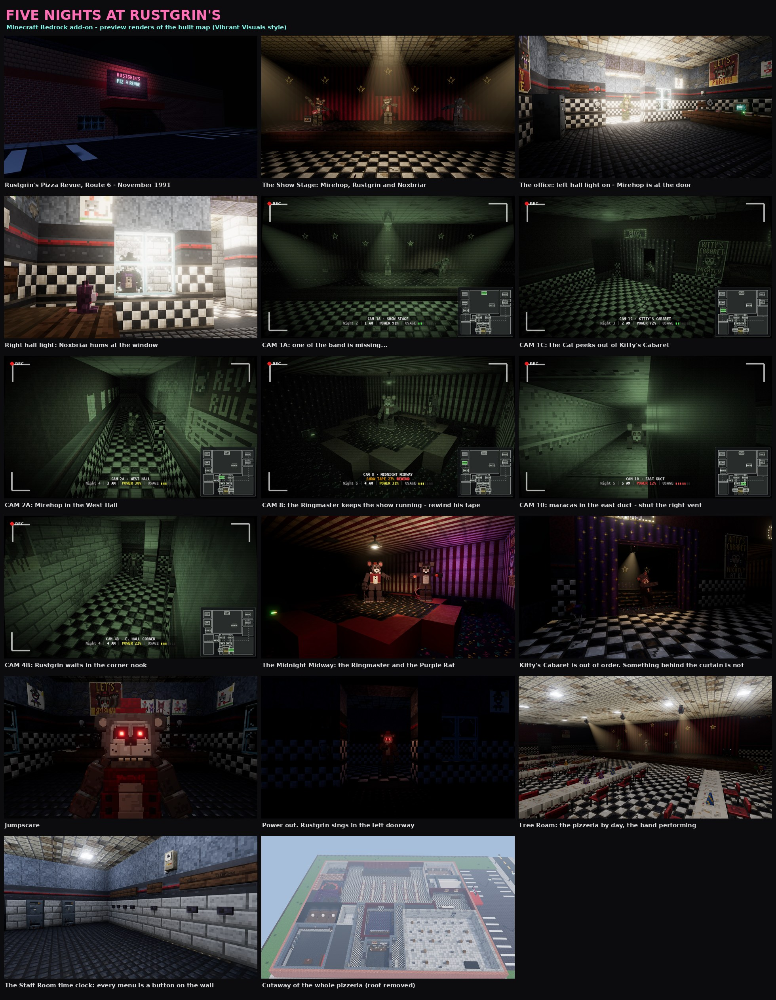

# Five Nights at Rustgrin's

An original FNAF-style night-guard horror add-on for **Minecraft Bedrock
1.26.50+**. You are the last night guard of *Rustgrin's Pizza Revue*, a dying
80s pizzeria with a show stage, a circus ring, the Ringmaster's Grand Marquee and a
crawl-duct system above the ceilings. Five nights. Then the Ringmaster takes
the sixth for himself. Built with vanilla-style blocks, ready for **Vibrant
Visuals**, and it runs with every experiment toggle **off**.

Not affiliated with Scott Cawthon or Mojang. The animatronic models and
animations, the background music and the two jumpscare screams were supplied by
the map owner; everything else (map, scripts, block art, sounds, story) is
original to this project.

More in [`previews/`](previews/): renders of the map the add-on builds, made
offline with the project's own renderer (see *Building from source*).

## Install

1. Open `dist/FiveNightsAtRustgrins.mcaddon` (double-click on Windows / open
   with Minecraft on mobile and console-capable platforms). It imports a
   behavior pack and a resource pack.
2. Create a world: **Flat** world type recommended, cheats **on**, and
   activate both packs.
3. Join the world. A prompt asks to build the pizzeria where you stand — or
   run `/fnar:setup` later. Keep the world open until it reports *The
   pizzeria is built* (about a minute).

## Playing

You start in the **Staff Room** at the time clock. Press a button on the wall:
`NEW GAME`, `CONTINUE`, `THE FINAL ACT` (night 6, once you have reached it),
`CUSTOM NIGHT` (after the Final Act), `FREE ROAM` (daytime, everyone performs),
`GALLERY`, `CLIPPINGS`, `SETTINGS`, `ERASE PROGRESS`.

**In the office** you sit facing the desk; every control is within arm's reach:

| Control | How |
|---|---|
| Left / right steel door | red wall button beside each window |
| Left / right hall light | white wall button below it |
| Ceiling vents | the two white buttons above the desk (labelled) |
| Cameras | use the **Camera Tablet** (in your hand) or click the CRT monitor on the desk |
| Switch camera | click a camera on the map, or scroll the hotbar |
| Lower the monitor | LOWER on the map or Esc; without the map: sneak or use the tablet |
| Rewind the show tape | PLAY SHOW while on CAM 8 |
| Drive the Ringmaster back (Final Act) | SPOTLIGHT on the camera map while a camera sees him |
| Hang up on the Ringmaster's call | click the desk phone |
| Everything in one menu | the **Office Remote** (slot 1) |
| Rules, tips, background music on/off | the **Shift Guide** (slot 9) |

Power drains all night; doors, lights, vents and the monitor drain it faster.
At 0 % everything opens… and someone comes to sing for you.

## The story

Every night the office phone rings, and it is not the manager. It is **the
Ringmaster**, the animatronic showman of *Marvello's Midnight Midway*, calling
from his own stage, the Grand Marquee, on CAM 1C. He knows your name. He teaches you the job,
night by night, and he has plans for the last night of the show.

On night 5, at 4 AM, the shift ends early. Or so the screen says.

**Night 6 - The Final Act** belongs to him, in three acts: he sends his
performers at you one at a time with a ten-second warning (*Meet the
Performers*), makes you play his games against the clock (*Audience
Participation*), and finally walks to your office himself (*The Ringmaster*).
Doors do not stop him. Find him on a camera and hit him with the SPOTLIGHT.

The newspaper clippings in the Staff Room fill in the rest.

## The cast

| | Watch for | Do |
|---|---|---|
| **Mirehop** (green rabbit) | West hall, a guitar twang at the left door | left light, shut the left door |
| **Noxbriar** (black bear, the band's girl) | East hall, humming at the right window; only her eyes show on dark cameras | right light, shut the right door |
| **Rustgrin** (grey bear) | moves only unwatched; mic feedback outside the right door = he is in the corner nook (only CAM 4B sees it) | keep the right door shut while on the cameras |
| **The Cat** | dances on the Midway ring (CAM 8) while the show tape plays; restless when it slows, gone when it stops | keep the tape playing (PLAY SHOW), check CAM 8 often, shut the door she sprints at |
| **Purple Rat** | shares the ring with the Cat; maracas in the ceiling ducts (CAM 9 / 10) | close that vent when he is above you |
| **The Ringmaster** | stands on his stage, the Grand Marquee (CAM 1C), and calls you every night | listen. On night 6, obey him, and keep the SPOTLIGHT ready |

Stars: reach the end of night 5, survive the Final Act, and beat the Custom
Night at 20/20/20/20/20/20.

## If something does not work

* When you join, chat should say *Five Nights at Rustgrin's 1.x.x is running*. If it
  does not, the behavior pack is not active in this world (world settings → Behavior
  Packs) or an older copy is: remove both Rustgrin packs from the world, add them again.
* The cameras, doors and lights only run during a shift (NEW GAME / CONTINUE).
* A world built by an older version is rebuilt in place automatically when it loads.
* *At least one of your resource or behavior packs failed to load* means a file was rejected:
  turn on Settings → Creator → Content Log, reload the world and send the log.
* Problems are reported in chat as `[FNaR] ...` lines. `/fnar:debug status` (cheats on)
  prints the version, the night, the cameras and where every animatronic is - send that
  along when reporting a bug.

## Commands (cheats on)

`/fnar:setup [rebuild]`, `/fnar:lobby`, `/fnar:debug status`, `/fnar:debug help`.

## Building from source

`python3 tools/build_addon.py` regenerates the generated assets, runs every
check (Mojang JSON schemas, the load rules and the no-experiments rule, block states against the 1.26.50 block data,
camera sight lines and routes on the built map, a typecheck against the
`@minecraft/server` 2.10 typings, a night-balance simulation, and a scripted
play session against a strict API mock) and writes `dist/*.mcaddon`.
See `docs/` for the design, block, sound and renderer specs.

`node tools/previews/make_previews.mjs` re-renders `previews/` from the build
plan (headless Chromium + three.js; camera shots get the in-game camera HUD
composited on top).
