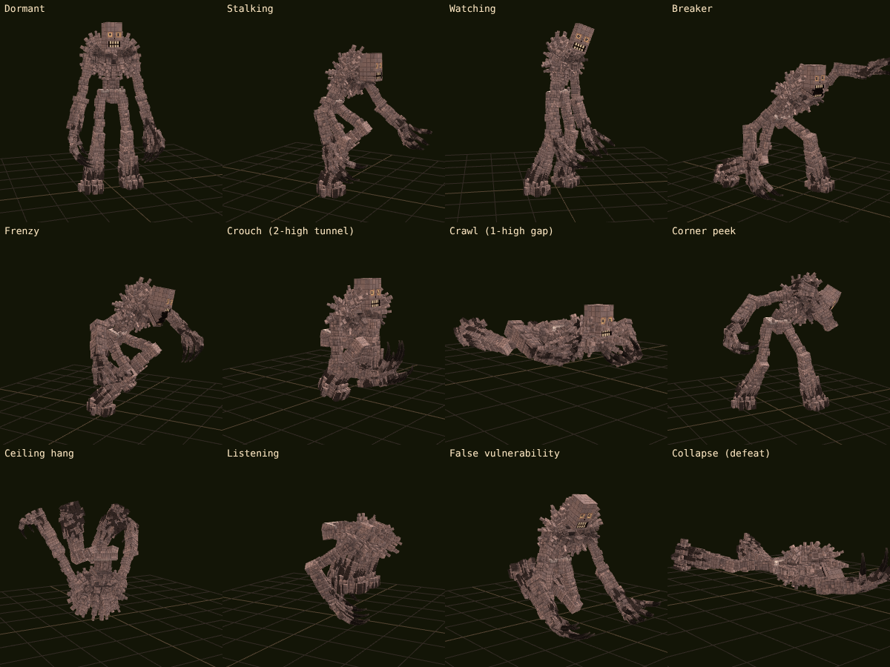

# The Shaftbreaker — adaptive cave dweller for Minecraft Bedrock

An original horror add-on built from your Shaftbreaker model, texture and animations and the design bible. The Shaftbreaker is one tall, stone-boned stalker that follows you through caves (and, at night, through the trees around your house). It wants to be seen, tests you when you see it, creeps closer every time you look away, and snaps into fast, brutal chases — always with a warning first.

**Version 2.1** rebuilds the core around being *seen* and *attacked* after 2.0 feedback ("he doesn't even stalk me, he barely attacks me"). See [CHANGELOG.md](CHANGELOG.md).



- **No experimental toggles.** Stable Script API only: `@minecraft/server` 2.3.0 and `@minecraft/server-ui` 2.0.0.
- **Needs Minecraft Bedrock 1.21.120 or newer** (any 1.26.x release works).
- Download: [`dist/Shaftbreaker.mcaddon`](dist/Shaftbreaker.mcaddon). (`tools/build.py` also writes the two packs as separate `.mcpack` files.)

## Install

1. Open `Shaftbreaker.mcaddon` (or import it) so Minecraft adds both packs.
2. In world settings, enable **both** the behavior pack *The Shaftbreaker* and the resource pack *The Shaftbreaker*.
3. Leave Experiments off. Cheats are only needed for the admin commands.
4. Go underground, or stay out after dark (any difficulty except Peaceful). About a minute in it arrives; the first time you see it is usually 2–3 minutes in, then every couple of minutes, and the first chase typically comes within 2–9 minutes.
5. Creative-mode players are stalked too, but are never damaged (hunts become harmless chases). Operators can turn this off in world settings.

## What you will experience (light spoilers)

- **It arrives silently and stays perfectly still** where you will notice it: on the ground at the edge of your light, on a high ledge above you, hanging upside down from a cave ceiling, or right behind you when you turn around.
- **It hides and peeks:** behind real tree trunks at night and behind pillars and corners in caves. Look at it and it ducks back; look away and it peeks out again, from the other side.
- **The standoff:** when you spot it, it tests you with a neck crack, a head tilt, or one slow step while you watch. Every time you look away it is a little closer, and if it gets close enough it lunges when you look back.
- **Its rage:** stare it down too long, shoot it or hit it and it snaps. It screams and comes faster than you can sprint, hitting hard (about four hearts a hit on Normal).
- **Nothing stops it reaching you:** in a chase it climbs walls, pillars, ledges and ladders, crawls through one-block gaps, opens doors, trapdoors and gates, and smashes glass and leaves. Shut yourself in and it goes for the nearest door or window. Everything it opens or breaks is put back afterwards.
- **Run at it** and it decides on the spot: attack, or vanish and ambush you later at a worse moment (when you are hurt, in the dark, with your back turned).
- **Lunges and strikes:** it sometimes lunges the moment it is spotted, and strikes if you walk right up to it. It only occasionally vanishes or flees when seen.
- **It vanishes in place** instead of walking away.
- **You can hear where it is:** clicks, scrapes, breathing and footsteps come from its real position; two music beds follow its real distance, a standoff drone plays while it tests you, and a heartbeat only when it is genuinely close.
- **Scripted moments on top:** a second pickaxe echoing yours, one footstep too many, breathing behind stone, claw marks.
- **Five phases, one body:** Dormant, Stalking, Watching, Breaker, Frenzy. The model never changes shape; only posture, animation, eye glow, speed, sound and decisions change.
- **Chases are frequent but fair:** every chase opens with a scream (or roar), and nothing can hit you within about 1.8 seconds of it; every lunge has a coil and growl first, every close strike a wind-up. Chases have a hard time cap, never follow you into daylight, and end when you break line of sight long enough. Meat, company and preparation still matter.
- **It learns, slowly:** 14 signals (stairs/door/water/pillar/surface escapes, straight mining, stopping to listen, torch use, backing off after swings, shields, traps, grouping, den interference). Two observations make it curious; three or four unlock a cautious response. Signals decay, and failed tactics get weaker.
- **Ecology:** after a few minutes underground a Shaft Den grows in a real chamber nearby. A **guide moth** then flutters up to you and flies toward the den along a real air route, nose pointing the way; if you fall behind it hovers and points at the den until you catch up, then circles the Den Heart. Break the **Den Heart** to quiet the territory for three in-game days. It remembers.
- **Trophy:** defeat it (112 HP; lethal hits turn into a scripted collapse) for the **Shaftbreaker Skull**: a wearable helmet (protection 2) with optional underground night vision.

## Settings

Craft the **Resonance Dial** (copper ingots + redstone + an amethyst shard or a Resonance Shard) and use it:

- **Status:** a resonance needle, encounter counts, what it has learned about *you* in plain words, and a rough direction to the nearest den.
- **Personal settings** (every player): reduced audio, reduced flicker, no chase music, threat captions in the action bar, heartbeat on/off, trophy filter.
- **World settings** (operators): preset (`atmospheric`, `balanced`, `relentless`, `harmless`, `accessibility`), frequency, stalking intensity, learning, memory decay, block destruction (`off` / `den` / `natural`), cosmetic build alteration, den generation, torch manipulation, max hunt length, death grace, chase music, quiet-hunt variant, surface mode, harmless preview, trophy drop, debug logging, creative-mode stalking, night stalking on the surface.

Admin commands (operators):

```
/shaftbreaker:sb status
/shaftbreaker:sb preset relentless
/shaftbreaker:sb set maxHuntSeconds=20
/shaftbreaker:sb debug                (action-bar overlay: state, phase, encounter, learned weights)
/shaftbreaker:sb list                 (all encounter templates)
/shaftbreaker:sb encounter corner_peek
/shaftbreaker:sb telemetry            (last encounters with trigger / tell / counterplay)
/shaftbreaker:sb stop
```

Every action also works as `/scriptevent shaftbreaker:<action> [value]`.

## How it works

| Part | File | Job |
|---|---|---|
| Stalker | `scripts/ai/encounters/stalk.js` | The visible stalker: show placement (still / ledge / ceiling / behind / peek behind trunks and pillars), the peek game, the standoff (tests, stare limit, creeping on look-away), reactions (vanish, flee, lunge, rage, standoff), run-at decisions, close strikes and the promised ambush. |
| Breaching | `scripts/world/breach.js` | Opening doors / gates / trapdoors and smashing glass and leaves during a chase, finding a way in when you are shut inside, and putting every change back (persisted across reloads). |
| Brain | `scripts/ai/brain.js` | The persistent stalker between shows: arrival out of sight, distance bands that depend on its mood, giving ground when approached, freezing when caught, catching up through the dark, positional sound cues, presence/close music and the proximity heartbeat. |
| Director | `scripts/ai/director.js` | The stalker clock (a show every ~1–3 minutes, a chase due every ~4–6.5 minutes, the ambush), rage on hits and shots, per-player pacing clocks for the other encounters (minor events every 1–2.5 min; occasional major encounters), a curiosity meter and an event-driven provocation meter that drive Dormant → Interested → Observing → Provoked → Hunting, novelty-aware weighted selection (design mix: stalking 30, uncanny 20, audio 15, environment 15, standoff 10, hunt 8, rare 2), multiplayer target choice and witness sharing. |
| Memory | `scripts/ai/memory.js` | The 14 bounded signals (score + confidence, saturation, decay, counter-learning), stored on each player. |
| Encounters | `scripts/ai/encounters/*.js` | 44 templates written as generators: each has a trigger, a tell and a counterplay recorded in telemetry. |
| Creature | `scripts/ai/creature.js` | The world singleton: phases, acts, eye glow, tunnel stance (stand / crouch in 2-high / spider-crawl in 1-high), script-driven movement along a flood-filled walk map of the real cave (physics steering with a step fallback, so it cannot get wedged), engine pathfinding only for hunts with a scripted chase fallback, stuck detection, the Breaker, strikes and the scripted defeat. |
| Space | `scripts/world/space.js` | Perception (line of sight, gaze angle, light, underground) and a flood-filled walk map of the real cave around you. It never places the creature in a sealed pocket or in anyone's direct view. |
| Protection | `scripts/world/protection.js` | Block provenance: natural cave materials only, never ores/containers/beds/portals/spawn, never anything you were seen placing, never anything next to something player-made, never the surface. |
| Dens | `scripts/world/den.js` | Den growth in real chambers (from the stalker's own walk map), guide moths with A* air routes, cleansing, territory suppression, retaliation, the hidden passage. |

### Fairness contract (enforced in code)

- Only one Shaftbreaker exists per world; a spawn egg either replaces it or is removed, never adding a second.
- Damage only in chases, lunges and close strikes, each with its tell; never through walls or closed doors (it opens or breaks them first), never during death/respawn grace.
- Spawns are dark, reachable, and outside every nearby player's view cone.
- Chases end on a time cap, a lost path, distance, daylight, death or a disabled world, and the creature then vanishes where it stands.
- Everything it opens or smashes (doors, gates, trapdoors, glass, leaves) is restored once the chase is over and nobody stands in the way; leftovers are restored on the next world load.
- Harmless preset: no damage and no block edits, even in forced hunts.

## Assets and originality

- **Model, texture and the 10 base animations** are the ones you supplied (`src_assets/model`).
- **50 new animation clips** (tunnel crouch/crawl, peeks, listening, prone drop, kneel, ceiling hang/reach/drop, wall climb, attacks, recovery, scramble, collapse, …) were authored in code against the rig (`tools/author_anims.py`), with the tunnel poses fitted by an optimizer so they really fit 2-high and 1-high passages.
- **All 70 sound files, including the four music tracks (presence, close, standoff, chase),** are procedurally synthesized (`tools/gen_audio.py`); no sound is taken from Minecraft or any other add-on.
- **Moth, den blocks, item icons, particles** are generated (`tools/gen_textures.py`, `tools/gen_rp.py`).
- Inspired by the cave-dweller genre; it contains no code, assets or names from XP Games' or Gargin's work.

## What was and was not verified

Verified here:
- Every script API call type-checks against Mojang's official `@minecraft/server` 2.3.0 / `@minecraft/server-ui` 2.0.0 typings.
- `tools/validate.py`: every animation, controller, geometry, bone, locator, texture, sound event and file, particle, entity event, component group, property, loot table, recipe item and vanilla block/item/effect ID and vanilla render controller resolves (0 errors) — checked against Mojang's vanilla data for 1.26.60. It also fails the build on the two 1.0 bugs: render controllers reading `context.*` variables, and blocks with material instances but no geometry.
- `tools/sim`: the real scripts run unmodified against a mock of the Script API in a voxel world (caves, a surface forest, a house with a door and glass windows) with bot players that stare at it, run at it, hit it, shoot it, flee and hide indoors; 30–60 simulated minutes per run (1–3 players; mixed, stairs, learning, harmless and night scenarios). 2.1 results: 0 script errors; never more than one Shaftbreaker; 0 spawns or silent teleports inside anyone's view; every hit preceded by its tell; a show every ~1.5–3 minutes (first at 1.6–2.6 min), every reaction type occurring (standoffs with neck cracks, head tilts and slow steps, creeping on look-away, lunges, flees, vanishes, rages from staring, hits and charges, ambushes); 10–14 chases an hour against these provoking bots; at night it stalks around the house, peeks from behind trees, and breaks in through the door or windows, and every opened door and smashed window was restored; harmless preset with 0 hits and 0 block edits. Against bots that never fight back it is lethal (about 8 deaths an hour solo); real players who keep their distance, avoid staring and fight back should do much better, but tell me if it is too much.

Not verified: **it has not been run inside the Minecraft client** (no Bedrock client here; a Bedrock Dedicated Server test was not run). The simulator models the API and approximates the engine's pathfinding and attacks, so in-game tuning may still be needed — most likely movement speeds, encounter frequency and the look of some new animations in motion. Please report what you see; the debug overlay and `/shaftbreaker:sb telemetry` exist for exactly that.

Known limitations:
- Dens are grown by script near players (not world-generation structures), so they appear in chambers you have been near.
- The Script API cannot tell whether a stone block was placed by a player before the add-on was installed. The Breaker therefore only touches natural materials with nothing player-made around them; set block destruction to `den` or `off` if your builds use raw stone or deepslate.
- Distance-based mob speeds are tuning targets, not measured in-game values.

## Building from source

```bash
python3 tools/build.py
```

Optional: `--audio` re-synthesizes all sounds; `--vanilla-data <path>` and `--vanilla-rp <path>` enable vanilla ID checks. Requires Python 3 with numpy and Pillow, and ffmpeg with libvorbis.

```bash
node tools/sim/run.js 120 1 7 mixed
```

Scenarios: `mixed`, `learn`, `harmless`, `stairs`, `door`, `night`; arguments are minutes, players, seed and scenario.

Type-check every API call against Mojang's official typings:

```bash
cd tools/typecheck && npm install && npx tsc -p .
```

See [FEATURES.md](FEATURES.md) for the L01–L90 / N01–N50 audit.
