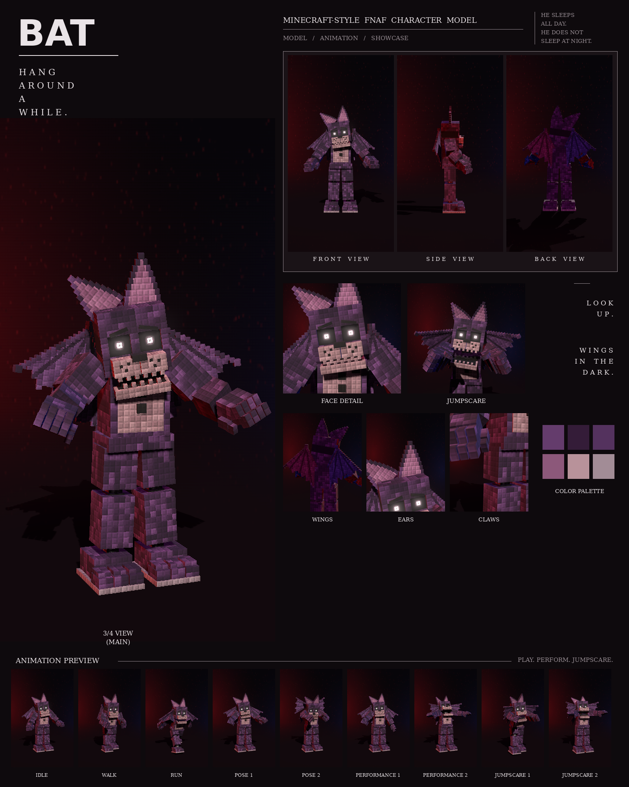

# Bat: Minecraft-style FNAF model

This is a Blockbench model of the purple bat with wings from your night-stage pictures, in the **Bedrock Entity** format.

It includes:

- 204 cubes and 28 bones
- a 1024×256 texture painted at 4 texels per model pixel, in the picture's "every pixel is a little block" style
- 9 animations in an animatronic style: idle, walk, run, pose 1, pose 2, performance 1, performance 2, jumpscare 1 and jumpscare 2



## Files

| File | What it is |
| --- | --- |
| `bat.bbmodel` | **Open this in Blockbench.** It contains the geometry, the embedded texture and all 9 animations. |
| `preview/bat_preview.mp4` | Preview video: turnaround, close-ups, then every animation |
| `preview/bat_sheet.png` | Character sheet |
| `textures/bat.png` | Texture atlas (the same one embedded in the .bbmodel) |
| `textures/bat_emissive.png` | Glow mask for the eyes |
| `bedrock/` | Resource-pack-ready files. They match Blockbench's own *Export Bedrock Geometry / Animations* output. |

## What's on the model

- **Build:** a small head under huge ears, a wide pelvis band and short forearms with spread claws
- **Fur:** purple with darker patches, a pale pink belly
- **Head:** two huge pointed ears with pink inner patches; angled brows over dark sockets with glowing pupils; a pale muzzle with dark freckles and a black nose; small teeth
- **Wings:** two jointed wings on his back, each with dark finger bones, knuckle knobs and a membrane stretched between them. The outer half of each wing is its own bone, so the wings can fold, flap and spread.
- **Chest:** a black bow tie and two black buttons
- **Joints:** chrome pistons at the neck, shoulders, elbows, wrists, hips, knees and ankles
- **Feet:** three-toed feet with stepped toes on a light sole

## Rig

```
root
├─ body (pelvis)
│  └─ torso (chest, belly, bow tie, buttons, neck piston)
│     ├─ head ─ jaw, eyes, rightEar, leftEar
│     ├─ rightArm ─ rightForearm ─ rightHand ─ rightFingers, rightThumb
│     ├─ leftArm  ─ leftForearm  ─ leftHand  ─ leftFingers, leftThumb
│     ├─ rightWing ─ rightWingTip
│     └─ leftWing  ─ leftWingTip
├─ rightLeg ─ rightShin ─ rightFoot
└─ leftLeg  ─ leftShin  ─ leftFoot
```

## Animations

All nine clips move like an animatronic at night. Each part is driven like its own servo: it jumps to a new position, stops dead with a small overshoot, and holds. Keyframes are linear on Blockbench's 24 fps grid, so the holds stay perfectly still. In every clip, the feet stay on the ground. A vampire in a costume: his wings are always moving, folding and opening in servo steps.

| Animation | Length | Notes |
| --- | --- | --- |
| `animation.bat.idle` | 6.0 s loop | Palms half up, head turning; the wings slowly fold and unfold, the ears twitch, the jaw clacks |
| `animation.bat.walk` | 1.6 s loop | A vampire creep: short shuffling steps, shoulders rocking, claws held up in front, wings folded back |
| `animation.bat.run` | 0.75 s loop | Bent forward with the arms swept back while the wings beat |
| `animation.bat.pose1` | 2.0 s loop | The picture: arms out with the palms up, wings spread, head tilted |
| `animation.bat.pose2` | 2.0 s loop | Looming: wings raised high behind his head like a cape, claws up, head bowed and staring |
| `animation.bat.performance1` | 4.0 s loop | Sings, presenting to one side of the crowd and then the other, the wings beating on every beat |
| `animation.bat.performance2` | 4.0 s loop | A screech solo: head thrown back, jaw wide, ears laid back, arms and wings fanned out and trembling |
| `animation.bat.jumpscare1` | 1.25 s, plays once | Wings snap open as he lunges at the camera with the claws reaching, screeching |
| `animation.bat.jumpscare2` | 1.5 s, plays once | Wings folded tight and head bowed... then the head snaps up and the wings and arms fling wide, screaming |

## Using it in a Bedrock addon

Copy `bedrock/` into your resource pack:

| Copy | To |
| --- | --- |
| `models/entity/` | `RP/models/entity/` |
| `animations/` | `RP/animations/` |
| `animation_controllers/` | `RP/animation_controllers/` |
| `render_controllers/` | `RP/render_controllers/` |
| `entity/` | `RP/entity/` |
| `textures/entity/bat/` | `RP/textures/entity/bat/` |

- **Identifier:** the client entity uses `fnaf:bat`. If your addon uses a different namespace, change it to match.
- **Glowing eyes:** the client entity uses `bat_glow.png` with the `entity_emissive_alpha` material, so the eyes glow in-game. Use `bat.png` with `entity_alphatest` if you don't want the glow.
- **Size:** about 2.9 blocks to the top of the head and 3.4 blocks to the ear tips.
- **Movement:** the animation controller plays idle, walk or run based on `query.ground_speed`.
- **Poses, performances and jumpscares:** these play when the behavior entity's `minecraft:mark_variant` value is set:

| mark_variant | Animation |
| --- | --- |
| 1 | pose1 |
| 2 | pose2 |
| 3 | performance1 |
| 4 | performance2 |
| 5 | jumpscare1 |
| 6 | jumpscare2 |

The jumpscares play once. After one finishes, set `mark_variant` back to 0 so the character returns to idle.

## How close is it to the reference?

These match the picture:

- the proportions, measured from the picture separately for this character
- the colours, sampled from it
- every part listed above

These differ:

- The fur is a procedural pattern of little blocks in the picture's colours, not a pixel copy of the picture.
- The wing membranes are flat panels of little blocks between the finger bones, not curved.
- The animations are my own, since the reference is a single pose. Pose 1 recreates the pose in the picture.
