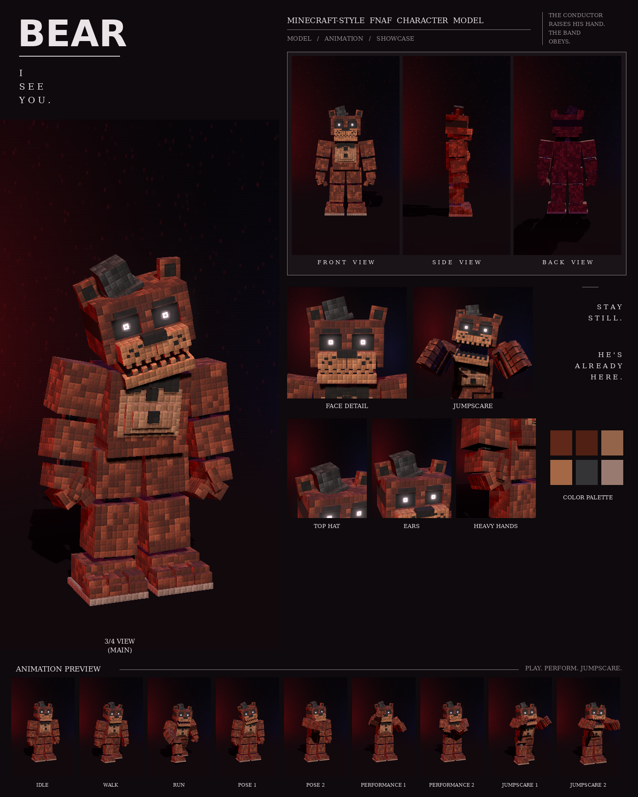

# Bear: Minecraft-style FNAF model

This is a Blockbench model of the dark brown bear with the big top hat from your night-stage pictures, in the **Bedrock Entity** format.

It includes:

- 111 cubes and 25 bones
- a 1024×512 texture painted at 4 texels per model pixel, in the picture's "every pixel is a little block" style
- 9 animations in an animatronic style: idle, walk, run, pose 1, pose 2, performance 1, performance 2, jumpscare 1 and jumpscare 2



## Files

| File | What it is |
| --- | --- |
| `bear.bbmodel` | **Open this in Blockbench.** It contains the geometry, the embedded texture and all 9 animations. |
| `preview/bear_preview.mp4` | Preview video: turnaround, close-ups, then every animation |
| `preview/bear_sheet.png` | Character sheet |
| `textures/bear.png` | Texture atlas (the same one embedded in the .bbmodel) |
| `textures/bear_emissive.png` | Glow mask for the eyes |
| `bedrock/` | Resource-pack-ready files. They match Blockbench's own *Export Bedrock Geometry / Animations* output. |

## What's on the model

- **Build:** heavy and broad, with thick arms and legs and a deep chest
- **Fur:** dark brown with darker patches, and a tan pot belly that bulges out
- **Head:** big, wide and square: small round ears with black inner patches; a big dark grey top hat tipped to his right; glowing eyes under flat, neutral brows; a wide tan muzzle with freckles and a big black nose; small teeth
- **Chest:** a black bow tie and two black buttons
- **Neck:** an exposed endoskeleton neck in the gap under the head: a dark steel column on a chrome collar, with two thin cables at the front
- **Joints:** chrome pistons at the shoulders, elbows, wrists, hips, knees and ankles
- **Feet:** three-toed feet with stepped toes on a light sole

## Rig

```
root
├─ body (pelvis)
│  └─ torso (chest, belly, pot belly, bow tie, buttons, endoskeleton neck)
│     ├─ head ─ jaw, eyes, rightEar, leftEar, hat
│     ├─ rightArm ─ rightForearm ─ rightHand ─ rightFingers, rightThumb
│     └─ leftArm  ─ leftForearm  ─ leftHand  ─ leftFingers, leftThumb
├─ rightLeg ─ rightShin ─ rightFoot
└─ leftLeg  ─ leftShin  ─ leftFoot
```

## Animations

All nine clips move like an animatronic at night. Each part is driven like its own servo: it jumps to a new position, stops dead with a small overshoot, and holds. Keyframes are linear on Blockbench's 24 fps grid, so the holds stay perfectly still. In every clip, the feet stay on the ground. Slow and deliberate. He barely moves, and that's the scary part.

| Animation | Length | Notes |
| --- | --- | --- |
| `animation.bear.idle` | 6.0 s loop | Dead still, staring; the head slowly sinks over to one side, a finger twitches |
| `animation.bear.walk` | 1.9 s loop | A slow, heavy lumber, rolling onto each leg with the head lolling |
| `animation.bear.run` | 0.9 s loop | A heavy stomping run with the fists swinging |
| `animation.bear.pose1` | 2.0 s loop | The picture: arms hanging, head tilted over to his right, staring |
| `animation.bear.pose2` | 2.0 s loop | Slowly raises one arm and points straight at you |
| `animation.bear.performance1` | 4.0 s loop | Conducts the band: the right hand beats out four-four while the left cues the players |
| `animation.bear.performance2` | 4.0 s loop | A slow, deliberate clap, his head tilting further with every one |
| `animation.bear.jumpscare1` | 1.25 s, plays once | Lunges at the camera and screams, head shaking |
| `animation.bear.jumpscare2` | 1.5 s, plays once | Powers down with his head drooping... then snaps up right in your face |

An IK solver brings his palms together for the clap in performance 2.

## Using it in a Bedrock addon

Copy `bedrock/` into your resource pack:

| Copy | To |
| --- | --- |
| `models/entity/` | `RP/models/entity/` |
| `animations/` | `RP/animations/` |
| `animation_controllers/` | `RP/animation_controllers/` |
| `render_controllers/` | `RP/render_controllers/` |
| `entity/` | `RP/entity/` |
| `textures/entity/bear/` | `RP/textures/entity/bear/` |

- **Identifier:** the client entity uses `fnaf:bear`. If your addon uses a different namespace, change it to match.
- **Glowing eyes:** the client entity uses `bear_glow.png` with the `entity_emissive_alpha` material, so the eyes glow in-game. Use `bear.png` with `entity_alphatest` if you don't want the glow.
- **Size:** about 3.1 blocks to the top of the head and 3.4 blocks to the top hat.
- **Movement:** the animation controller plays idle, walk or run based on `query.ground_speed`.
- **Poses, performances and jumpscares:** these play when the behavior entity's `minecraft:mark_variant` value is set:

| mark_variant | Animation |
| --- | --- |
| 1 | pose1 |
| 2 | pose2 |
| 3 | performance1 |
| 4 | performance2 |
| 5 | jumpscare1 |
| 6 | jumpscare2 |

The jumpscares play once. After one finishes, set `mark_variant` back to 0 so the character returns to idle.

## How close is it to the reference?

These match the picture:

- the proportions, measured from the picture separately for this character
- the colours, sampled from it
- every part listed above

These differ:

- The fur is a procedural pattern of little blocks in the picture's colours, not a pixel copy of the picture.
- The animations are my own, since the reference is a single pose. Pose 1 recreates the pose in the picture.
