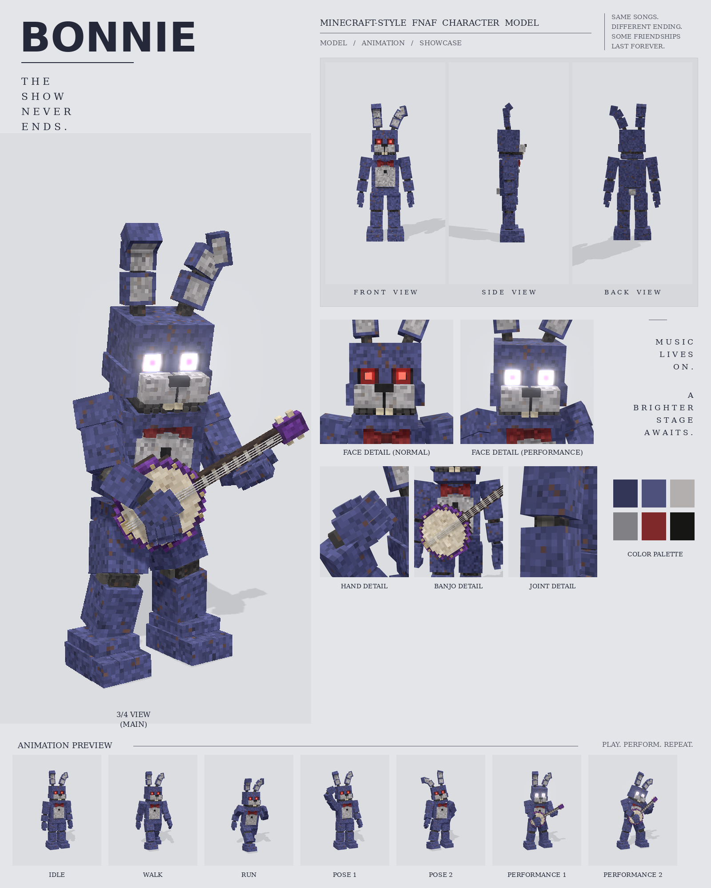

# Bonnie: Minecraft-style FNAF model

This is a Blockbench model of Bonnie in the **Bedrock Entity** format, built from the "BONNIE: Minecraft-style FNAF character model" reference sheet. It includes:

- 149 cubes and 30 bones
- a 512×128 texture painted at 2 texels per model pixel
- 7 animations: idle, walk, run, pose 1, pose 2, performance 1 and performance 2



## Files

| File | What it is |
| --- | --- |
| `bonnie.bbmodel` | **Open this in Blockbench.** It contains the geometry, the embedded texture and all 7 animations. |
| `preview/bonnie_preview.mp4` | Preview video: turnaround, face close-ups (normal and performance eyes), then every animation |
| `preview/bonnie_sheet.png` | Character sheet laid out like the reference |
| `textures/bonnie.png` | Texture atlas (the same one embedded in the .bbmodel) |
| `textures/bonnie_emissive.png` | Glow mask for the eyes |
| `bedrock/` | Resource-pack-ready files (see below). These match Blockbench's own *Export Bedrock Geometry / Animations* output. |
| `tools/` | Generator (`build_bonnie.py`) and preview renderer (`render/`) |

## Opening it in Blockbench

1. In Blockbench, choose **File → Open Model** and pick `bonnie.bbmodel`.
2. Open the **Animate** tab to see the 7 animations. Click one and press play.

The file was checked in Blockbench 5.2.2 (web). It loads with no errors, and its Bedrock export matches the files in `bedrock/`.

### Rig

```
root
├─ body (pelvis, tail)
│  └─ torso (chest, belly, bow tie, button, neck)
│     ├─ head ─ jaw, eyesNormal, eyesPerformance,
│     │         rightEar ─ rightEarUpper ─ rightEarTip  (same for left)
│     ├─ rightArm ─ rightForearm ─ rightHand ─ rightFingers, rightThumb  (same for left)
│     └─ banjo
├─ rightLeg ─ rightShin ─ rightFoot
└─ leftLeg  ─ leftShin  ─ leftFoot
```

The limb names (`rightArm`, `leftLeg`, …) follow vanilla naming, so vanilla-style humanoid animations can target the same bones.

### Animations

| Animation | Length | Notes |
| --- | --- | --- |
| `animation.bonnie.idle` | 4.0 s loop | Breathing, a slow look around, ear twitches |
| `animation.bonnie.walk` | 1.25 s loop | Heavy animatronic stride. The feet stay planted, and the hips and shoulders counter-rotate. |
| `animation.bonnie.run` | 0.75 s loop | High knees, pumping arms, forward lean and a short airborne moment |
| `animation.bonnie.pose1` | 2.0 s loop | Waving beside the head |
| `animation.bonnie.pose2` | 2.0 s loop | Hand on hip, leg kicked out, head tilted, right ear flopped |
| `animation.bonnie.performance1` | 2.0 s loop | Plays the banjo at 120 BPM: strumming, chord changes, head bob, singing jaw, white/purple stage eyes |
| `animation.bonnie.performance2` | 2.0 s loop | A more energetic set: leans back, taps a foot, headbangs, raises the banjo neck |

The keyframes snap to Blockbench's 24 fps grid and use catmull-rom smoothing. I removed redundant keys so the timeline stays editable. In both performances, IK keeps the hands on the banjo strings and neck. In every clip, the feet stay on the ground.

### The banjo and the two eye styles

- The **banjo** is part of the model, so you'll see it in front of Bonnie in Blockbench's Edit tab. Every non-performance animation sets the `banjo` bone's scale to 0, which hides it.
- **Eyes:** by default you see the red pupils (`eyesNormal`). The white glowing eyes with purple pupils (`eyesPerformance`) are tucked inside the head. Both performance animations move them forward and hide the red ones.

## Using it in a Bedrock addon

Copy the contents of `bedrock/` into your resource pack:

```
bedrock/models/entity/bonnie.geo.json                      -> RP/models/entity/
bedrock/animations/bonnie.animation.json                   -> RP/animations/
bedrock/animation_controllers/bonnie.animation_controllers.json -> RP/animation_controllers/
bedrock/render_controllers/bonnie.render_controllers.json  -> RP/render_controllers/
bedrock/entity/bonnie.entity.json                          -> RP/entity/
bedrock/textures/entity/bonnie/*.png                       -> RP/textures/entity/bonnie/
```

- The client entity uses the identifier `fnaf:bonnie`. If your addon uses a different namespace, change it to match.
- The client entity uses `bonnie_glow.png` with the `entity_emissive_alpha` material, which makes the eyes glow in-game. Use `bonnie.png` with `entity_alphatest` if you don't want the glow.
- Bonnie's world size: about 2.8 blocks to the top of the head and 3.4 blocks to the ear tips.
- The animation controller picks idle, walk or run from `query.ground_speed`. It plays a pose or performance when the behavior entity has a `minecraft:mark_variant` value:

| mark_variant | Animation |
| --- | --- |
| 1 | pose1 |
| 2 | pose2 |
| 3 | performance1 |
| 4 | performance2 |

  For example, add component groups in your behavior pack that set `"minecraft:mark_variant": { "value": 3 }` when Bonnie is on stage.

## Rebuilding / re-rendering

```bash
python3 tools/build_bonnie.py          # regenerates the .bbmodel, textures and bedrock/ files
cd tools/render && npm install         # three.js + playwright
node render.mjs video ../../preview/bonnie_preview.mp4
python3 make_sheet.py                  # preview/bonnie_sheet.png
```

- The geometry, the texture painting and the animations are all plain Python in `tools/rig.py` and `tools/anims.py`.
- The first animation build takes a few minutes because it runs the IK solver. After that, the result is cached in `tools/.cache/`.
- The preview renderer reads `bonnie.bbmodel` directly. I checked its posing against Blockbench's own viewport.

## How close is it to the sheet?

These match the sheet:

- the proportions, measured from the front, side and back views
- the 6-colour palette, sampled from the swatches
- the parts: segmented ears with a folded tip, recessed eye sockets with glowing pupils, a two-piece muzzle with a nose and buck teeth, visible endoskeleton gaps at every joint, the bow tie and button, three-toed feet, a stubby tail, and a banjo with a studded purple rim

These differ:

- The texture is a procedural mottled fur in the same colours, not a pixel copy of the image.
- The animation poses are recreations of the thumbnails, not exact frames.
