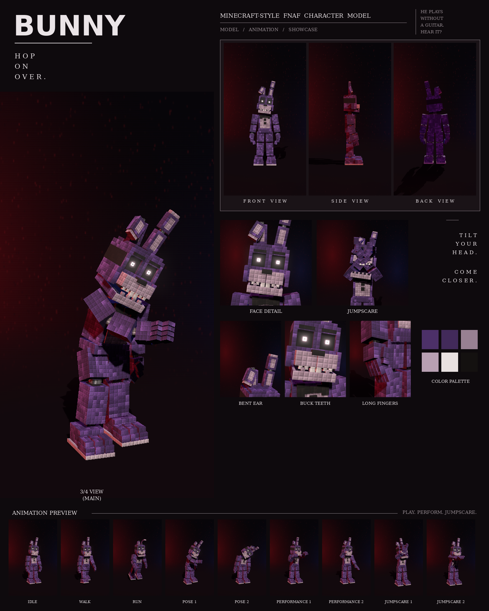

# Bunny: Minecraft-style FNAF model

This is a Blockbench model of the purple bunny with the bent ear from your night-stage pictures, in the **Bedrock Entity** format.

It includes:

- 113 cubes and 26 bones
- a 1024×256 texture painted at 4 texels per model pixel, in the picture's "every pixel is a little block" style
- 9 animations in an animatronic style: idle, walk, run, pose 1, pose 2, performance 1, performance 2, jumpscare 1 and jumpscare 2



## Files

| File | What it is |
| --- | --- |
| `bunny.bbmodel` | **Open this in Blockbench.** It contains the geometry, the embedded texture and all 9 animations. |
| `preview/bunny_preview.mp4` | Preview video: turnaround, close-ups, then every animation |
| `preview/bunny_sheet.png` | Character sheet |
| `textures/bunny.png` | Texture atlas (the same one embedded in the .bbmodel) |
| `textures/bunny_emissive.png` | Glow mask for the eyes |
| `bedrock/` | Resource-pack-ready files. They match Blockbench's own *Export Bedrock Geometry / Animations* output. |

## What's on the model

- **Build:** slim and lanky, with thin limbs, long fingers and long rabbit feet
- **Fur:** purple with darker patches, a pale lilac belly
- **Head:** rounded top edges and chubby cheeks; tall ears on chrome joints with pale inner panels. His right ear is folded over at the joint, as in the picture. A pale muzzle with a black nose, two big buck teeth and small teeth beside them; glowing eyes under flat brows
- **Chest:** a black bow tie and two black buttons
- **Neck:** an exposed endoskeleton neck in the gap under the head: a dark steel column on a chrome collar, with two thin cables at the front
- **Joints:** chrome pistons at the shoulders, elbows, wrists, hips, knees and ankles
- **Feet:** three-toed feet with tall stepped toes on a light sole

## Rig

```
root
├─ body (pelvis)
│  └─ torso (chest, belly, bow tie, buttons, endoskeleton neck)
│     ├─ head ─ jaw, eyes, rightEar ─ rightEarTop, leftEar ─ leftEarTop
│     ├─ rightArm ─ rightForearm ─ rightHand ─ rightFingers, rightThumb
│     └─ leftArm  ─ leftForearm  ─ leftHand  ─ leftFingers, leftThumb
├─ rightLeg ─ rightShin ─ rightFoot
└─ leftLeg  ─ leftShin  ─ leftFoot
```

## Animations

All nine clips move like an animatronic at night. Each part is driven like its own servo: it jumps to a new position, stops dead with a small overshoot, and holds. Keyframes are linear on Blockbench's 24 fps grid, so the holds stay perfectly still. In every clip, the feet stay on the ground. Jittery and bouncy, with ears that never stop twitching.

| Animation | Length | Notes |
| --- | --- | --- |
| `animation.bunny.idle` | 6.0 s loop | Ears twitching one at a time, head turning and cocking, fingers flexing |
| `animation.bunny.walk` | 1.2 s loop | A bouncy hop-step with the ears flopping |
| `animation.bunny.run` | 0.6 s loop | A hopping run: both legs push off together, the ears streaming back |
| `animation.bunny.pose1` | 2.0 s loop | The picture: leaning and reaching out with his right claw, head tilted |
| `animation.bunny.pose2` | 2.0 s loop | The creepy tilt: head lolled right over onto his shoulder, ears drooping, arms limp, swaying |
| `animation.bunny.performance1` | 4.0 s loop | Air guitar: left hand up the neck, right hand strumming, head banging on the beat |
| `animation.bunny.performance2` | 4.0 s loop | A hop dance: hopping side to side, waving one arm overhead and then the other |
| `animation.bunny.jumpscare1` | 1.25 s, plays once | Ducks down low, then springs up into the camera with the ears snapping upright |
| `animation.bunny.jumpscare2` | 1.5 s, plays once | Leans in slowly with his head tilting... then the scream, arms flung up |

## Using it in a Bedrock addon

Copy `bedrock/` into your resource pack:

| Copy | To |
| --- | --- |
| `models/entity/` | `RP/models/entity/` |
| `animations/` | `RP/animations/` |
| `animation_controllers/` | `RP/animation_controllers/` |
| `render_controllers/` | `RP/render_controllers/` |
| `entity/` | `RP/entity/` |
| `textures/entity/bunny/` | `RP/textures/entity/bunny/` |

- **Identifier:** the client entity uses `fnaf:bunny`. If your addon uses a different namespace, change it to match.
- **Glowing eyes:** the client entity uses `bunny_glow.png` with the `entity_emissive_alpha` material, so the eyes glow in-game. Use `bunny.png` with `entity_alphatest` if you don't want the glow.
- **Size:** about 3.2 blocks to the top of the head and 3.9 blocks to the left ear tip.
- **Movement:** the animation controller plays idle, walk or run based on `query.ground_speed`.
- **Poses, performances and jumpscares:** these play when the behavior entity's `minecraft:mark_variant` value is set:

| mark_variant | Animation |
| --- | --- |
| 1 | pose1 |
| 2 | pose2 |
| 3 | performance1 |
| 4 | performance2 |
| 5 | jumpscare1 |
| 6 | jumpscare2 |

The jumpscares play once. After one finishes, set `mark_variant` back to 0 so the character returns to idle.

## How close is it to the reference?

These match the picture:

- the proportions, measured from the picture separately for this character
- the colours, sampled from it
- every part listed above

These differ:

- The fur is a procedural pattern of little blocks in the picture's colours, not a pixel copy of the picture.
- The ear joints are simple chrome blocks rather than round hinges.
- The animations are my own, since the reference is a single pose. Pose 1 recreates the pose in the picture.
