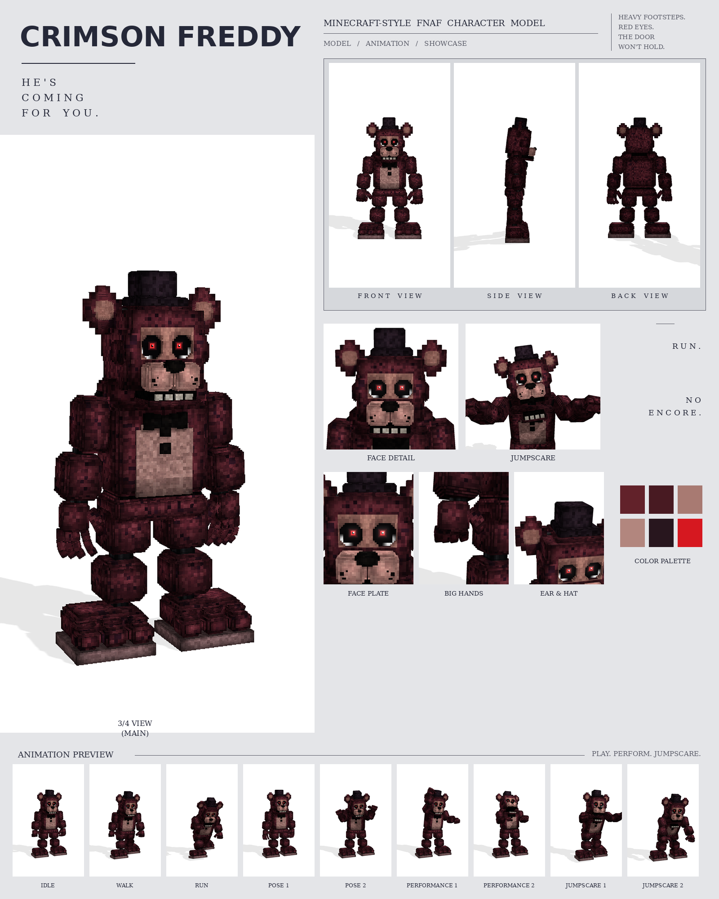

# Crimson Freddy: Minecraft-style FNAF model

This is a Blockbench model of Crimson Freddy built from your dark-red Freddy picture, in the **Bedrock Entity** format.

Every part was measured from the picture at one shared scale (26 picture pixels = 1 model pixel), the same scale used for the other two characters from that set. No part is enlarged or shrunk: each keeps the size it has in the picture, and so does the character.

To make it a replica, the model's exact front outline was then laid over the picture's outline, and every limb, the chest, the legs, the ears and the hat were fitted until they lined up. The two outlines now overlap by 92%, and the inner edges (where the arms meet the chest, the joints, the face) were checked against the picture too. Every colour was matched by rendering the model under a front light like the picture's and sampling it at the same spots.

It includes:

- 415 cubes and 49 bones
- a 1024×1024 texture painted at 4 texels per model pixel (the eyes at 32, so they keep every detail), in half-pixel squares of colour with a fine grain and scattered dark specks, like the picture (no tile or brick edges)
- soft light and shadow baked into the texture: every block darkens toward its edges and where it meets the next part, so the model looks rounded and shaded like the picture, in Blockbench and in Minecraft too
- 9 animations in an animatronic style: idle, walk, run, pose 1, pose 2, performance 1, performance 2, jumpscare 1 and jumpscare 2



## Files

| File | What it is |
| --- | --- |
| `crimson_freddy.bbmodel` | **Open this in Blockbench.** It contains the geometry, the embedded texture and all 9 animations. |
| `preview/crimson_freddy_preview.mp4` | Preview video: turnaround, close-ups, then every animation |
| `preview/crimson_freddy_sheet.png` | Character sheet |
| `textures/crimson_freddy.png` | Texture atlas (the same one embedded in the .bbmodel) |
| `textures/crimson_freddy_emissive.png` | Glow mask for the eyes |
| `bedrock/` | Resource-pack-ready files. They match Blockbench's own *Export Bedrock Geometry / Animations* output. |

## What's on the model

- **Fur:** dark crimson with small darker specks, a pinkish belly
- **Head:** a dark top hat; big round ears with pink centres on chrome pins; a flat pink face plate around the eyes; round sockets filled by glossy black eyeballs with square pixel-art red irises (a dark ring, a black pupil and a white glint), a dark-red glow round them and white reflections along the bottom, as in the picture; a wide pink muzzle with black freckles, split down the middle, and a black nose; a row of cream teeth
- **Chest:** a black bow tie and two square black buttons
- **Hands:** big mitten hands laid out from the picture: the back of the hand faces forward, four chunky fingers bend in toward the tips and the thumb reaches down from the inner edge. Every finger segment has its own bone, so the fingers bend at every knuckle
- **Arms and legs:** rounded shoulder caps beside the jaw; big upper arms hanging close beside a wide chest on dark ball joints; thick thighs and shins on dark knee joints. Every limb block has its corners cut back in steps, like the picture
- **Feet:** big three-toed feet on a pale sole

## Rig

```
root
├─ body (pelvis)
│  └─ torso (chest, belly, bow tie, buttons, neck)
│     ├─ head ─ jaw, eyes, rightEar, leftEar, hat
│     ├─ rightArm ─ rightForearm ─ rightHand ─ rightFinger1a ─ 1b ─ 1c (one chain per finger), rightThumba ─ b
│     └─ leftArm  ─ leftForearm  ─ leftHand  ─ leftFinger1a ─ 1b ─ 1c ..., leftThumba ─ b
├─ rightLeg ─ rightShin ─ rightFoot
└─ leftLeg  ─ leftShin  ─ leftFoot
```

The hands hang with the back of the hand facing forward, as in the picture. Each finger is a chain of three bones (`rightFinger1a`, `rightFinger1b`, `rightFinger1c`, ... the thumb two: `rightThumba`, `rightThumbb`); a positive X rotation bends a joint into a fist.

## Animations

All nine clips move like an animatronic at night. Each part is driven like its own servo: it jumps to a new position, stops dead with a small overshoot, and holds. Keyframes are linear on Blockbench's 24 fps grid, so the holds stay perfectly still. In every clip, the feet stay on the ground. A heavy brute who breathes, clenches his fists and stomps.

| Animation | Length | Notes |
| --- | --- | --- |
| `animation.crimson_freddy.idle` | 6.0 s loop | Heavy breathing, fists clenching and unclenching, head scanning the room, and a neck crack |
| `animation.crimson_freddy.walk` | 1.7 s loop | Heavy stomping steps; the body drops onto each foot, the shoulders roll and the fists swing |
| `animation.crimson_freddy.run` | 0.8 s loop | A charge with the head down and the fists pumping |
| `animation.crimson_freddy.pose1` | 2.0 s loop | The picture: broad and square, arms hanging, hands half closed, staring ahead |
| `animation.crimson_freddy.pose2` | 2.0 s loop | Boxer stance: fists up in front of his face, bouncing on his feet, throwing a jab |
| `animation.crimson_freddy.performance1` | 4.0 s loop | A rock song: one fist punching the air on every beat, head banging, jaw singing |
| `animation.crimson_freddy.performance2` | 4.0 s loop | A belly laugh: head thrown back, shoulders shaking, both hands on his belly |
| `animation.crimson_freddy.jumpscare1` | 1.25 s, plays once | A roaring lunge: both arms swing up and in to grab you, jaw wide |
| `animation.crimson_freddy.jumpscare2` | 1.5 s, plays once | Raises both fists overhead, then slams them down toward the camera with a roar |

## Using it in a Bedrock addon

It's included in the combined add-on, [`../addon/FNAF_Animatronics.mcaddon`](../addon/README.md), with spawn eggs and events. To use it in your own resource pack instead, copy `bedrock/` into it:

| Copy | To |
| --- | --- |
| `models/entity/` | `RP/models/entity/` |
| `animations/` | `RP/animations/` |
| `animation_controllers/` | `RP/animation_controllers/` |
| `render_controllers/` | `RP/render_controllers/` |
| `entity/` | `RP/entity/` |
| `textures/entity/crimson_freddy/` | `RP/textures/entity/crimson_freddy/` |

- **Identifier:** the client entity uses `fnaf:crimson_freddy`. If your addon uses a different namespace, change it to match.
- **Glowing eyes:** the client entity uses `crimson_freddy_glow.png` with the `entity_emissive_alpha` material. The red irises glow in the dark.
- **Size:** about 3.1 blocks to the top of the head and 3.4 blocks to the top of the hat.
- **Movement:** the animation controller plays idle, walk or run based on `query.ground_speed`.
- **Poses, performances and jumpscares:** these play when the behavior entity's `minecraft:mark_variant` value is set:

| mark_variant | Animation |
| --- | --- |
| 1 | pose1 |
| 2 | pose2 |
| 3 | performance1 |
| 4 | performance2 |
| 5 | jumpscare1 |
| 6 | jumpscare2 |

The jumpscares play once. After one finishes, set `mark_variant` back to 0 so the character returns to idle.

## How close is it to the reference?

These match the picture:

- every size and position, measured in picture pixels from the front view
- the colours, sampled from it
- every part listed above

These differ:

- The picture shows only the front, so the depths (front to back) are estimated from the widths.
- The fur is a procedural pattern of little blocks in the picture's colours, not a pixel copy of the picture.
- Only soft shading is baked into the texture, not the picture's coloured side lights, so the model looks right from every side.
- The animations are my own, since the reference is a single pose. Pose 1 recreates the pose in the picture.
