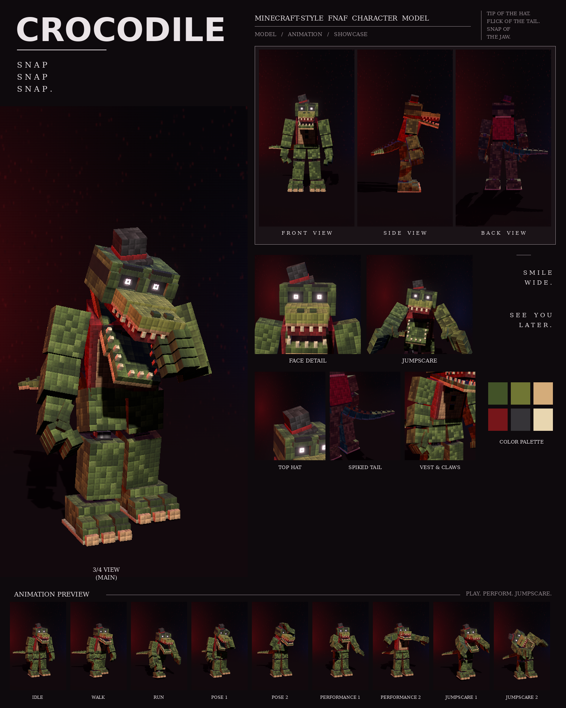

# Crocodile: Minecraft-style FNAF model

This is a Blockbench model of the green crocodile with the top hat, red vest and spiked tail from your night-stage pictures, in the **Bedrock Entity** format.

It includes:

- 149 cubes and 32 bones
- a 1024×512 texture painted at 4 texels per model pixel, in the picture's "every pixel is a little block" style
- 9 animations in an animatronic style: idle, walk, run, pose 1, pose 2, performance 1, performance 2, jumpscare 1 and jumpscare 2



## Files

| File | What it is |
| --- | --- |
| `crocodile.bbmodel` | **Open this in Blockbench.** It contains the geometry, the embedded texture and all 9 animations. |
| `preview/crocodile_preview.mp4` | Preview video: turnaround, close-ups, then every animation |
| `preview/crocodile_sheet.png` | Character sheet |
| `textures/crocodile.png` | Texture atlas (the same one embedded in the .bbmodel) |
| `textures/crocodile_emissive.png` | Glow mask for the eyes |
| `bedrock/` | Resource-pack-ready files. They match Blockbench's own *Export Bedrock Geometry / Animations* output. |

## What's on the model

- **Build:** tall and hunched, with long shins, a long vested torso and big clawed hands
- **Scales:** dark and olive green in a blocky pattern, a tan belly
- **Head:** a long snout with two nostrils on top; a red mouth with rows of cream teeth on both jaws; glowing eyes under flat black brows
- **Top hat:** small and dark grey with a red band, tipped to his right
- **Clothes:** a red vest with lapels over the tan belly, two black buttons and a black bow tie
- **Tail:** long and thick, with a row of dark green spikes along the top
- **Feet:** clawed feet with pale claws
- **Joints:** chrome pistons at the neck, shoulders, elbows, wrists, hips, knees and ankles

## Rig

```
root
├─ body (pelvis) ─ tail0 ─ tail1 … tail8
│  └─ torso (chest, vest, lapels, bow tie, buttons, neck piston)
│     ├─ head ─ jaw, eyes, hat (the snout's top half is part of head)
│     ├─ rightArm ─ rightForearm ─ rightHand ─ rightFingers, rightThumb
│     └─ leftArm  ─ leftForearm  ─ leftHand  ─ leftFingers, leftThumb
├─ rightLeg ─ rightShin ─ rightFoot
└─ leftLeg  ─ leftShin  ─ leftFoot
```

## Animations

All nine clips move like an animatronic at night. Each part is driven like its own servo: it jumps to a new position, stops dead with a small overshoot, and holds. Keyframes are linear on Blockbench's 24 fps grid, so the holds stay perfectly still. In every clip, the feet stay on the ground. Heavy and patient: a gentleman with a hat and a jaw that never stays shut for long.

| Animation | Length | Notes |
| --- | --- | --- |
| `animation.crocodile.idle` | 6.0 s loop | Hunched, head turning slowly; the jaw creeps open for over two seconds... then snaps shut |
| `animation.crocodile.walk` | 1.8 s loop | A heavy waddle: the body rolls onto each leg and the tail swings the other way |
| `animation.crocodile.run` | 0.8 s loop | A crouched charge with the jaws open and the tail held up straight behind him |
| `animation.crocodile.pose1` | 2.0 s loop | The picture: hunched, right arm hanging forward, left claw curled up, head tilted, mouth open, with a sudden snap |
| `animation.crocodile.pose2` | 2.0 s loop | Tips his top hat with a little bow, the other hand on his belly |
| `animation.crocodile.performance1` | 4.0 s loop | A soft-shoe shuffle: sliding side to side with little kicks, hat bobbing, tail swishing |
| `animation.crocodile.performance2` | 4.0 s loop | The snap song: jazz hands out wide, swaying, the jaw opening slowly and snapping shut on every beat |
| `animation.crocodile.jumpscare1` | 1.25 s, plays once | Lunges with the snout gaping, snapping shut three times |
| `animation.crocodile.jumpscare2` | 1.5 s, plays once | The death roll: head and body twist hard one way and back while the jaw snaps |

An IK solver puts his hand on the hat brim and his other hand on his belly in pose 2.

## Using it in a Bedrock addon

Copy `bedrock/` into your resource pack:

| Copy | To |
| --- | --- |
| `models/entity/` | `RP/models/entity/` |
| `animations/` | `RP/animations/` |
| `animation_controllers/` | `RP/animation_controllers/` |
| `render_controllers/` | `RP/render_controllers/` |
| `entity/` | `RP/entity/` |
| `textures/entity/crocodile/` | `RP/textures/entity/crocodile/` |

- **Identifier:** the client entity uses `fnaf:crocodile`. If your addon uses a different namespace, change it to match.
- **Glowing eyes:** the client entity uses `crocodile_glow.png` with the `entity_emissive_alpha` material, so the eyes glow in-game. Use `crocodile.png` with `entity_alphatest` if you don't want the glow.
- **Size:** about 3.0 blocks to the top of the head and 3.3 blocks to the top hat.
- **Movement:** the animation controller plays idle, walk or run based on `query.ground_speed`.
- **Poses, performances and jumpscares:** these play when the behavior entity's `minecraft:mark_variant` value is set:

| mark_variant | Animation |
| --- | --- |
| 1 | pose1 |
| 2 | pose2 |
| 3 | performance1 |
| 4 | performance2 |
| 5 | jumpscare1 |
| 6 | jumpscare2 |

The jumpscares play once. After one finishes, set `mark_variant` back to 0 so the character returns to idle.

## How close is it to the reference?

These match the picture:

- the proportions, measured from the picture separately for this character
- the colours, sampled from it
- every part listed above

These differ:

- The fur is a procedural pattern of little blocks in the picture's colours, not a pixel copy of the picture.
- The vest and lapels are painted on the chest, with thin raised panels, rather than separate cloth.
- The animations are my own, since the reference is a single pose. Pose 1 recreates the pose in the picture.
