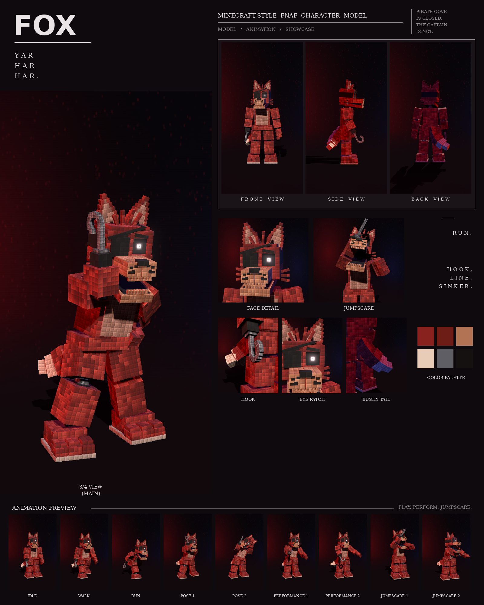

# Fox: Minecraft-style FNAF model

This is a Blockbench model of the red pirate fox with the hook and eye patch from your night-stage pictures, in the **Bedrock Entity** format.

It includes:

- 134 cubes and 27 bones
- a 1024×512 texture painted at 4 texels per model pixel, in the picture's "every pixel is a little block" style
- 9 animations in an animatronic style: idle, walk, run, pose 1, pose 2, performance 1, performance 2, jumpscare 1 and jumpscare 2



## Files

| File | What it is |
| --- | --- |
| `fox.bbmodel` | **Open this in Blockbench.** It contains the geometry, the embedded texture and all 9 animations. |
| `preview/fox_preview.mp4` | Preview video: turnaround, close-ups, then every animation |
| `preview/fox_sheet.png` | Character sheet |
| `textures/fox.png` | Texture atlas (the same one embedded in the .bbmodel) |
| `textures/fox_emissive.png` | Glow mask for the eyes |
| `bedrock/` | Resource-pack-ready files. They match Blockbench's own *Export Bedrock Geometry / Animations* output. |

## What's on the model

- **Build:** a narrow chest over wide hips
- **Fur:** red with darker patches, a tan belly
- **Head:** a narrow head with rounded top edges and a long, narrow snout; a black eye patch over his right eye, its strap running up over his head; one glowing eye on the left; tall pointed ears with tan inner patches; tufts of fur on top of the head and on both cheeks; a tan muzzle with freckles and a black nose; a row of small teeth
- **Hook:** his right hand is a grey cuff and ring with a long shaft that curls into a hook
- **Tail:** big and bushy, hanging behind him past his right leg and curling out to a pale tip
- **Neck:** an exposed endoskeleton neck in the gap under the head: a dark steel column on a chrome collar, with two thin cables at the front
- **Joints:** chrome pistons at the shoulders, elbows, wrists, hips, knees and ankles
- **Feet:** three-toed feet with stepped toes on a light sole

## Rig

```
root
├─ body (pelvis) ─ tail0 ─ tail1 … tail4
│  └─ torso (chest, belly, endoskeleton neck)
│     ├─ head ─ jaw, eyes, rightEar, leftEar (eye patch and tufts are part of head)
│     ├─ rightArm ─ rightForearm ─ rightHand (the hook)
│     └─ leftArm  ─ leftForearm  ─ leftHand  ─ leftFingers, leftThumb
├─ rightLeg ─ rightShin ─ rightFoot
└─ leftLeg  ─ leftShin  ─ leftFoot
```

## Animations

All nine clips move like an animatronic at night. Each part is driven like its own servo: it jumps to a new position, stops dead with a small overshoot, and holds. Keyframes are linear on Blockbench's 24 fps grid, so the holds stay perfectly still. In every clip, the feet stay on the ground. A pirate captain: a swaggering walk, a famous sprint, and the hook always ready.

| Animation | Length | Notes |
| --- | --- | --- |
| `animation.fox.idle` | 6.0 s loop | Shifts his weight from foot to foot, looks around with his one eye, and slowly raises the hook and lowers it again |
| `animation.fox.walk` | 1.3 s loop | A pirate swagger: shoulders rolling, arms swinging, tail swaying |
| `animation.fox.run` | 0.6 s loop | The sprint: leaning far forward, arms swinging low and back, long strides, jaw open |
| `animation.fox.pose1` | 2.0 s loop | The picture: hook raised beside his head, other hand on his hip, wide stance, head tilted |
| `animation.fox.pose2` | 2.0 s loop | Peeking out from behind the curtain of his cove, leaning round sideways |
| `animation.fox.performance1` | 4.0 s loop | A sea shanty: rocking like a ship's deck, hook raised on every "yo-ho", foot stomping |
| `animation.fox.performance2` | 4.0 s loop | A sword fight with the hook: four diagonal slashes, lunging forward on each one |
| `animation.fox.jumpscare1` | 1.25 s, plays once | Two sprint strides, then the leap at the camera with the hook up, screaming |
| `animation.fox.jumpscare2` | 1.5 s, plays once | A hook swipe straight across the camera, head jerking |

An IK solver keeps his left hand on his hip in pose 1.

## Using it in a Bedrock addon

Copy `bedrock/` into your resource pack:

| Copy | To |
| --- | --- |
| `models/entity/` | `RP/models/entity/` |
| `animations/` | `RP/animations/` |
| `animation_controllers/` | `RP/animation_controllers/` |
| `render_controllers/` | `RP/render_controllers/` |
| `entity/` | `RP/entity/` |
| `textures/entity/fox/` | `RP/textures/entity/fox/` |

- **Identifier:** the client entity uses `fnaf:fox`. If your addon uses a different namespace, change it to match.
- **Glowing eyes:** the client entity uses `fox_glow.png` with the `entity_emissive_alpha` material, so the eyes glow in-game. Use `fox.png` with `entity_alphatest` if you don't want the glow.
- **Size:** about 3.1 blocks to the top of the head and 3.5 blocks to the ear tips.
- **Movement:** the animation controller plays idle, walk or run based on `query.ground_speed`.
- **Poses, performances and jumpscares:** these play when the behavior entity's `minecraft:mark_variant` value is set:

| mark_variant | Animation |
| --- | --- |
| 1 | pose1 |
| 2 | pose2 |
| 3 | performance1 |
| 4 | performance2 |
| 5 | jumpscare1 |
| 6 | jumpscare2 |

The jumpscares play once. After one finishes, set `mark_variant` back to 0 so the character returns to idle.

## How close is it to the reference?

These match the picture:

- the proportions, measured from the picture separately for this character
- the colours, sampled from it
- every part listed above

These differ:

- The fur is a procedural pattern of little blocks in the picture's colours, not a pixel copy of the picture.
- The tufts and the hook are built from little cubes, so the hook's curve is stepped.
- The animations are my own, since the reference is a single pose. Pose 1 recreates the pose in the picture.
