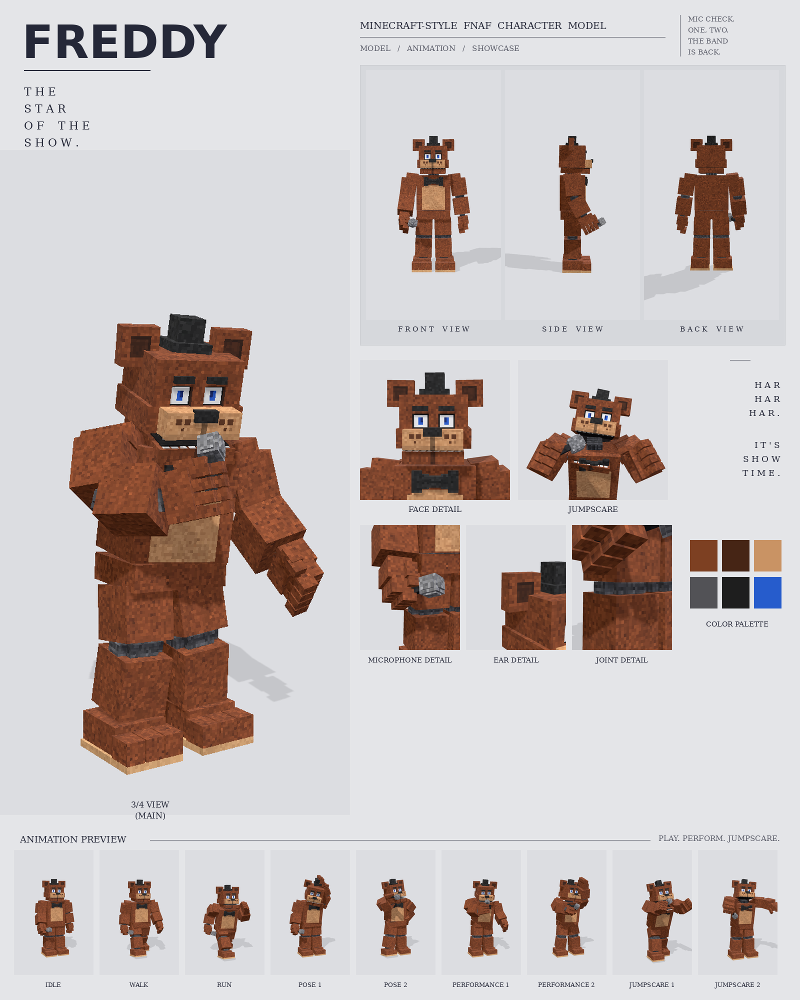

# Freddy (classic): Minecraft-style FNAF model

This is a Blockbench model of classic Freddy Fazbear in the **Bedrock Entity** format. It's built from the classic Freddy reference picture, with one requested change: the angry slanted eyebrows are replaced by Withered Freddy's flat, relaxed ones.

It includes:

- 101 cubes and 26 bones
- a 512×256 texture painted at 3 texels per model pixel
- 9 animations: idle, walk, run, pose 1, pose 2, performance 1, performance 2, jumpscare 1 and jumpscare 2



## Files

| File | What it is |
| --- | --- |
| `freddy.bbmodel` | **Open this in Blockbench.** It contains the geometry, the embedded texture and all 9 animations. |
| `preview/freddy_preview.mp4` | Preview video: turnaround, close-ups, then every animation |
| `preview/freddy_sheet.png` | Character sheet |
| `textures/freddy.png` | Texture atlas (the same one embedded in the .bbmodel) |
| `bedrock/` | Resource-pack-ready files. They match Blockbench's own *Export Bedrock Geometry / Animations* output. |

## What's on the model

- Clean brown fur, a big tan belly, and a 3D black bow tie
- Square ears with dark inner patches and a small black top hat
- White eyes with blue irises, and flat relaxed brows
- A freckled tan muzzle with a wide black nose, and a closed jaw with a centre seam
- Grey cylinder joints at the shoulders, elbows, wrists, knees and ankles
- Three-toed feet with tan soles
- A microphone in the right fist, as in the reference

## Rig

```
root
├─ body (pelvis)
│  └─ torso (chest, belly, bow tie, neck)
│     ├─ head ─ jaw, eyes, hat, rightEar, leftEar
│     ├─ rightArm ─ rightForearm ─ rightHand ─ rightFingers, rightThumb, mic
│     └─ leftArm  ─ leftForearm  ─ leftHand  ─ leftFingers, leftThumb
├─ rightLeg ─ rightShin ─ rightFoot
└─ leftLeg  ─ leftShin  ─ leftFoot
```

## Animations

| Animation | Length | Notes |
| --- | --- | --- |
| `animation.freddy.idle` | 4.0 s loop | Breathing, a slow look around, the mic held at his side |
| `animation.freddy.walk` | 1.25 s loop | Heavy stride with planted feet. The mic arm swings less. |
| `animation.freddy.run` | 0.75 s loop | High knees, pumping arms, forward lean |
| `animation.freddy.pose1` | 2.0 s loop | Tips his hat with his left hand and gives a little bow |
| `animation.freddy.pose2` | 2.0 s loop | Points the mic at the crowd, other hand on his hip |
| `animation.freddy.performance1` | 2.0 s loop | Sings into the mic at 120 BPM. The free arm opens out to the audience, and his foot taps. |
| `animation.freddy.performance2` | 2.0 s loop | Sings for two beats, then holds the mic out to the crowd and pumps his fist |
| `animation.freddy.jumpscare1` | 1.25 s, plays once | Lunges at the camera, arms up, jaw wide open, head shaking |
| `animation.freddy.jumpscare2` | 1.5 s, plays once | Springs up from a crouch, arms flung wide, head jerking while the jaw snaps |

- The keyframes snap to Blockbench's 24 fps grid and use catmull-rom smoothing.
- An IK solver keeps the mic at his mouth, or aimed at the crowd. It also puts his hand on the hat brim and on his hip.
- In every clip, the feet stay on the ground.

## Using it in a Bedrock addon

Copy `bedrock/` into your resource pack:

| Copy | To |
| --- | --- |
| `models/entity/` | `RP/models/entity/` |
| `animations/` | `RP/animations/` |
| `animation_controllers/` | `RP/animation_controllers/` |
| `render_controllers/` | `RP/render_controllers/` |
| `entity/` | `RP/entity/` |
| `textures/entity/freddy/` | `RP/textures/entity/freddy/` |

- **Identifier:** the client entity uses `fnaf:freddy`. If your addon uses a different namespace, change it to match.
- **Size:** Freddy is about 2.8 blocks to the top of his head and 3.0 blocks to the top of the hat.
- **Movement:** the animation controller plays idle, walk or run based on `query.ground_speed`.
- **Poses, performances and jumpscares:** these play when the behavior entity's `minecraft:mark_variant` value is set:

| mark_variant | Animation |
| --- | --- |
| 1 | pose1 |
| 2 | pose2 |
| 3 | performance1 |
| 4 | performance2 |
| 5 | jumpscare1 |
| 6 | jumpscare2 |

The jumpscares play once. After one finishes, set `mark_variant` back to 0 in your behavior pack (for example, with a timer event) so Freddy returns to idle.

## How close is it to the reference?

These match the picture:

- the proportions, measured from the reference
- the colours, sampled from it
- every part listed above

These differ:

- The brows are flat and relaxed instead of angry, as you asked.
- The fur is a procedural texture in the reference's colours, not a pixel copy.
- The animations are my own, since the reference is a single pose.
