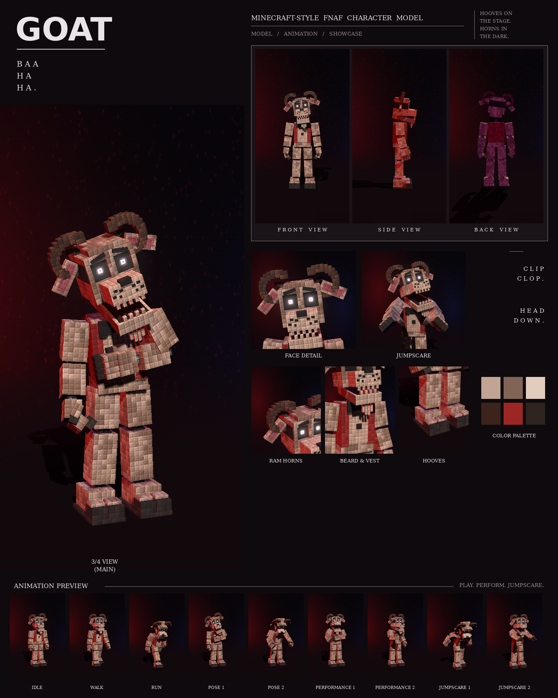

# Goat: Minecraft-style FNAF model

This is a Blockbench model of the beige goat with the ram horns, beard and red vest from your night-stage pictures, in the **Bedrock Entity** format.

It includes:

- 161 cubes and 26 bones
- a 1024×256 texture painted at 4 texels per model pixel, in the picture's "every pixel is a little block" style
- 9 animations in an animatronic style: idle, walk, run, pose 1, pose 2, performance 1, performance 2, jumpscare 1 and jumpscare 2



## Files

| File | What it is |
| --- | --- |
| `goat.bbmodel` | **Open this in Blockbench.** It contains the geometry, the embedded texture and all 9 animations. |
| `preview/goat_preview.mp4` | Preview video: turnaround, close-ups, then every animation |
| `preview/goat_sheet.png` | Character sheet |
| `textures/goat.png` | Texture atlas (the same one embedded in the .bbmodel) |
| `textures/goat_emissive.png` | Glow mask for the eyes |
| `bedrock/` | Resource-pack-ready files. They match Blockbench's own *Export Bedrock Geometry / Animations* output. |

## What's on the model

- **Build:** tall and thin, with long legs and thin arms
- **Fur:** beige with darker patches, a lighter belly
- **Head:** a long, narrow face that narrows again at the top; two dark ram horns that curl round in a spiral from the top corners of his head; floppy ears with pink inner patches hanging out to the sides; glowing eyes under angled brows; a long muzzle with freckles and a black nose; a long jaw with small teeth; a pale beard hanging from his chin
- **Clothes:** a red vest with one button and a black bow tie
- **Hands and feet:** dark fingertips, and two-toed dark hooves
- **Neck:** an exposed endoskeleton neck in the gap under the head: a dark steel column on a chrome collar, with two thin cables at the front
- **Joints:** chrome pistons at the shoulders, elbows, wrists, hips, knees and ankles

## Rig

```
root
├─ body (pelvis)
│  └─ torso (chest, vest, button, bow tie, endoskeleton neck)
│     ├─ head ─ jaw (beard), eyes, rightHorn, leftHorn, rightEar, leftEar
│     ├─ rightArm ─ rightForearm ─ rightHand ─ rightFingers, rightThumb
│     └─ leftArm  ─ leftForearm  ─ leftHand  ─ leftFingers, leftThumb
├─ rightLeg ─ rightShin ─ rightFoot
└─ leftLeg  ─ leftShin  ─ leftFoot
```

## Animations

All nine clips move like an animatronic at night. Each part is driven like its own servo: it jumps to a new position, stops dead with a small overshoot, and holds. Keyframes are linear on Blockbench's 24 fps grid, so the holds stay perfectly still. In every clip, the feet stay on the ground. Stiff-legged and always chewing, with a laugh that never quite stops.

| Animation | Length | Notes |
| --- | --- | --- |
| `animation.goat.idle` | 6.0 s loop | Chews with the jaw grinding side to side in little servo steps, ears flopping, and stamps a hoof |
| `animation.goat.walk` | 1.4 s loop | A stiff, high-stepping trot with the head bobbing forward and back |
| `animation.goat.run` | 0.75 s loop | A ram charge: head down, horns first |
| `animation.goat.pose1` | 2.0 s loop | The picture: one hand on his belly, the other hanging with the fingers curled, head tilted |
| `animation.goat.pose2` | 2.0 s loop | Head down with the horns forward, pawing the ground with a hoof |
| `animation.goat.performance1` | 4.0 s loop | A bleating belly laugh: hand on his belly, head shaking, jaw trembling |
| `animation.goat.performance2` | 4.0 s loop | A stomp dance: alternating hoof stomps, arms marching, beard swinging |
| `animation.goat.jumpscare1` | 1.25 s, plays once | Rears back, then rams his horns at the camera, bleating |
| `animation.goat.jumpscare2` | 1.5 s, plays once | The bleating scream: head thrashing side to side, jaw chattering |

An IK solver keeps his hand on his belly in pose 1 and performance 1.

## Using it in a Bedrock addon

Copy `bedrock/` into your resource pack:

| Copy | To |
| --- | --- |
| `models/entity/` | `RP/models/entity/` |
| `animations/` | `RP/animations/` |
| `animation_controllers/` | `RP/animation_controllers/` |
| `render_controllers/` | `RP/render_controllers/` |
| `entity/` | `RP/entity/` |
| `textures/entity/goat/` | `RP/textures/entity/goat/` |

- **Identifier:** the client entity uses `fnaf:goat`. If your addon uses a different namespace, change it to match.
- **Glowing eyes:** the client entity uses `goat_glow.png` with the `entity_emissive_alpha` material, so the eyes glow in-game. Use `goat.png` with `entity_alphatest` if you don't want the glow.
- **Size:** about 3.3 blocks to the top of the head and 3.6 blocks to the horns.
- **Movement:** the animation controller plays idle, walk or run based on `query.ground_speed`.
- **Poses, performances and jumpscares:** these play when the behavior entity's `minecraft:mark_variant` value is set:

| mark_variant | Animation |
| --- | --- |
| 1 | pose1 |
| 2 | pose2 |
| 3 | performance1 |
| 4 | performance2 |
| 5 | jumpscare1 |
| 6 | jumpscare2 |

The jumpscares play once. After one finishes, set `mark_variant` back to 0 so the character returns to idle.

## How close is it to the reference?

These match the picture:

- the proportions, measured from the picture separately for this character
- the colours, sampled from it
- every part listed above

These differ:

- The fur is a procedural pattern of little blocks in the picture's colours, not a pixel copy of the picture.
- The horns are a spiral of small cubes, so they are stepped rather than smooth.
- The animations are my own, since the reference is a single pose. Pose 1 recreates the pose in the picture.
