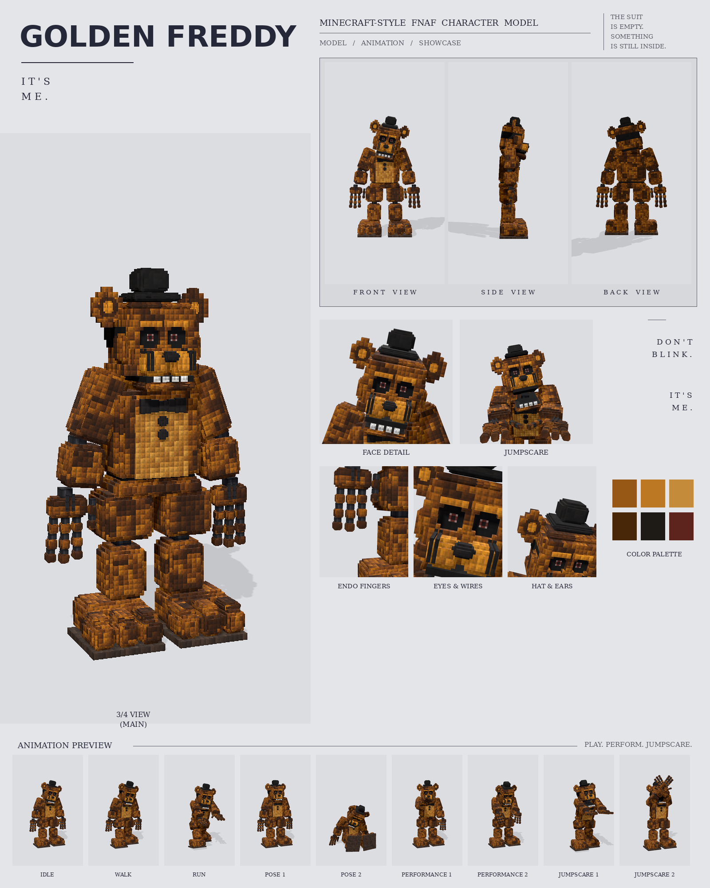

# Golden Freddy: Minecraft-style FNAF model

This is a Blockbench model of Golden Freddy built from your Golden Freddy picture, in the **Bedrock Entity** format.

Every part was measured from the picture at one shared scale (26 picture pixels = 1 model pixel), the same scale used for the other two characters from that set. No part is enlarged or shrunk: each keeps the size it has in the picture, and so does the character.

To make it a replica, the model's exact front outline was then laid over the picture's outline, and every limb, the chest, the legs, the ears and the hat were fitted until they lined up. The two outlines now overlap by 86%. Every colour was matched by rendering the model under plain studio light and sampling it at the same spots as the picture.

It includes:

- 353 cubes and 25 bones
- a 1024×1024 texture painted at 4 texels per model pixel, in the picture's "every pixel is a little block" style, with rounded block edges like the picture
- 9 animations in an animatronic style: idle, walk, run, pose 1, pose 2, performance 1, performance 2, jumpscare 1 and jumpscare 2



## Files

| File | What it is |
| --- | --- |
| `golden_freddy.bbmodel` | **Open this in Blockbench.** It contains the geometry, the embedded texture and all 9 animations. |
| `preview/golden_freddy_preview.mp4` | Preview video: turnaround, close-ups, then every animation |
| `preview/golden_freddy_sheet.png` | Character sheet |
| `textures/golden_freddy.png` | Texture atlas (the same one embedded in the .bbmodel) |
| `textures/golden_freddy_emissive.png` | Glow mask for the eyes |
| `bedrock/` | Resource-pack-ready files. They match Blockbench's own *Export Bedrock Geometry / Animations* output. |

## What's on the model

- **Fur:** golden yellow with dark grimy patches, a lighter tan belly
- **Head:** a black top hat; round ears with a dark ring and a lighter centre; hollow black eye sockets with tiny dull red-brown irises; lighter brow blocks above the eyes; black wires running down from the eyes over the muzzle; a tan muzzle split down the middle with a big black nose; a row of grey teeth
- **Chest:** a black bow tie and two round black buttons
- **Hands:** bare endoskeleton fingers, as in the picture: a furry back of the hand with two wire rods, then three fingers and a thumb, each a chain of golden blocks on black ball joints
- **Arms and legs:** rounded shoulder caps beside the jaw; the upper arms angle out from dark ball joints and the forearms hang straight down; chunky rounded thighs and shins on dark knee joints
- **Feet:** big three-toed feet on a dark sole

## Rig

```
root
├─ body (pelvis)
│  └─ torso (chest, belly, bow tie, buttons, neck)
│     ├─ head ─ jaw, eyes, rightEar, leftEar, hat
│     ├─ rightArm ─ rightForearm ─ rightHand ─ rightFingers, rightThumb
│     └─ leftArm  ─ leftForearm  ─ leftHand  ─ leftFingers, leftThumb
├─ rightLeg ─ rightShin ─ rightFoot
└─ leftLeg  ─ leftShin  ─ leftFoot
```

The hands hang with the back of the hand facing forward, as in the picture, so in an animation the fingers curl with a positive X rotation of `rightFingers` / `leftFingers`.

## Animations

All nine clips move like an animatronic at night. Each part is driven like its own servo: it jumps to a new position, stops dead with a small overshoot, and holds. Keyframes are linear on Blockbench's 24 fps grid, so the holds stay perfectly still. In every clip, the feet stay on the ground. Quiet and wrong: the head moves in slow, heavy steps and every so often glitches.

| Animation | Length | Notes |
| --- | --- | --- |
| `animation.golden_freddy.idle` | 6.0 s loop | Stands still with the jaw hanging slightly open; the head tilts slowly side to side, glitches sideways now and then, and the bare metal fingers curl one hand at a time |
| `animation.golden_freddy.walk` | 1.9 s loop | Slow, dragging steps with the head lolling and the arms hanging almost still, plus a sudden head jerk |
| `animation.golden_freddy.run` | 0.9 s loop | A stiff, lurching run with both arms reaching out ahead and the fingers spread |
| `animation.golden_freddy.pose1` | 2.0 s loop | The picture: standing upright, arms out at the sides, fingers loose |
| `animation.golden_freddy.pose2` | 2.0 s loop | The slump: sitting on the floor, legs out in front, head hanging to one side |
| `animation.golden_freddy.performance1` | 4.0 s loop | A music-box song: a slow sway, the head turning across the crowd, one hand beckoning with the fingers curling in on the beat |
| `animation.golden_freddy.performance2` | 4.0 s loop | Plays an invisible piano, both hands out in front, the endoskeleton fingers rippling |
| `animation.golden_freddy.jumpscare1` | 1.25 s, plays once | "IT'S ME": the head snaps up into the camera with the jaw wide, then shakes |
| `animation.golden_freddy.jumpscare2` | 1.5 s, plays once | The head drops, limp... then jerks up with the jaw open and the arms flung up, glitching |

## Using it in a Bedrock addon

It's included in the combined add-on, [`../addon/FNAF_Animatronics.mcaddon`](../addon/README.md), with spawn eggs and events. To use it in your own resource pack instead, copy `bedrock/` into it:

| Copy | To |
| --- | --- |
| `models/entity/` | `RP/models/entity/` |
| `animations/` | `RP/animations/` |
| `animation_controllers/` | `RP/animation_controllers/` |
| `render_controllers/` | `RP/render_controllers/` |
| `entity/` | `RP/entity/` |
| `textures/entity/golden_freddy/` | `RP/textures/entity/golden_freddy/` |

- **Identifier:** the client entity uses `fnaf:golden_freddy`. If your addon uses a different namespace, change it to match.
- **Glowing eyes:** the client entity uses `golden_freddy_glow.png` with the `entity_emissive_alpha` material. Golden Freddy's dull eyes don't glow, as in the picture.
- **Size:** about 3.1 blocks to the top of the head and 3.4 blocks to the top of the hat.
- **Movement:** the animation controller plays idle, walk or run based on `query.ground_speed`.
- **Poses, performances and jumpscares:** these play when the behavior entity's `minecraft:mark_variant` value is set:

| mark_variant | Animation |
| --- | --- |
| 1 | pose1 |
| 2 | pose2 |
| 3 | performance1 |
| 4 | performance2 |
| 5 | jumpscare1 |
| 6 | jumpscare2 |

The jumpscares play once. After one finishes, set `mark_variant` back to 0 so the character returns to idle.

## How close is it to the reference?

These match the picture:

- every size and position, measured in picture pixels from the front view
- the colours, sampled from it
- every part listed above

These differ:

- The picture shows only the front, so the depths (front to back) are estimated from the widths.
- The fur is a procedural pattern of little blocks in the picture's colours, not a pixel copy of the picture.
- The black wires under the eyes are thin straight strips.
- The animations are my own, since the reference is a single pose. Pose 1 recreates the pose in the picture.
