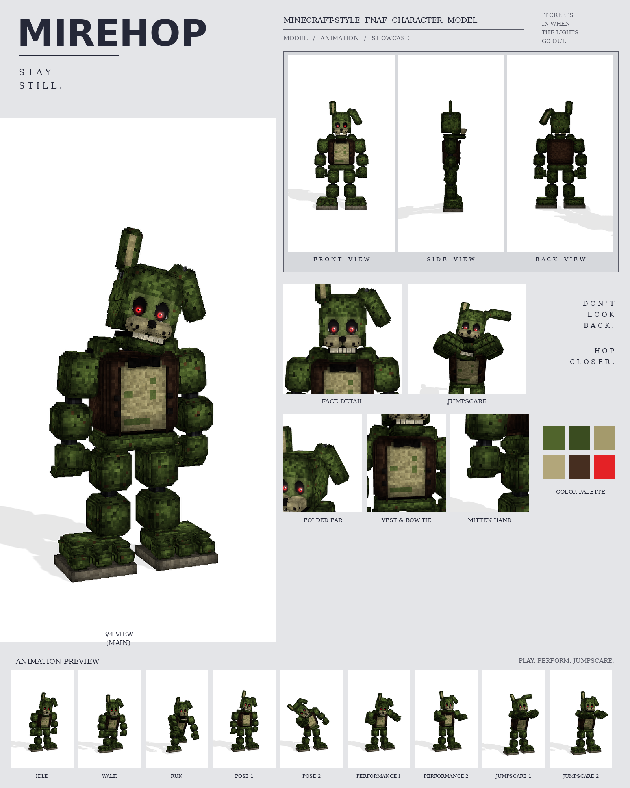

# Mirehop: Minecraft-style FNAF model

This is a Blockbench model of Mirehop in the **Bedrock Entity** format, built from your Mirehop picture.

The picture is from the same series as Golden Freddy, Crimson Freddy and Violet Bunny. The model is built on the same parts and at the same scale: 26 picture pixels = 1 model pixel. No part is enlarged or shrunk. Each keeps the size it has in the picture, and so does the whole character.

It includes:

- 423 cubes and 49 bones
- a 1024×1024 texture painted at 4 texels per model pixel (the eyes at 32), with soft light and shadow baked in
- 9 animations in an animatronic style: idle, walk, run, pose 1, pose 2, performance 1, performance 2, jumpscare 1 and jumpscare 2



## Files

| File | What it is |
| --- | --- |
| `mirehop.bbmodel` | **Open this in Blockbench.** It contains the geometry, the embedded texture and all 9 animations. |
| `preview/mirehop_preview.mp4` | Preview video: turnaround, close-ups, then every animation |
| `preview/mirehop_sheet.png` | Character sheet |
| `textures/mirehop.png` | Texture atlas (the same one embedded in the .bbmodel) |
| `textures/mirehop_emissive.png` | Glow mask for the eyes |
| `bedrock/` | Resource-pack-ready files, in the same format as Blockbench's own *Export Bedrock Geometry / Animations*. |

## What's on the model

- **Fur:** mossy green with darker patches and rusty specks; a tan belly with green patches, as in the picture
- **Head:** the right ear stands up, with a tan inner panel; the left ear leans out from a chrome joint and folds over at a chrome hinge so its top hangs down and out; a lighter green plate round the eyes; deep black eye sockets filled by glossy eyeballs, as in the picture: a big glowing red iris with a dark red ring and a black pupil, a white glint, a dim red glow in the socket and thin white reflections along the bottom and outer corner of each socket; a tan muzzle split down the middle, with black freckles and a black nose; a row of teeth
- **Chest:** a brown vest that wraps the whole torso and hangs open over the belly, with a dark trim along each lapel and four square black buttons; a black bow tie
- **Hands:** working mitten hands that hang with the palm facing the leg and the thumb in front: a palm with four stubby fingers and a thumb, each finger a chain of three blocks with a darker tip, and chrome pins at the wrists
- **Arms and legs:** rounded shoulder caps beside the jaw, chunky blocks on black ball joints, with corners stepped back like the picture
- **Feet:** big three-toed feet on a pale sole, as wide as in the picture: flush with the inside of each leg and reaching well out past its outer side

## Rig

```
root
├─ body (pelvis)
│  └─ torso (vest, belly, bow tie, buttons, neck)
│     ├─ head ─ jaw, eyes, rightEar, leftEar ─ leftEarTop
│     ├─ rightArm ─ rightForearm ─ rightHand ─ rightFinger1a ─ 1b ─ 1c (one chain per finger), rightThumba ─ b
│     └─ leftArm  ─ leftForearm  ─ leftHand  ─ leftFinger1a ─ 1b ─ 1c ..., leftThumba ─ b
├─ rightLeg ─ rightShin ─ rightFoot
└─ leftLeg  ─ leftShin  ─ leftFoot
```

The hands hang with the palm facing the leg and the thumb in front. With an arm raised in front they turn palm down or palm up as a clip needs. Each finger is a chain of three bones, and none of them has a rest rotation, so a positive X rotation bends any joint into a fist.

## Animations

All nine clips move like an animatronic at night. Each part is driven like its own servo: it jumps to a new position, stops dead with a small overshoot, and holds. Keyframes are linear on Blockbench's 24 fps grid. A creeping, damaged rabbit: hunched and slow, with sudden bursts of speed and twitchy ears.

| Animation | Length | Notes |
| --- | --- | --- |
| `animation.mirehop.idle` | 5.0 s loop | Hunched, the head lolling from side to side, arms hanging forward; the standing ear twitches and the fingers curl one by one |
| `animation.mirehop.walk` | 2.0 s loop | A crouched sneak: knees bent, long slow steps, arms hanging forward, head low |
| `animation.mirehop.run` | 0.7 s loop | A lurching sprint: pitched forward, both clawed hands reaching out, the ears streaming back |
| `animation.mirehop.pose1` | 2.5 s loop | The picture: upright, arms at its sides, the head cocking one way then the other while the ears twitch |
| `animation.mirehop.pose2` | 3.0 s loop | Leans way out to one side to peek round a corner, beckoning you with one finger |
| `animation.mirehop.performance1` | 4.0 s loop | A stiff air guitar: left hand up the neck, right hand strumming, knees and head bobbing |
| `animation.mirehop.performance2` | 2.0 s loop | Hops in place on both feet, paws up, the ears flopping on every landing |
| `animation.mirehop.jumpscare1` | 1.3 s, plays once | Crouches low, then springs at you with its claws out and screams |
| `animation.mirehop.jumpscare2` | 1.6 s, plays once | Slumped and dead, then the head jerks up and it lunges at you screaming |

## Using it in a Bedrock addon

It's in [`../addon/FNAF_Six.mcaddon`](../addon/README.md), together with Bonnie, Freddy and Withered Freddy, with a spawn egg and events. To use it in your own resource pack instead, copy `bedrock/` into it:

| Copy | To |
| --- | --- |
| `models/entity/` | `RP/models/entity/` |
| `animations/` | `RP/animations/` |
| `animation_controllers/` | `RP/animation_controllers/` |
| `render_controllers/` | `RP/render_controllers/` |
| `entity/` | `RP/entity/` |
| `textures/entity/mirehop/` | `RP/textures/entity/mirehop/` |

- **Identifier:** the client entity uses `fnaf:mirehop`. If your addon uses a different namespace, change it to match.
- **Glowing eyes:** the client entity uses `mirehop_glow.png` with the `entity_emissive_alpha` material, so the red eyes glow in-game.
- **Size:** about 3.1 blocks to the top of the head and 3.7 blocks to the tip of the standing ear.
- **Movement:** the animation controller plays idle, walk or run based on `query.ground_speed`.
- **Poses, performances and jumpscares:** these play when the behavior entity's `minecraft:mark_variant` value is set:

| mark_variant | Animation |
| --- | --- |
| 1 | pose1 |
| 2 | pose2 |
| 3 | performance1 |
| 4 | performance2 |
| 5 | jumpscare1 |
| 6 | jumpscare2 |

The jumpscares play once, and the add-on's behavior pack returns the character to idle afterwards.

## How close is it to the picture?

These match the picture:

- the size and position of every part, measured in picture pixels from the front view
- the colours, read off the picture
- every part listed above

These differ:

- The sizes were measured by eye from the picture you attached in chat, then checked by rendering the model in the picture's exact framing (1024×1536, same scale, same floor line) under a coordinate grid and comparing every part. The picture isn't saved in the repo, so its outline couldn't be overlaid pixel by pixel. If you add the picture to the repo, I can fit the outline against it exactly.
- The picture shows only the front, so the depths (front to back) are estimated from the widths.
- The fur is a procedural pattern of small blocks in the picture's colours, not a pixel copy of the picture.
- The folded ear's angles were set by eye. To change them, edit `left_angle` and `fold_angle` in `BUNNY_EARS`, in `tools/characters/vested.py`.
- The animations are my own, since the picture shows a single pose. Pose 1 recreates the pose in the picture.
- The hands are built to work (fists, pointing, spreading) rather than to copy the picture's hand pose.
