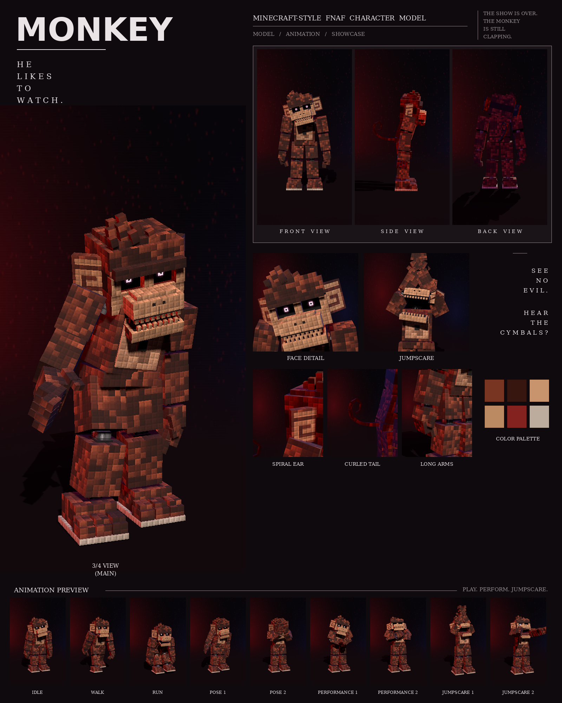

# Monkey: Minecraft-style FNAF model

This is a Blockbench model of the red-brown monkey with the spiral ears from your second night-stage picture, in the **Bedrock Entity** format. It replaces the earlier "Spiral Bear": every bear feature is gone and the face is rebuilt as a monkey's.

It includes:

- 129 cubes and 35 bones
- a 1024×512 texture painted at 4 texels per model pixel, in the picture's "every pixel is a little block" style
- 9 animations in an animatronic style: idle, walk, run, pose 1, pose 2, performance 1, performance 2, jumpscare 1 and jumpscare 2



## Files

| File | What it is |
| --- | --- |
| `monkey.bbmodel` | **Open this in Blockbench.** It contains the geometry, the embedded texture and all 9 animations. |
| `preview/monkey_preview.mp4` | Preview video: turnaround, close-ups, then every animation |
| `preview/monkey_sheet.png` | Character sheet |
| `textures/monkey.png` | Texture atlas (the same one embedded in the .bbmodel) |
| `textures/monkey_emissive.png` | Glow mask for the eyes |
| `bedrock/` | Resource-pack-ready files. They match Blockbench's own *Export Bedrock Geometry / Animations* output. |

## What's on the model

- **Build:** lanky and hunched, with long arms that hang down past his thighs
- **Fur:** red-brown with darker patches
- **Head:** a light monkey face mask under a heavy dark brow ridge; deep-set eye sockets with small glowing pupils; a broad muzzle with two nostrils and a dark lip line; a wide grin with rows of small upper and lower teeth; a scruffy tuft of fur on top
- **Ears:** round monkey ears on the sides of the head, each with the light spiral from the picture
- **Chest:** a red bow tie and two black buttons
- **Tail:** long, rising behind him and rolling into a spiral at the tip
- **Joints:** chrome pistons at the neck, shoulders, elbows, wrists, hips, knees and ankles
- **Feet:** three-toed feet with stepped toes on a light sole

## Rig

```
root
├─ body (pelvis) ─ tail0 ─ tail1 … tail10
│  └─ torso (chest, belly, bow tie, buttons, neck piston)
│     ├─ head ─ jaw, eyes, rightEar, leftEar (tuft and brow are part of head)
│     ├─ rightArm ─ rightForearm ─ rightHand ─ rightFingers, rightThumb
│     └─ leftArm  ─ leftForearm  ─ leftHand  ─ leftFingers, leftThumb
├─ rightLeg ─ rightShin ─ rightFoot
└─ leftLeg  ─ leftShin  ─ leftFoot
```

## Animations

All nine clips move like an animatronic at night. Each part is driven like its own servo: it jumps to a new position, stops dead with a small overshoot, and holds. Keyframes are linear on Blockbench's 24 fps grid, so the holds stay perfectly still. In every clip, the feet stay on the ground. Twitchy and hunched, like a wind-up toy left running in the dark.

| Animation | Length | Notes |
| --- | --- | --- |
| `animation.monkey.idle` | 6.0 s loop | Hunched, head cocking at odd angles in servo jerks, jaw chattering, claws flexing |
| `animation.monkey.walk` | 1.4 s loop | A knuckle-dragging shuffle: bent far forward, long arms swinging low, tail swaying |
| `animation.monkey.run` | 0.7 s loop | A galloping lope with the body thrown forward and the arms reaching out ahead |
| `animation.monkey.pose1` | 2.0 s loop | The picture: head tilted hard to his right, right claw held out at his side with the fingers spread |
| `animation.monkey.pose2` | 2.0 s loop | See-no-evil: both hands over his eyes, then the fingers part and he peeks out |
| `animation.monkey.performance1` | 4.0 s loop | The wind-up cymbal monkey: arms swing out and clap together twice a second, the jaw snapping on every clap |
| `animation.monkey.performance2` | 4.0 s loop | Chest drumming with alternating fists, head thrown back, hooting |
| `animation.monkey.jumpscare1` | 1.25 s, plays once | Crouches, then leaps at the camera with both arms over his head, screeching |
| `animation.monkey.jumpscare2` | 1.5 s, plays once | His head creaks round sideways, much too far, then snaps forward with a screech |

An IK solver puts his claw out to the side in pose 1, his hands over his eyes in pose 2, his palms together in the clap and his fists on his chest in the drumming.

## Using it in a Bedrock addon

Copy `bedrock/` into your resource pack:

| Copy | To |
| --- | --- |
| `models/entity/` | `RP/models/entity/` |
| `animations/` | `RP/animations/` |
| `animation_controllers/` | `RP/animation_controllers/` |
| `render_controllers/` | `RP/render_controllers/` |
| `entity/` | `RP/entity/` |
| `textures/entity/monkey/` | `RP/textures/entity/monkey/` |

- **Identifier:** the client entity uses `fnaf:monkey`. If your addon uses a different namespace, change it to match.
- **Glowing eyes:** the client entity uses `monkey_glow.png` with the `entity_emissive_alpha` material, so the eyes glow in-game. Use `monkey.png` with `entity_alphatest` if you don't want the glow.
- **Size:** about 3.1 blocks to the top of the head and 3.3 blocks to the tuft.
- **Movement:** the animation controller plays idle, walk or run based on `query.ground_speed`.
- **Poses, performances and jumpscares:** these play when the behavior entity's `minecraft:mark_variant` value is set:

| mark_variant | Animation |
| --- | --- |
| 1 | pose1 |
| 2 | pose2 |
| 3 | performance1 |
| 4 | performance2 |
| 5 | jumpscare1 |
| 6 | jumpscare2 |

The jumpscares play once. After one finishes, set `mark_variant` back to 0 so the character returns to idle.

## How close is it to the reference?

These match the picture:

- the proportions, measured from the picture separately for this character
- the colours, sampled from it
- every part listed above

These differ:

- The fur is a procedural pattern of little blocks in the picture's colours, not a pixel copy of the picture.
- The spirals on the ears are painted on, not carved in.
- The animations are my own, since the reference is a single pose. Pose 1 recreates the pose in the picture.
