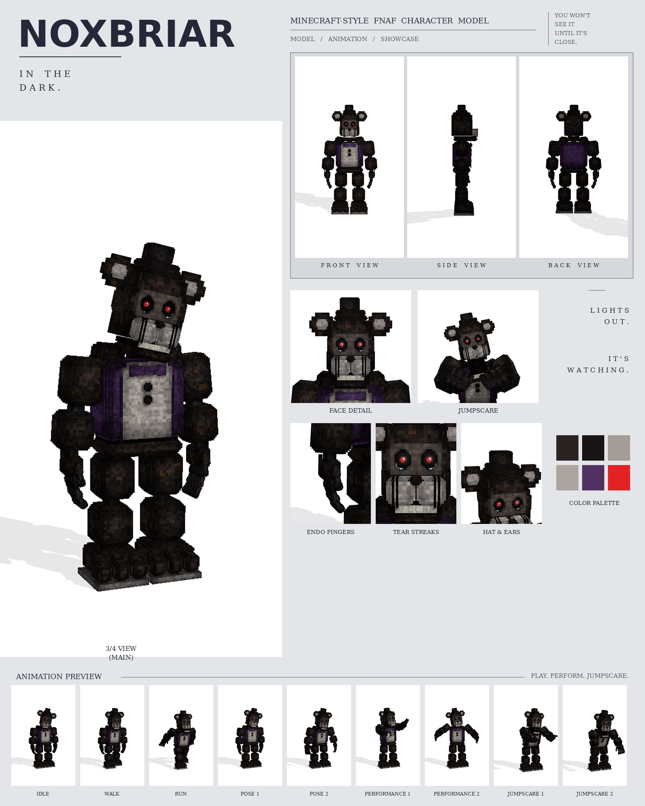

# Noxbriar: Minecraft-style FNAF model

This is a Blockbench model of Noxbriar in the **Bedrock Entity** format, built from your Noxbriar picture.

The picture is from the same series as Golden Freddy, Crimson Freddy and Violet Bunny. The model is built on the same parts and at the same scale: 26 picture pixels = 1 model pixel. No part is enlarged or shrunk. Each keeps the size it has in the picture, and so does the whole character.

It includes:

- 471 cubes and 49 bones
- a 1024×1024 texture painted at 4 texels per model pixel (the eyes at 32), with soft light and shadow baked in
- 9 animations in an animatronic style: idle, walk, run, pose 1, pose 2, performance 1, performance 2, jumpscare 1 and jumpscare 2



## Files

| File | What it is |
| --- | --- |
| `noxbriar.bbmodel` | **Open this in Blockbench.** It contains the geometry, the embedded texture and all 9 animations. |
| `preview/noxbriar_preview.mp4` | Preview video: turnaround, close-ups, then every animation |
| `preview/noxbriar_sheet.png` | Character sheet |
| `textures/noxbriar.png` | Texture atlas (the same one embedded in the .bbmodel) |
| `textures/noxbriar_emissive.png` | Glow mask for the eyes |
| `bedrock/` | Resource-pack-ready files, in the same format as Blockbench's own *Export Bedrock Geometry / Animations*. |

## What's on the model

- **Fur:** sooty black-brown with rusty patches; a pale grey belly
- **Head:** a black top hat; round black ears with a grey centre; a grey-brown plate round the eyes; deep black eye sockets filled by glossy eyeballs, as in the picture: a big glowing red iris with a dark red ring and a black pupil, a white glint, a dim red glow in the socket and thin white reflections curving up the outer edge of each socket; black tear streaks running from the eyes down over the pale muzzle; a black nose; a row of teeth
- **Chest:** a purple vest that wraps the whole torso and hangs open over the belly, with a dark trim along each lapel and two lighter pocket flaps; a purple bow tie; two round black buttons on the belly
- **Hands:** working endoskeleton hands that hang with the back of the hand facing forward, as in the picture: a furry back of the hand with two tendon rods, four bare fingers and a thumb, each a chain of dark blocks on black ball joints
- **Arms and legs:** rounded shoulder caps beside the jaw, chunky blocks on black ball joints, with corners stepped back like the picture
- **Feet:** big three-toed feet on a grey sole, as wide as in the picture: flush with the inside of each leg and reaching well out past its outer side

## Rig

```
root
├─ body (pelvis)
│  └─ torso (vest, belly, bow tie, buttons, neck)
│     ├─ head ─ jaw, eyes, rightEar, leftEar, hat
│     ├─ rightArm ─ rightForearm ─ rightHand ─ rightFinger1a ─ 1b ─ 1c (one chain per finger), rightThumba ─ b
│     └─ leftArm  ─ leftForearm  ─ leftHand  ─ leftFinger1a ─ 1b ─ 1c ..., leftThumba ─ b
├─ rightLeg ─ rightShin ─ rightFoot
└─ leftLeg  ─ leftShin  ─ leftFoot
```

The hands hang with the back of the hand facing forward and the thumb on the inner side, as in the picture. Each finger is a chain of three bones, and none of them has a rest rotation, so a positive X rotation bends any joint into a fist.

## Animations

All nine clips move like an animatronic at night. Each part is driven like its own servo: it jumps to a new position, stops dead with a small overshoot, and holds. Keyframes are linear on Blockbench's 24 fps grid. A shadow bear: slow, smooth and deliberate, with long dead holds broken by instant moves.

| Animation | Length | Notes |
| --- | --- | --- |
| `animation.noxbriar.idle` | 8.0 s loop | Almost still: the head slowly turns to follow you and the shoulders rise and fall; one glitch frame jerks the head |
| `animation.noxbriar.walk` | 2.4 s loop | A slow, heavy glide: short steps with no bounce, arms hanging dead still; the head turns to stare and holds |
| `animation.noxbriar.run` | 0.9 s loop | Stiff and fast, upright, arms swept back, the head locked on you |
| `animation.noxbriar.pose1` | 4.0 s loop | The picture: standing tall; the head slowly tilts over to one side and back, a finger twitches |
| `animation.noxbriar.pose2` | 4.0 s loop | Looming: leans forward over you, head tipped down, arms raised a little with the fingers spread |
| `animation.noxbriar.performance1` | 4.0 s loop | Conducts an orchestra in 4/4: the right hand beats the pattern with a pointing finger, the left is raised for the strings |
| `animation.noxbriar.performance2` | 4.8 s loop | A music-box waltz: sways from side to side in ratchet clicks, arms open |
| `animation.noxbriar.jumpscare1` | 1.6 s, plays once | Tilts its head slowly... then it is in your face, jaw wide, claws up, screaming |
| `animation.noxbriar.jumpscare2` | 1.6 s, plays once | Raises both arms high over its head, then crashes them down at you and screams |

## Using it in a Bedrock addon

It's in [`../addon/FNAF_Six.mcaddon`](../addon/README.md), together with Bonnie, Freddy and Withered Freddy, with a spawn egg and events. To use it in your own resource pack instead, copy `bedrock/` into it:

| Copy | To |
| --- | --- |
| `models/entity/` | `RP/models/entity/` |
| `animations/` | `RP/animations/` |
| `animation_controllers/` | `RP/animation_controllers/` |
| `render_controllers/` | `RP/render_controllers/` |
| `entity/` | `RP/entity/` |
| `textures/entity/noxbriar/` | `RP/textures/entity/noxbriar/` |

- **Identifier:** the client entity uses `fnaf:noxbriar`. If your addon uses a different namespace, change it to match.
- **Glowing eyes:** the client entity uses `noxbriar_glow.png` with the `entity_emissive_alpha` material, so the red eyes glow in-game.
- **Size:** about 3.2 blocks to the top of the head and 3.4 blocks to the top of the hat.
- **Movement:** the animation controller plays idle, walk or run based on `query.ground_speed`.
- **Poses, performances and jumpscares:** these play when the behavior entity's `minecraft:mark_variant` value is set:

| mark_variant | Animation |
| --- | --- |
| 1 | pose1 |
| 2 | pose2 |
| 3 | performance1 |
| 4 | performance2 |
| 5 | jumpscare1 |
| 6 | jumpscare2 |

The jumpscares play once, and the add-on's behavior pack returns the character to idle afterwards.

## How close is it to the picture?

These match the picture:

- the size and position of every part, measured in picture pixels from the front view
- the colours, read off the picture
- every part listed above

These differ:

- The sizes were measured by eye from the picture you attached in chat, then checked by rendering the model in the picture's exact framing (1024×1536, same scale, same floor line) under a coordinate grid and comparing every part. The picture isn't saved in the repo, so its outline couldn't be overlaid pixel by pixel. If you add the picture to the repo, I can fit the outline against it exactly.
- The picture shows only the front, so the depths (front to back) are estimated from the widths.
- The fur is a procedural pattern of small blocks in the picture's colours, not a pixel copy of the picture.
- The animations are my own, since the picture shows a single pose. Pose 1 recreates the pose in the picture.
- The hands are built to work (fists, pointing, spreading) rather than to copy the picture's hand pose.
