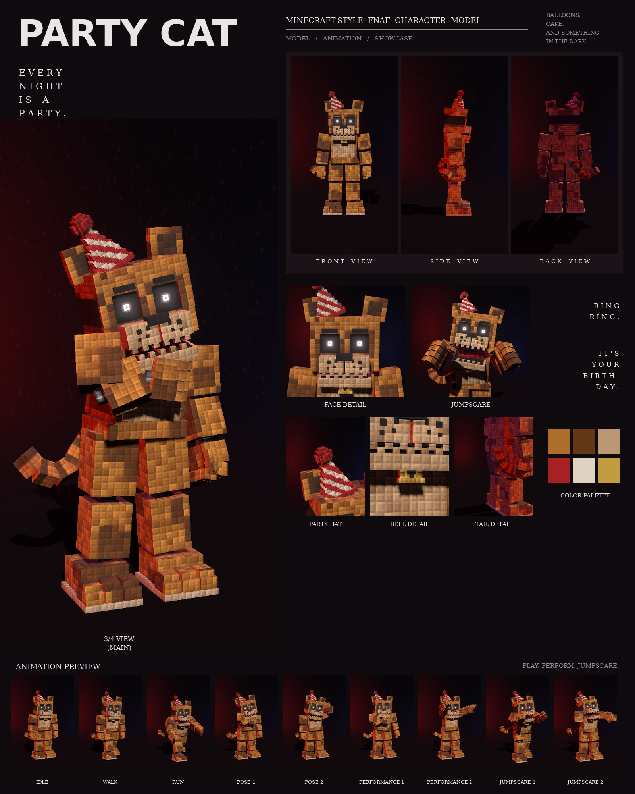

# Party Cat: Minecraft-style FNAF model

This is a Blockbench model of the golden cat with the party hat from your second night-stage picture, in the **Bedrock Entity** format.

It includes:

- 118 cubes and 32 bones
- a 1024×512 texture painted at 4 texels per model pixel, in the picture's "every pixel is a little block" style
- 9 animations in an animatronic style: idle, walk, run, pose 1, pose 2, performance 1, performance 2, jumpscare 1 and jumpscare 2



## Files

| File | What it is |
| --- | --- |
| `party_cat.bbmodel` | **Open this in Blockbench.** It contains the geometry, the embedded texture and all 9 animations. |
| `preview/party_cat_preview.mp4` | Preview video: turnaround, close-ups, then every animation |
| `preview/party_cat_sheet.png` | Character sheet |
| `textures/party_cat.png` | Texture atlas (the same one embedded in the .bbmodel) |
| `textures/party_cat_emissive.png` | Glow mask for the eyes |
| `bedrock/` | Resource-pack-ready files. They match Blockbench's own *Export Bedrock Geometry / Animations* output. |

## What's on the model

- **Build:** chunky, with a wide head and chest, a belt-like pelvis band and short curled fingers
- **Fur:** golden orange with big dark-brown patches, and a cream belly
- **Head:** square ears with dark inner patches; flat black brows; dark eye sockets with small white ring-shaped pupils; a freckled muzzle split down the middle; a black nose; square teeth
- **Party hat:** red-and-cream striped, tipped to his right, with a fluffy red pom-pom on top
- **Collar:** red, with a gold bell under the chin
- **Tail:** thick and striped, curling out from behind him
- **Joints:** chrome pistons at the neck, shoulders, elbows, wrists, hips, knees and ankles
- **Feet:** big three-toed feet with stepped toes on a light sole

## Rig

```
root
├─ body (pelvis) ─ tail0 ─ tail1 … tail5
│  └─ torso (chest, belly, collar, neck piston) ─ bell
│     ├─ head ─ jaw, eyes, rightEar, leftEar, hat
│     ├─ rightArm ─ rightForearm ─ rightHand ─ rightFingers, rightThumb
│     └─ leftArm  ─ leftForearm  ─ leftHand  ─ leftFingers, leftThumb
├─ rightLeg ─ rightShin ─ rightFoot
└─ leftLeg  ─ leftShin  ─ leftFoot
```

## Animations

All nine clips move like an animatronic at night. Each part (head, torso, each arm, legs, jaw, ears, tail) is driven like its own servo: it jumps to a new position, stops dead with a small overshoot, and holds. Keyframes are linear on Blockbench's 24 fps grid, so the holds stay perfectly still. In every clip, the feet stay on the ground.

| Animation | Length | Notes |
| --- | --- | --- |
| `animation.party_cat.idle` | 6.0 s loop | Stands still and scans the room with servo head turns; tail ticks side to side |
| `animation.party_cat.walk` | 1.6 s loop | Stiff pendulum steps, arms jerking, tail swinging in steps |
| `animation.party_cat.run` | 0.8 s loop | A rigid chase with arms locked out reaching and the tail raised |
| `animation.party_cat.pose1` | 2.0 s loop | The picture: head tilted to his right, right hand on the bell, tail curled out |
| `animation.party_cat.pose2` | 2.0 s loop | Waves hello with the left hand, head tilted the other way |
| `animation.party_cat.performance1` | 4.0 s loop | Dances on the spot: hips swaying, ringing the bell, tail swishing, hat wobbling |
| `animation.party_cat.performance2` | 4.0 s loop | Party: both arms up, swaying side to side |
| `animation.party_cat.jumpscare1` | 1.25 s, plays once | Lunges at the camera, then the shaking scream |
| `animation.party_cat.jumpscare2` | 1.5 s, plays once | Slumped and powered down, then snaps awake with arms flung wide |

An IK solver keeps his hand on the bell and places the waving hand beside his head.

## Using it in a Bedrock addon

Copy `bedrock/` into your resource pack:

| Copy | To |
| --- | --- |
| `models/entity/` | `RP/models/entity/` |
| `animations/` | `RP/animations/` |
| `animation_controllers/` | `RP/animation_controllers/` |
| `render_controllers/` | `RP/render_controllers/` |
| `entity/` | `RP/entity/` |
| `textures/entity/party_cat/` | `RP/textures/entity/party_cat/` |

- **Identifier:** the client entity uses `fnaf:party_cat`. If your addon uses a different namespace, change it to match.
- **Glowing eyes:** the client entity uses `party_cat_glow.png` with the `entity_emissive_alpha` material, so the eyes glow in-game. Use `party_cat.png` with `entity_alphatest` if you don't want the glow.
- **Size:** about 3.0 blocks to the top of the head and 3.6 blocks to the pom-pom.
- **Movement:** the animation controller plays idle, walk or run based on `query.ground_speed`.
- **Poses, performances and jumpscares:** these play when the behavior entity's `minecraft:mark_variant` value is set:

| mark_variant | Animation |
| --- | --- |
| 1 | pose1 |
| 2 | pose2 |
| 3 | performance1 |
| 4 | performance2 |
| 5 | jumpscare1 |
| 6 | jumpscare2 |

The jumpscares play once. After one finishes, set `mark_variant` back to 0 so the character returns to idle.

## How close is it to the reference?

These match the picture:

- the proportions, measured from the picture separately for this character
- the colours, sampled from it
- every part listed above

These differ:

- The fur is a procedural pattern of little blocks in the picture's colours, not a pixel copy of the picture.
- The pom-pom is built from small blocks instead of the fuzzy ball in the picture.
- The animations are my own, since the reference is a single pose. Pose 1 recreates the pose in the picture.
