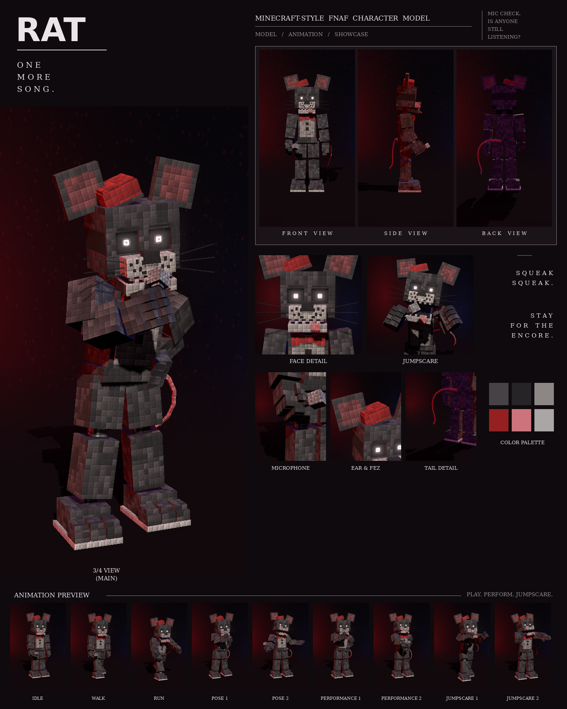

# Rat: Minecraft-style FNAF model

This is a Blockbench model of the grey rat with the fez and microphone from your third night-stage picture, in the **Bedrock Entity** format.

It includes:

- 125 cubes and 36 bones
- a 1024×256 texture painted at 4 texels per model pixel, in the picture's "every pixel is a little block" style
- 9 animations in an animatronic style: idle, walk, run, pose 1, pose 2, performance 1, performance 2, jumpscare 1 and jumpscare 2



## Files

| File | What it is |
| --- | --- |
| `rat.bbmodel` | **Open this in Blockbench.** It contains the geometry, the embedded texture and all 9 animations. |
| `preview/rat_preview.mp4` | Preview video: turnaround, close-ups, then every animation |
| `preview/rat_sheet.png` | Character sheet |
| `textures/rat.png` | Texture atlas (the same one embedded in the .bbmodel) |
| `textures/rat_emissive.png` | Glow mask for the eyes |
| `bedrock/` | Resource-pack-ready files. They match Blockbench's own *Export Bedrock Geometry / Animations* output. |

## What's on the model

- **Build:** narrow chest, long legs with long knee pistons, a big head
- **Fur:** dark grey with darker patches, and a light grey belly
- **Head:** huge square ears with dark rims and red inner patches; a small red fez tipped to his right; thin flat brows; dark eye sockets with small white ring-shaped pupils; a light grey muzzle with black freckles; a black nose; whiskers fanning out on both sides; small teeth and a pink tongue hanging out of the left side of his mouth
- **Chest:** a red bow tie and two black buttons
- **Microphone:** in his right hand
- **Tail:** long and pink, out past his left side and curving down toward the floor
- **Neck:** an exposed endoskeleton neck in the gap under the head: a dark steel column on a chrome collar, with two thin cables at the front
- **Joints:** chrome pistons at the shoulders, elbows, wrists, hips, knees and ankles
- **Feet:** big three-toed feet with stepped toes on a light sole

## Rig

```
root
├─ body (pelvis) ─ tail0 ─ tail1 … tail9
│  └─ torso (chest, belly, bow tie, buttons, endoskeleton neck)
│     ├─ head ─ jaw, eyes, rightEar, leftEar, hat (whiskers are part of head)
│     ├─ rightArm ─ rightForearm ─ rightHand ─ rightFingers, rightThumb, mic
│     └─ leftArm  ─ leftForearm  ─ leftHand  ─ leftFingers, leftThumb
├─ rightLeg ─ rightShin ─ rightFoot
└─ leftLeg  ─ leftShin  ─ leftFoot
```

## Animations

All nine clips move like an animatronic at night. Each part (head, torso, each arm, legs, jaw, ears, tail) is driven like its own servo: it jumps to a new position, stops dead with a small overshoot, and holds. Keyframes are linear on Blockbench's 24 fps grid, so the holds stay perfectly still. In every clip, the feet stay on the ground.

| Animation | Length | Notes |
| --- | --- | --- |
| `animation.rat.idle` | 6.0 s loop | Stands still and scans the room with servo head turns; the tail ticks |
| `animation.rat.walk` | 1.6 s loop | Stiff pendulum steps, arms jerking, head locked forward except for one snap to the side |
| `animation.rat.run` | 0.8 s loop | A rigid chase with arms locked out reaching and the tail raised |
| `animation.rat.pose1` | 2.0 s loop | The picture: mic at his mouth, other hand on his hip, head cocked |
| `animation.rat.pose2` | 2.0 s loop | Arms open to the audience, mic held out to the side |
| `animation.rat.performance1` | 4.0 s loop | Sings into the mic with his hand on his hip, swaying and tapping a foot |
| `animation.rat.performance2` | 4.0 s loop | Holds the mic out to the crowd, then brings it back for the chorus |
| `animation.rat.jumpscare1` | 1.25 s, plays once | Lunges at the camera, then the shaking scream |
| `animation.rat.jumpscare2` | 1.5 s, plays once | Slumped and powered down, then snaps awake with arms flung wide |

An IK solver keeps the mic at his mouth (or aimed at the crowd) and his hand on his hip.

## Using it in a Bedrock addon

Copy `bedrock/` into your resource pack:

| Copy | To |
| --- | --- |
| `models/entity/` | `RP/models/entity/` |
| `animations/` | `RP/animations/` |
| `animation_controllers/` | `RP/animation_controllers/` |
| `render_controllers/` | `RP/render_controllers/` |
| `entity/` | `RP/entity/` |
| `textures/entity/rat/` | `RP/textures/entity/rat/` |

- **Identifier:** the client entity uses `fnaf:rat`. If your addon uses a different namespace, change it to match.
- **Glowing eyes:** the client entity uses `rat_glow.png` with the `entity_emissive_alpha` material, so the eyes glow in-game. Use `rat.png` with `entity_alphatest` if you don't want the glow.
- **Size:** about 3.4 blocks to the top of the head and 3.8 blocks to the ear tips.
- **Movement:** the animation controller plays idle, walk or run based on `query.ground_speed`.
- **Poses, performances and jumpscares:** these play when the behavior entity's `minecraft:mark_variant` value is set:

| mark_variant | Animation |
| --- | --- |
| 1 | pose1 |
| 2 | pose2 |
| 3 | performance1 |
| 4 | performance2 |
| 5 | jumpscare1 |
| 6 | jumpscare2 |

The jumpscares play once. After one finishes, set `mark_variant` back to 0 so the character returns to idle.

## How close is it to the reference?

These match the picture:

- the proportions, measured from the picture separately for this character
- the colours, sampled from it
- every part listed above

These differ:

- The fur is a procedural pattern of little blocks in the picture's colours, not a pixel copy of the picture.
- The whiskers are thin flat strips rather than round wires.
- The animations are my own, since the reference is a single pose. Pose 1 recreates the pose in the picture.
