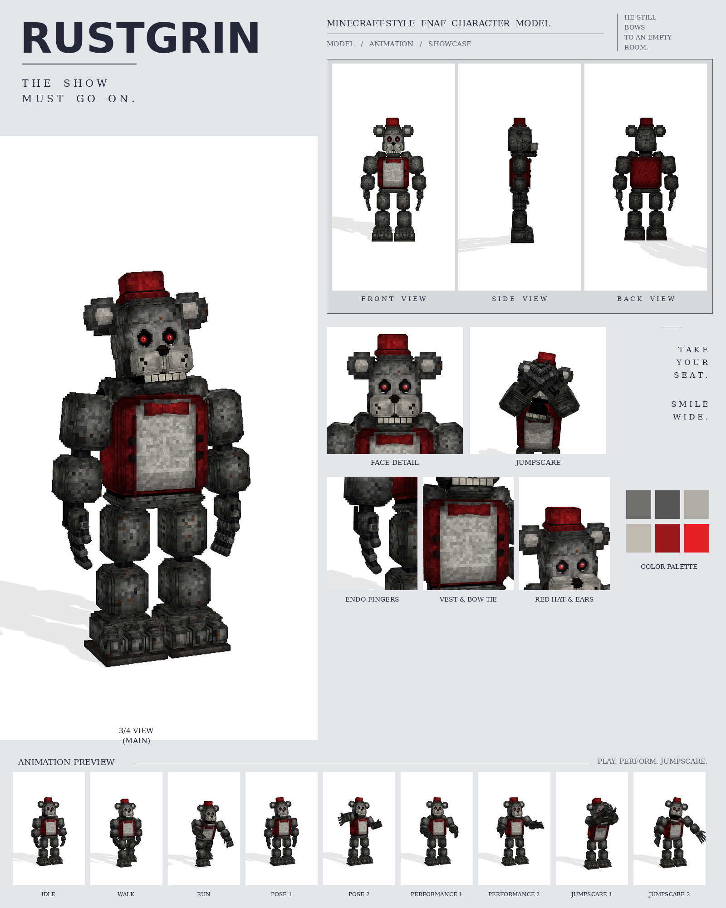

# Rustgrin: Minecraft-style FNAF model

This is a Blockbench model of Rustgrin in the **Bedrock Entity** format, built from your Rustgrin picture.

The picture is from the same series as Golden Freddy, Crimson Freddy and Violet Bunny. The model is built on the same parts and at the same scale: 26 picture pixels = 1 model pixel. No part is enlarged or shrunk. Each keeps the size it has in the picture, and so does the whole character.

It includes:

- 459 cubes and 49 bones
- a 1024×1024 texture painted at 4 texels per model pixel (the eyes at 32), with soft light and shadow baked in
- 9 animations in an animatronic style: idle, walk, run, pose 1, pose 2, performance 1, performance 2, jumpscare 1 and jumpscare 2



## Files

| File | What it is |
| --- | --- |
| `rustgrin.bbmodel` | **Open this in Blockbench.** It contains the geometry, the embedded texture and all 9 animations. |
| `preview/rustgrin_preview.mp4` | Preview video: turnaround, close-ups, then every animation |
| `preview/rustgrin_sheet.png` | Character sheet |
| `textures/rustgrin.png` | Texture atlas (the same one embedded in the .bbmodel) |
| `textures/rustgrin_emissive.png` | Glow mask for the eyes |
| `bedrock/` | Resource-pack-ready files, in the same format as Blockbench's own *Export Bedrock Geometry / Animations*. |

## What's on the model

- **Fur:** rust-flecked grey, with darker patches and a pale grey belly
- **Head:** a red top hat with a black band; round ears with a dark ring and a pale centre; a lighter plate round the eyes; deep black eye sockets filled by glossy eyeballs, as in the picture: a big glowing red iris with a dark red ring and a black pupil, a white glint, a dim red glow in the socket and thin white reflections along the bottom of each socket; a pale grey muzzle split down the middle, with black freckles and a black nose; a row of cream teeth
- **Chest:** a red vest that wraps the whole torso and hangs open over the belly, with a dark trim along each lapel and four square black buttons; a red bow tie
- **Hands:** working endoskeleton hands that hang with the palm facing the leg and the thumb in front: a furry back of the hand with two tendon rods, four bare fingers and a thumb, each a chain of grey blocks on black ball joints
- **Arms and legs:** rounded shoulder caps beside the jaw, chunky blocks on black ball joints, with corners stepped back like the picture
- **Feet:** big three-toed feet on a dark sole, as wide as in the picture: flush with the inside of each leg and reaching well out past its outer side

## Rig

```
root
├─ body (pelvis)
│  └─ torso (vest, belly, bow tie, buttons, neck)
│     ├─ head ─ jaw, eyes, rightEar, leftEar, hat
│     ├─ rightArm ─ rightForearm ─ rightHand ─ rightFinger1a ─ 1b ─ 1c (one chain per finger), rightThumba ─ b
│     └─ leftArm  ─ leftForearm  ─ leftHand  ─ leftFinger1a ─ 1b ─ 1c ..., leftThumba ─ b
├─ rightLeg ─ rightShin ─ rightFoot
└─ leftLeg  ─ leftShin  ─ leftFoot
```

The hands hang with the palm facing the leg and the thumb in front. With an arm raised in front they turn palm down or palm up as a clip needs. Each finger is a chain of three bones, and none of them has a rest rotation, so a positive X rotation bends any joint into a fist.

## Animations

All nine clips move like an animatronic at night. Each part is driven like its own servo: it jumps to a new position, stops dead with a small overshoot, and holds. Keyframes are linear on Blockbench's 24 fps grid. A creaky old showman: proud and upright, chest out and chin up, moving in stiff jerks with rusty stalls and the odd grinding judder.

| Animation | Length | Notes |
| --- | --- | --- |
| `animation.rustgrin.idle` | 6.0 s loop | Chest out, chin up, arms at his sides; the head pans the room in creaky steps, the fingers drum, the jaw clacks and the hat tips |
| `animation.rustgrin.walk` | 1.8 s loop | A stiff, proud march: chest out, knees high, arms swinging straight from the shoulder, one snap of the head to the side |
| `animation.rustgrin.run` | 0.9 s loop | A lumbering charge, leaning in with both clawed hands out in front, the jaw open |
| `animation.rustgrin.pose1` | 3.0 s loop | The picture: upright, arms hanging; a slow nod and chin lift, the fingers flexing one at a time |
| `animation.rustgrin.pose2` | 3.0 s loop | "Ladies and gentlemen!": sweeps his right arm out wide, palm open, left hand on his belly, and announces |
| `animation.rustgrin.performance1` | 4.0 s loop | Sings with a deep showman bow on every phrase, then throws both arms open on the chorus |
| `animation.rustgrin.performance2` | 4.0 s loop | A soft-shoe shuffle: steps from side to side with heel taps and swinging arms, tipping his hat on the beat |
| `animation.rustgrin.jumpscare1` | 1.3 s, plays once | Rears back, then lunges in with both clawed hands up beside his gaping jaw and screams, shaking |
| `animation.rustgrin.jumpscare2` | 1.8 s, plays once | Stands still while his head grinds round sideways, then it snaps back and he screams with arms out |

## Using it in a Bedrock addon

It's in [`../addon/FNAF_Six.mcaddon`](../addon/README.md), together with Bonnie, Freddy and Withered Freddy, with a spawn egg and events. To use it in your own resource pack instead, copy `bedrock/` into it:

| Copy | To |
| --- | --- |
| `models/entity/` | `RP/models/entity/` |
| `animations/` | `RP/animations/` |
| `animation_controllers/` | `RP/animation_controllers/` |
| `render_controllers/` | `RP/render_controllers/` |
| `entity/` | `RP/entity/` |
| `textures/entity/rustgrin/` | `RP/textures/entity/rustgrin/` |

- **Identifier:** the client entity uses `fnaf:rustgrin`. If your addon uses a different namespace, change it to match.
- **Glowing eyes:** the client entity uses `rustgrin_glow.png` with the `entity_emissive_alpha` material, so the red eyes glow in-game.
- **Size:** about 3.2 blocks to the top of the head and 3.4 blocks to the top of the hat.
- **Movement:** the animation controller plays idle, walk or run based on `query.ground_speed`.
- **Poses, performances and jumpscares:** these play when the behavior entity's `minecraft:mark_variant` value is set:

| mark_variant | Animation |
| --- | --- |
| 1 | pose1 |
| 2 | pose2 |
| 3 | performance1 |
| 4 | performance2 |
| 5 | jumpscare1 |
| 6 | jumpscare2 |

The jumpscares play once, and the add-on's behavior pack returns the character to idle afterwards.

## How close is it to the picture?

These match the picture:

- the size and position of every part, measured in picture pixels from the front view
- the colours, read off the picture
- every part listed above

These differ:

- The sizes were measured by eye from the picture you attached in chat, then checked by rendering the model in the picture's exact framing (1024×1536, same scale, same floor line) under a coordinate grid and comparing every part. The picture isn't saved in the repo, so its outline couldn't be overlaid pixel by pixel. If you add the picture to the repo, I can fit the outline against it exactly.
- The picture shows only the front, so the depths (front to back) are estimated from the widths.
- The fur is a procedural pattern of small blocks in the picture's colours, not a pixel copy of the picture.
- The animations are my own, since the picture shows a single pose. Pose 1 recreates the pose in the picture.
- The hands are built to work (fists, pointing, spreading) rather than to copy the picture's hand pose.
