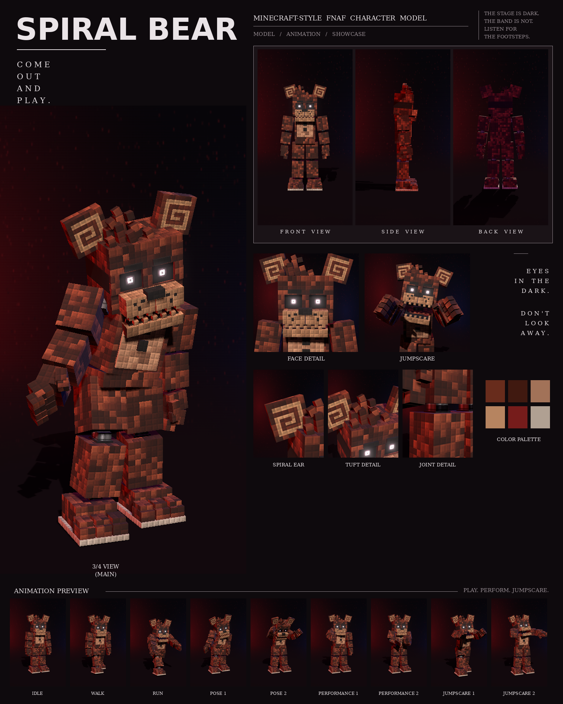

# Spiral Bear: Minecraft-style FNAF model

This is a Blockbench model of the red-brown bear with spiral ears from your first night-stage picture, in the **Bedrock Entity** format.

It includes:

- 116 cubes and 24 bones
- a 1024×256 texture painted at 4 texels per model pixel, in the picture's "every pixel is a little block" style
- 9 animations in an animatronic style: idle, walk, run, pose 1, pose 2, performance 1, performance 2, jumpscare 1 and jumpscare 2



## Files

| File | What it is |
| --- | --- |
| `spiral_bear.bbmodel` | **Open this in Blockbench.** It contains the geometry, the embedded texture and all 9 animations. |
| `preview/spiral_bear_preview.mp4` | Preview video: turnaround, close-ups, then every animation |
| `preview/spiral_bear_sheet.png` | Character sheet |
| `textures/spiral_bear.png` | Texture atlas (the same one embedded in the .bbmodel) |
| `textures/spiral_bear_emissive.png` | Glow mask for the eyes |
| `bedrock/` | Resource-pack-ready files. They match Blockbench's own *Export Bedrock Geometry / Animations* output. |

## What's on the model

- **Build:** lanky, with long legs, big blocky shoulders and long-fingered claws
- **Fur:** dark red-brown, mottled with darker patches, and a tan belly
- **Ears:** square, with a light spiral inlaid on the front of each
- **Head:** a scruffy tuft of loose blocks on top; angled black brows; dark eye sockets with small white ring-shaped pupils; a freckled two-piece muzzle with a wide black nose; a slit mouth with a row of square teeth
- **Chest:** a dark red bow tie and two black buttons
- **Joints:** chrome pistons at the neck, shoulders, elbows, wrists, hips, knees and ankles
- **Feet:** big three-toed feet with stepped toes on a light sole

## Rig

```
root
├─ body (pelvis)
│  └─ torso (chest, belly, bow tie, buttons, neck piston)
│     ├─ head ─ jaw, eyes, rightEar, leftEar (tuft blocks are part of head)
│     ├─ rightArm ─ rightForearm ─ rightHand ─ rightFingers, rightThumb
│     └─ leftArm  ─ leftForearm  ─ leftHand  ─ leftFingers, leftThumb
├─ rightLeg ─ rightShin ─ rightFoot
└─ leftLeg  ─ leftShin  ─ leftFoot
```

## Animations

All nine clips move like an animatronic at night. Each part (head, torso, each arm, legs, jaw, ears, tail) is driven like its own servo: it jumps to a new position, stops dead with a small overshoot, and holds. Keyframes are linear on Blockbench's 24 fps grid, so the holds stay perfectly still. In every clip, the feet stay on the ground.

| Animation | Length | Notes |
| --- | --- | --- |
| `animation.spiral_bear.idle` | 6.0 s loop | Stands still and scans the room with servo head turns; jaw clacks, an ear and an arm twitch |
| `animation.spiral_bear.walk` | 1.6 s loop | Stiff pendulum steps, arms jerking, head locked forward except for one snap to the side |
| `animation.spiral_bear.run` | 0.8 s loop | A rigid chase: arms locked out reaching, head staring with a servo judder |
| `animation.spiral_bear.pose1` | 2.0 s loop | The picture: head tilted hard to his right, right claw held out at his side |
| `animation.spiral_bear.pose2` | 2.0 s loop | Menacing: both claws raised, head down, staring |
| `animation.spiral_bear.performance1` | 4.0 s loop | Sings without a mic: slow sway, alternating open-palm gestures to the audience |
| `animation.spiral_bear.performance2` | 4.0 s loop | A slow clap every beat with a head bob |
| `animation.spiral_bear.jumpscare1` | 1.25 s, plays once | Lunges at the camera, then the shaking scream |
| `animation.spiral_bear.jumpscare2` | 1.5 s, plays once | Slumped and powered down, then snaps awake with arms flung wide |

An IK solver places the outstretched claw in pose 1 and brings the hands together for the claps.

## Using it in a Bedrock addon

Copy `bedrock/` into your resource pack:

| Copy | To |
| --- | --- |
| `models/entity/` | `RP/models/entity/` |
| `animations/` | `RP/animations/` |
| `animation_controllers/` | `RP/animation_controllers/` |
| `render_controllers/` | `RP/render_controllers/` |
| `entity/` | `RP/entity/` |
| `textures/entity/spiral_bear/` | `RP/textures/entity/spiral_bear/` |

- **Identifier:** the client entity uses `fnaf:spiral_bear`. If your addon uses a different namespace, change it to match.
- **Glowing eyes:** the client entity uses `spiral_bear_glow.png` with the `entity_emissive_alpha` material, so the eyes glow in-game. Use `spiral_bear.png` with `entity_alphatest` if you don't want the glow.
- **Size:** about 3.1 blocks to the top of the head and 3.4 blocks to the top of the ears.
- **Movement:** the animation controller plays idle, walk or run based on `query.ground_speed`.
- **Poses, performances and jumpscares:** these play when the behavior entity's `minecraft:mark_variant` value is set:

| mark_variant | Animation |
| --- | --- |
| 1 | pose1 |
| 2 | pose2 |
| 3 | performance1 |
| 4 | performance2 |
| 5 | jumpscare1 |
| 6 | jumpscare2 |

The jumpscares play once. After one finishes, set `mark_variant` back to 0 so the character returns to idle.

## How close is it to the reference?

These match the picture:

- the proportions, measured from the picture separately for this character
- the colours, sampled from it
- every part listed above

These differ:

- The fur is a procedural pattern of little blocks in the picture's colours, not a pixel copy of the picture.
- The picture has the spiral ears slightly rounded; on the model they are square blocks with the spiral inlaid.
- The animations are my own, since the reference is a single pose. Pose 1 recreates the pose in the picture.
