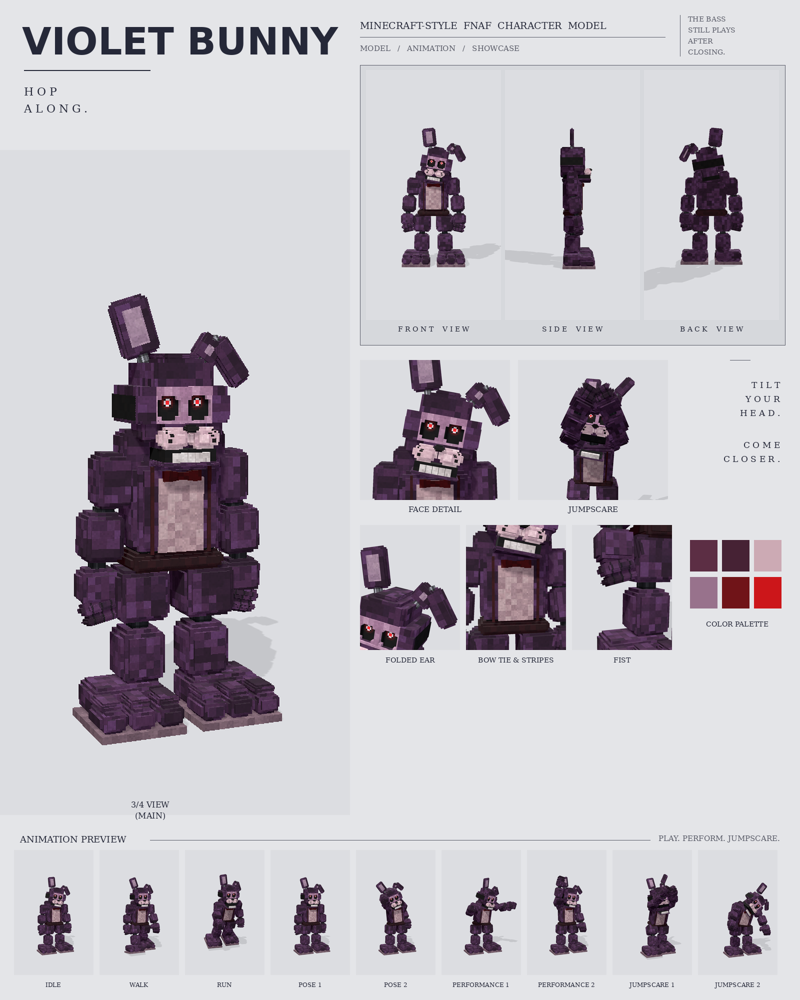

# Violet Bunny: Minecraft-style FNAF model

This is a Blockbench model of Violet Bunny built from your purple bunny picture, in the **Bedrock Entity** format.

Every part was measured from the picture at one shared scale (26 picture pixels = 1 model pixel), the same scale used for the other two characters from that set. No part is enlarged or shrunk: each keeps the size it has in the picture, and so does the character.

To make it a replica, the model's exact front outline was then laid over the picture's outline, and every limb, the chest, the legs, the ears and the hat were fitted until they lined up. The two outlines now overlap by 91%. Every colour was matched by rendering the model under plain studio light and sampling it at the same spots as the picture.

It includes:

- 252 cubes and 25 bones
- a 1024×1024 texture painted at 4 texels per model pixel, in flat one-pixel squares of colour with a fine grain, like the picture (no tile or brick edges)
- 9 animations in an animatronic style: idle, walk, run, pose 1, pose 2, performance 1, performance 2, jumpscare 1 and jumpscare 2



## Files

| File | What it is |
| --- | --- |
| `violet_bunny.bbmodel` | **Open this in Blockbench.** It contains the geometry, the embedded texture and all 9 animations. |
| `preview/violet_bunny_preview.mp4` | Preview video: turnaround, close-ups, then every animation |
| `preview/violet_bunny_sheet.png` | Character sheet |
| `textures/violet_bunny.png` | Texture atlas (the same one embedded in the .bbmodel) |
| `textures/violet_bunny_emissive.png` | Glow mask for the eyes |
| `bedrock/` | Resource-pack-ready files. They match Blockbench's own *Export Bedrock Geometry / Animations* output. |

## What's on the model

- **Fur:** purple with darker patches, a pale lilac belly
- **Head:** his right ear stands up, tilted out; the left ear rises a little and then folds down outward at a chrome hinge, as in the picture; both ears have pale inner panels. A lilac face plate around the eyes; dark sockets with red glowing irises; a lilac muzzle with black freckles, split down the middle, and a small black nose; the mouth slightly open over a row of lower teeth
- **Chest:** a red bow tie, with two thin dark-red stripes running down the chest on either side of the belly
- **Hips:** a maroon band around the hips
- **Hands:** mitten fists: the back of the hand faces forward, the fingers are one chunky grooved block curling in, with chrome pins at the wrists
- **Feet:** big three-toed feet on a pale sole

## Rig

```
root
├─ body (pelvis, hip band)
│  └─ torso (chest, belly, bow tie, stripes, neck)
│     ├─ head ─ jaw, eyes, rightEar, leftEar ─ leftEarTop
│     ├─ rightArm ─ rightForearm ─ rightHand ─ rightFingers, rightThumb
│     └─ leftArm  ─ leftForearm  ─ leftHand  ─ leftFingers, leftThumb
├─ rightLeg ─ rightShin ─ rightFoot
└─ leftLeg  ─ leftShin  ─ leftFoot
```

The hands hang with the back of the hand facing forward, as in the picture, so in an animation the fingers curl with a positive X rotation of `rightFingers` / `leftFingers`.

## Animations

All nine clips move like an animatronic at night. Each part is driven like its own servo: it jumps to a new position, stops dead with a small overshoot, and holds. Keyframes are linear on Blockbench's 24 fps grid, so the holds stay perfectly still. In every clip, the feet stay on the ground. Jittery and bouncy, with ears that won't keep still.

| Animation | Length | Notes |
| --- | --- | --- |
| `animation.violet_bunny.idle` | 6.0 s loop | Flicks the upright ear, flops the folded one, tilts his head curiously and fidgets with his fingers |
| `animation.violet_bunny.walk` | 1.5 s loop | Springy, bouncy steps with the ears flopping |
| `animation.violet_bunny.run` | 0.64 s loop | A hopping run with both feet pushing off together |
| `animation.violet_bunny.pose1` | 2.0 s loop | The picture: standing straight, arms hanging, the folded ear bobbing |
| `animation.violet_bunny.pose2` | 2.0 s loop | A shy wave beside his head, head tilted, the other hand behind his back |
| `animation.violet_bunny.performance1` | 4.0 s loop | Slap bass: bass held across the hips, the right hand slapping on the beat, foot tapping |
| `animation.violet_bunny.performance2` | 4.0 s loop | A side-step dance: stepping side to side with one arm up and then the other |
| `animation.violet_bunny.jumpscare1` | 1.25 s, plays once | The ears snap upright, then the lunge and the screech, arms up |
| `animation.violet_bunny.jumpscare2` | 1.5 s, plays once | Leans in slowly from the side with his head tipped right over... then screams |

## Using it in a Bedrock addon

It's included in the combined add-on, [`../addon/FNAF_Animatronics.mcaddon`](../addon/README.md), with spawn eggs and events. To use it in your own resource pack instead, copy `bedrock/` into it:

| Copy | To |
| --- | --- |
| `models/entity/` | `RP/models/entity/` |
| `animations/` | `RP/animations/` |
| `animation_controllers/` | `RP/animation_controllers/` |
| `render_controllers/` | `RP/render_controllers/` |
| `entity/` | `RP/entity/` |
| `textures/entity/violet_bunny/` | `RP/textures/entity/violet_bunny/` |

- **Identifier:** the client entity uses `fnaf:violet_bunny`. If your addon uses a different namespace, change it to match.
- **Glowing eyes:** the client entity uses `violet_bunny_glow.png` with the `entity_emissive_alpha` material. The red irises glow in the dark.
- **Size:** about 3.0 blocks to the top of the head and 3.4 blocks to the ear tip.
- **Movement:** the animation controller plays idle, walk or run based on `query.ground_speed`.
- **Poses, performances and jumpscares:** these play when the behavior entity's `minecraft:mark_variant` value is set:

| mark_variant | Animation |
| --- | --- |
| 1 | pose1 |
| 2 | pose2 |
| 3 | performance1 |
| 4 | performance2 |
| 5 | jumpscare1 |
| 6 | jumpscare2 |

The jumpscares play once. After one finishes, set `mark_variant` back to 0 so the character returns to idle.

## How close is it to the reference?

These match the picture:

- every size and position, measured in picture pixels from the front view
- the colours, sampled from it
- every part listed above

These differ:

- The picture shows only the front, so the depths (front to back) are estimated from the widths.
- The fur is a procedural pattern of little blocks in the picture's colours, not a pixel copy of the picture.
- The animations are my own, since the reference is a single pose. Pose 1 recreates the pose in the picture.
