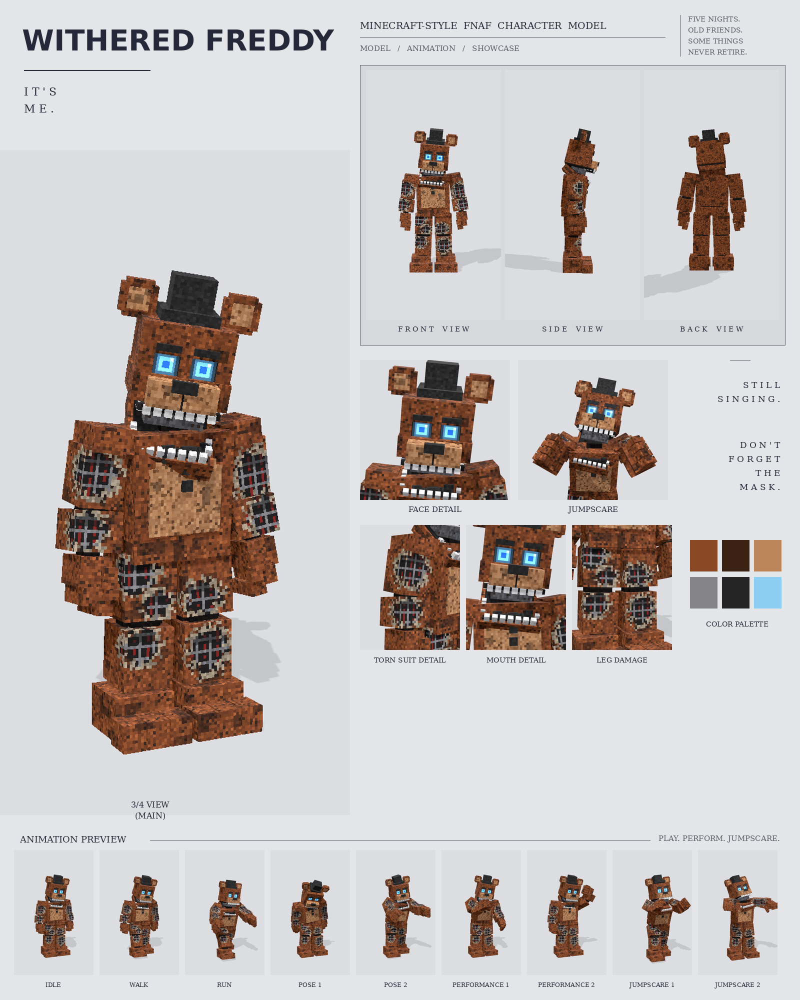

# Withered Freddy: Minecraft-style FNAF model

This is a Blockbench model of Withered Freddy in the **Bedrock Entity** format, built from the Withered Freddy reference picture. It includes:

- 123 cubes and 26 bones
- a 512×256 texture painted at 3 texels per model pixel
- 9 animations in a broken-animatronic style: idle, walk, run, pose 1, pose 2, performance 1, performance 2, jumpscare 1 and jumpscare 2



## Files

| File | What it is |
| --- | --- |
| `withered_freddy.bbmodel` | **Open this in Blockbench.** It contains the geometry, the embedded texture and all 9 animations. |
| `preview/withered_freddy_preview.mp4` | Preview video: turnaround, close-ups, then every animation |
| `preview/withered_freddy_sheet.png` | Character sheet |
| `textures/withered_freddy.png` | Texture atlas (the same one embedded in the .bbmodel) |
| `textures/withered_freddy_emissive.png` | Glow mask for the eyes |
| `bedrock/` | Resource-pack-ready files. They match Blockbench's own *Export Bedrock Geometry / Animations* output. |

## What's on the model

- **Fur:** rusty, grimy brown, with a stained tan belly, two black buttons and a flat black bow tie
- **Damage:** torn holes in both upper arms, both forearms, both thighs and both shins. Each shows the endoskeleton: a dark cavity, grey bars, red wires and a frayed rim.
- **Head:**
  - jaw hanging open, with spaced white teeth on both jaws and the grey endoskeleton skull visible inside
  - glowing light-blue eyes with darker blue centres, under flat, relaxed brows
  - round ears with tan inner patches, and a large black top hat
- **Joints:** near-black joint gaps
- **Feet:** big three-toed feet

## Rig

```
root
├─ body (pelvis)
│  └─ torso (chest, belly, buttons, bow tie, neck)
│     ├─ head ─ jaw, eyes, hat, rightEar, leftEar
│     ├─ rightArm ─ rightForearm (mic) ─ rightHand ─ rightFingers, rightThumb
│     └─ leftArm  ─ leftForearm  ─ leftHand  ─ leftFingers, leftThumb
├─ rightLeg ─ rightShin ─ rightFoot
└─ leftLeg  ─ leftShin  ─ leftFoot
```

The reference has no microphone, so the `mic` bone is stored out of sight inside the right forearm. Only performance 1 slides it into his hand.

## Animations

All nine clips move like a broken animatronic at night. Each part (head, torso, each arm, legs, jaw, ears) moves like its own servo: it jumps, stops dead with a small overshoot, and holds. On top of that come glitchy twitches.

| Animation | Length | Notes |
| --- | --- | --- |
| `animation.withered_freddy.idle` | 6.0 s loop | Sagging and still, scanning the room in servo jerks, with sudden head and arm twitches and the jaw hanging open |
| `animation.withered_freddy.walk` | 1.8 s loop | A stiff limp: the left leg drags, the body lurches onto it, the jaw flaps |
| `animation.withered_freddy.run` | 0.8 s loop | A rigid chase with arms locked out, the head juddering and the jaw chattering |
| `animation.withered_freddy.pose1` | 2.0 s loop | Powered down: slumped, head lolling, jaw hanging wide, the odd twitch |
| `animation.withered_freddy.pose2` | 2.0 s loop | Stalking: arms reaching forward with fingers spread, head cocked |
| `animation.withered_freddy.performance1` | 4.0 s loop | The same calm stage song as Classic Freddy, but slower and broken: head tilted, jaw hanging, and a stall and twitch mid-song. The mic slides out of his forearm into his hand. |
| `animation.withered_freddy.performance2` | 4.0 s loop | A slow, lagging wave, then a broken "har har har" with a head jerk |
| `animation.withered_freddy.jumpscare1` | 1.25 s, plays once | Lunges at the camera with the jaw gaping, then the violent head shake |
| `animation.withered_freddy.jumpscare2` | 1.5 s, plays once | Slumped and powered down, then snaps awake with arms flung wide and head jerking |

- Keyframes are linear on Blockbench's 24 fps grid, so the holds stay perfectly still.
- An IK solver keeps the mic at his mouth during performance 1.
- In every clip, the feet stay on the ground.

## Using it in a Bedrock addon

Copy `bedrock/` into your resource pack:

| Copy | To |
| --- | --- |
| `models/entity/` | `RP/models/entity/` |
| `animations/` | `RP/animations/` |
| `animation_controllers/` | `RP/animation_controllers/` |
| `render_controllers/` | `RP/render_controllers/` |
| `entity/` | `RP/entity/` |
| `textures/entity/withered_freddy/` | `RP/textures/entity/withered_freddy/` |

- **Identifier:** the client entity uses `fnaf:withered_freddy`. If your addon uses a different namespace, change it to match.
- **Glowing eyes:** the client entity uses `withered_freddy_glow.png` with the `entity_emissive_alpha` material, so the eyes glow in-game. Use `withered_freddy.png` with `entity_alphatest` if you don't want the glow.
- **Size:** about 2.9 blocks to the top of the head and 3.2 blocks to the top of the hat.
- **Animation triggers:** the same `query.ground_speed` and `minecraft:mark_variant` setup as classic Freddy (see [../freddy/README.md](../freddy/README.md)):

| mark_variant | Animation |
| --- | --- |
| 1 | pose1 |
| 2 | pose2 |
| 3 | performance1 |
| 4 | performance2 |
| 5 | jumpscare1 |
| 6 | jumpscare2 |

The jumpscares play once. After one finishes, set `mark_variant` back to 0.

## How close is it to the reference?

These match the picture:

- the proportions, measured from the reference
- the colours, sampled from it
- every part listed above

These differ:

- The fur and damage are procedural textures in the reference's colours, not a pixel copy.
- The torn holes are painted on. The reference shows them as recessed 3D cut-outs.
- The animations are my own, since the reference is a single pose.
