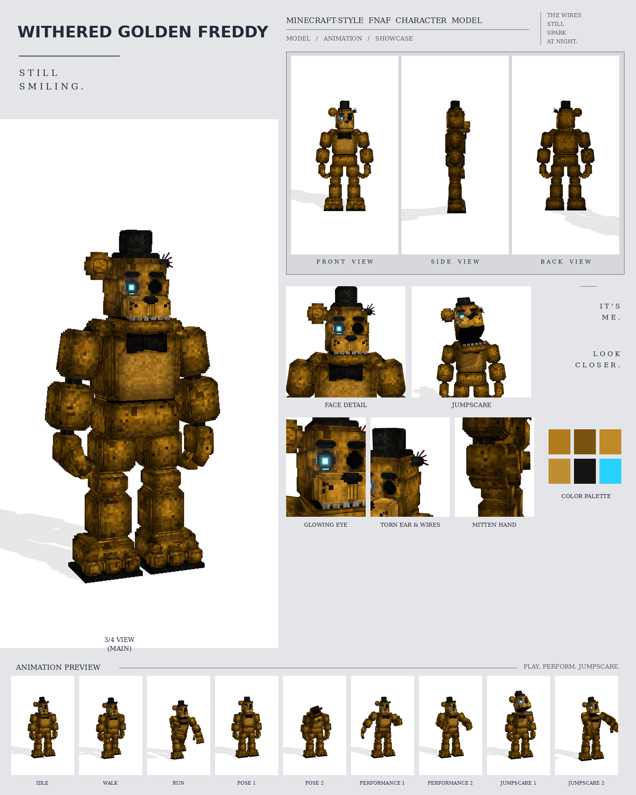

# Withered Golden Freddy: Minecraft-style FNAF model

This is a Blockbench model of Withered Golden Freddy (the movie Golden Freddy) in the **Bedrock Entity** format, built from your two pictures: the straight front view and the 3/4 view.

It's built on the same parts and at the same scale as the other picture replicas (Golden Freddy, Crimson Freddy, Violet Bunny, Rustgrin, Mirehop, Noxbriar), so it stands as tall as they do. No part is enlarged or shrunk.

Every width, height and position was measured in pixels on the front picture, part by part, at the replicas' shared scale of 26 picture pixels per model pixel: the hat, head, ears, brows, eye sockets, nose, muzzle, freckles, mouth, jaw, bow tie, belly, chest, pelvis, shoulder caps, both arm segments, the mitts, thighs, knee caps, shins and feet. The model was then rendered from the front picture's camera and its outline laid over the picture's, and every part was adjusted until the two lined up: **they overlap by 93%**. The depths, which a front view can't show, were checked the same way against the 3/4 picture (88% overlap). The colours were matched by sampling the render and the picture in the same places.

It includes:

- 453 cubes and 50 bones
- a 1024×1024 texture painted at 4 texels per model pixel (the glowing eye at 32), with soft light and shadow baked in
- 9 animations in an animatronic style: idle, walk, run, pose 1, pose 2, performance 1, performance 2, jumpscare 1 and jumpscare 2



## Files

| File | What it is |
| --- | --- |
| `withered_golden_freddy.bbmodel` | **Open this in Blockbench.** It contains the geometry, the embedded texture and all 9 animations. |
| `preview/withered_golden_freddy_preview.mp4` | Preview video: turnaround, close-ups, then every animation |
| `preview/withered_golden_freddy_sheet.png` | Character sheet |
| `textures/withered_golden_freddy.png` | Texture atlas (the same one embedded in the .bbmodel) |
| `textures/withered_golden_freddy_emissive.png` | Glow mask for the eye |
| `bedrock/` | Resource-pack-ready files, in the same format as Blockbench's own *Export Bedrock Geometry / Animations*. |

## What's on the model

- **Fur:** mustard gold with soft darker-brown patches; a lighter belly
- **Head:**
  - a small black top hat
  - flat, sharp-edged black brows
  - the right eye glowing cyan: a bright square core and a cyan iris drawn in square pixels, a soft glow in the black socket and a cyan rim along the socket's edge
  - the left eye an empty black socket with a torn rim
  - the right ear a rounded square, with a raised rim around a square inner panel; the left ear torn off, leaving a grey mechanical stub with red, black and grey wires hanging out of it
  - a big muzzle split down the middle, with three black freckles on each side and a wide, flat black nose
  - a dark mouth line with grey teeth, over a heavy lower jaw
- **Chest:** a big black bow tie
- **Hands:** working mitten hands that hang as in the front picture: the back of the hand facing forward (turned a little toward the leg), the four thick fingers half bent and the thumb on the inner side. Each finger is a chain of three blocks.
- **Arms and legs:** two cap blocks on top of each shoulder; chunky upper arms angled out from dark ball joints and forearms hanging nearly straight; thick thighs and shins with a knee cap block on each knee. Every limb block has its corners cut back in steps, like the picture.
- **Feet:** big three-toed feet on black soles, as wide as in the picture, with a raised block over the toes under each ankle

## Rig

```
root
├─ body (pelvis)
│  └─ torso (chest, belly, bow tie, neck)
│     ├─ head ─ jaw, eyes ─ eyeGlow, hat, rightEar, leftEar (the torn stub and its wires)
│     ├─ rightArm ─ rightForearm ─ rightHand ─ rightFinger1a ─ 1b ─ 1c (one chain per finger), rightThumba ─ b
│     └─ leftArm  ─ leftForearm  ─ leftHand  ─ leftFinger1a ─ 1b ─ 1c ..., leftThumba ─ b
├─ rightLeg ─ rightShin ─ rightFoot
└─ leftLeg  ─ leftShin  ─ leftFoot
```

- The glowing eye has its own bone, `eyeGlow`, so the clips can make it flicker. Set its scale to 0 to switch the eye off.
- The hands hang with the back of the hand facing forward, turned 15° toward the leg, and the thumb on the inner side. Each finger is a chain of three bones with no rest rotation, so a positive X rotation bends any joint into a fist.

## Animations

All nine clips move like an animatronic at night: each part jumps to a new position, stops dead with a small overshoot, and holds. Keyframes are linear on Blockbench's 24 fps grid. Withered Golden Freddy is a half-broken, lopsided suit. Its head lists to one side, the torn wires short out and jerk its head, and the glowing eye flickers off and back on.

| Animation | Length | Notes |
| --- | --- | --- |
| `animation.withered_golden_freddy.idle` | 6.0 s loop | Lopsided and slack-jawed, the head drifting in servo steps; sparks jerk the head and the eye flickers; the fingers twitch |
| `animation.withered_golden_freddy.walk` | 2.0 s loop | A stiff, heavy shuffle with a hitch on the left side; a spark mid-step |
| `animation.withered_golden_freddy.run` | 0.9 s loop | A lurching charge, both mitts reaching out in front, palms down |
| `animation.withered_golden_freddy.pose1` | 3.0 s loop | The front picture: standing square, facing front, the fingers half bent; then a slow look aside, one spark and flicker |
| `animation.withered_golden_freddy.pose2` | 4.0 s loop | Powered down: the head sags onto its chest and the eye is dark; the eye flickers on, the head snaps up and stares, then it sags again |
| `animation.withered_golden_freddy.performance1` | 4.0 s loop | An old crooner's song: swaying, one mitt on the chest, the other sweeping out palm up, then tipping the hat; the jaw follows the lyrics |
| `animation.withered_golden_freddy.performance2` | 4.0 s loop | A broken jig: side steps and knee lifts that seize up halfway, with sparks and flickers, then carry on |
| `animation.withered_golden_freddy.jumpscare1` | 1.4 s, plays once | Only the head comes at you: it lunges off the shoulders, jaw wide, the eye flaring, then the shaking scream |
| `animation.withered_golden_freddy.jumpscare2` | 1.6 s, plays once | Slumped and dark, then it jolts upright and lunges with its arms flung out, screaming |

## Using it in a Bedrock addon

It's in its own add-on, [`../addon/FNAF_Withered_Golden_Freddy.mcaddon`](../addon/README.md), with a spawn egg and events. To use it in your own resource pack instead, copy `bedrock/` into it:

| Copy | To |
| --- | --- |
| `models/entity/` | `RP/models/entity/` |
| `animations/` | `RP/animations/` |
| `animation_controllers/` | `RP/animation_controllers/` |
| `render_controllers/` | `RP/render_controllers/` |
| `entity/` | `RP/entity/` |
| `textures/entity/withered_golden_freddy/` | `RP/textures/entity/withered_golden_freddy/` |

- **Identifier:** the client entity uses `fnaf:withered_golden_freddy`. If your addon uses a different namespace, change it to match.
- **Glowing eye:** the client entity uses `withered_golden_freddy_glow.png` with the `entity_emissive_alpha` material, so the eye glows in-game.
- **Size:** about 3.2 blocks to the top of the head and 3.5 blocks to the top of the hat.
- **Movement:** the animation controller plays idle, walk or run based on `query.ground_speed`.
- **Poses, performances and jumpscares:** these play when the behavior entity's `minecraft:mark_variant` value is set:

| mark_variant | Animation |
| --- | --- |
| 1 | pose1 |
| 2 | pose2 |
| 3 | performance1 |
| 4 | performance2 |
| 5 | jumpscare1 |
| 6 | jumpscare2 |

The jumpscares play once, and the add-on's behavior pack returns the character to idle afterwards.

## How close is it to the picture?

These match the picture:

- every size and position, measured in pixels on the front picture
- the outline from each picture's own camera: 93% overlap with the front picture, 88% with the 3/4 picture
- the colours, sampled from the front picture
- every part listed above

These differ:

- Neither picture shows the back, so it's estimated. The 3/4 picture constrains the depths only loosely.
- The pictures look AI-generated, so their perspective isn't perfectly consistent (the picture's head sits a few pixels left of the body's centre line, and the two views don't agree exactly). The model is symmetric and follows the front view.
- The fur is a procedural pattern of small blocks in the picture's colours, not a pixel copy of the picture.
- The animations are my own, since the pictures show a single pose. Pose 1 recreates the pose in the front picture.

## Rebuilding

From the `fnaf_addon/` folder:

```bash
python3 tools/build.py withered_golden_freddy
cd tools/render && node render.mjs withered_golden_freddy video && python3 make_sheet.py withered_golden_freddy
```

The geometry is in `tools/characters/withered_golden.py` and the animations are in `tools/characters/withered_golden_anims.py`. Both build on `fred3.py` and `vested.py`.
