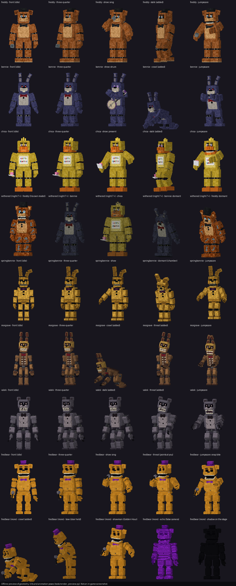

# 07 · Construction procedure and assets

The map is not shipped as a world file. It is **constructed in your own world by the behavior pack** from a
deterministic build plan (`scripts/data/build_plan.js`), so it can be rebuilt, repaired and checked at any time.
The same plan drives the offline voxel model used by every map test, and the integration tests prove that the
in-game builder produces exactly that model (docs/10).

## Stage 0 — world requirements

* A **Flat** world (default flat preset: grass at y −61). The plinth is built from y −61 to y −52 and everything
  above is cleared, so other terrain also works, but Flat avoids caves and water under the property.
* Cheats **on** (needed for `/fb:setup` and for command blocks), behavior pack **FREDBEAR: Six Nights Below (Behavior)**
  active (it pulls in the resource pack as a dependency). No experiments.
* Stand anywhere; the build area is world x −12..211, z −12..211, y −61..−10.

## Stage 1 — `/fb:setup` (automatic)

`/fb:setup` (or `/function fb/setup`) starts `Builder.start()`:

1. **Palette check.** All 253 block permutations are resolved with `BlockPermutation.resolve`; any failure is reported.
2. **World policy.** `gamerule commandblocksenabled true`, `commandblockoutput false`, `sendcommandfeedback false`,
   no daylight/weather cycles, no mob spawning, `time set 18000`.
3. **Ticking areas** `fb_nw`, `fb_ne`, `fb_sw`, `fb_se` (8 × 8 chunks each, docs/02).
4. **Wait for chunks**: 197 probe points must report loaded.
5. **Plan phases** (time-sliced with `system.runJob`; fills above 32,768 blocks are split into columns, one per job step):

   | Phase | Operations | Blocks written | Contents |
   |---|---:|---:|---|
   | terrain | 123 | 2,611,384 | clear the volume, plinth, earth berm |
   | shell | 682 | 516,735 | floors, walls, ceilings and roofs of the 62 rooms by style, structural solids, brick façade |
   | openings | 147 | 1,642 | doors, archways, windows (boarded where broken) |
   | stairs | 389 | 1,349 | 8 stairways/ladders/hatch with railings |
   | decor | 812 | 11,839 | room kits (≈50): stage, tables, arcade cabinets, kitchen, parts bins, posters, webs, lights…; then 40 soft hidden camera lights (light blocks 6/8/10 where each camera looks, none near the office corners) |
   | exterior | 188 | 11,045 | plaza, parking, roads, loading dock and truck, fence, dead trees, rooftop billboard |
   | consoles | 8 | 69 | console blocks under every control |
   | *(structures)* | 30 | 448 | command-block structure files, see below |
   | controls | 4 | 75 | buttons, levers on the consoles |
   | signs | 196 | 196 | room story signs, control labels, control-room labels (waxed) |

   Progress is saved in `fb:build` every 24 operations: if the world closes, run `/fb:setup` again and it resumes.
6. **Command blocks.** After the consoles phase, each of the 30 files in `structures/fb/` is placed with
   `world.structureManager.place()` at the origin listed in docs/06 "Structure files".
7. **Verification.** Every input command block must exist where registered; errors are listed in a *Build report* form.
8. **Lobby.** A full reset puts you at the time clock.

`/fb:setup true` (or `/function fb/rebuild`) rebuilds from scratch. Run `/fb:debug selftest` afterwards: it should
report 9 PASS lines (palette, structures, command blocks in place, actuator round trip, heartbeat, AI routes clear,
camera positions in open air, one puppet per animatronic, chunks loaded).

## Stage 2 — manual fallback for command blocks

Only needed if the self-test reports missing command blocks or a failed round trip.

1. **Load the structure files by hand.** For each row of docs/06 "Structure files":
   `/structure load fb:cb_row_0 23 -59 169` (identifier, then the world origin). A Structure Block in *Load* mode with
   the same name and offset works too.
2. **If a structure cannot be loaded at all**, rebuild its modules from docs/06 "Every command block" (or
   `docs/command_blocks.csv`). For each row: place the block type at the listed world coordinates facing the listed
   direction (modules face **east**, input blocks face **up**), set *Unconditional*, set *Needs Redstone* for impulse
   blocks and *Always Active* for chain/repeating blocks, enter the tick delay and paste the exact command.
   The first (impulse) block of each module sits one block east of its redstone pad and its command clears that pad.
3. Re-run `/fb:debug selftest`.

## Resource pack assets

Every animatronic is now one of the owner's models (`art/models_incoming/`), imported by `tools/owner_models.py`
(Fredbear by `tools/fredbear_v6.py`): since 1.5 **Freddy** is the owner's **Classic Freddy** (`Classic_Freddy_Pack.zip`),
whose withered look on nights 7-9 is the pack's own **Withered Freddy** model, **Bonnie** is the **Midnight Banjo Bonnie**
(`Bonnie_Midnight_Banjo.zip`, built on the Classic Freddy body), **Springbonnie** comes from `Springbonnie_Spotty.zip`, and
**Chica** is built by `tools/chica_classic.py` on the Classic Freddy body itself (same shells, height, eye rig and
animations). Morgrave and Valek are the 1.3 imports. The skin-built Freddy, Bonnie, Chica and Fredbear and the earlier
Freddy V6 / Bonnie V2 zips are kept outside the game (`art/models_archive/`, `art/models_incoming/`).
`tools/gen_rp.py` regenerates every file below deterministically.

| Asset | Files | Notes |
|---|---|---|
| Fredbear V6 | `models/entity/fb_fredbear.geo.json` (43 bones, 730 cubes), `textures/entity/fb/fredbear.png` (256×256), `animations/fb_fredbear.animation.json`, `controller.animation.fb.fredbear` | imported unchanged except the geometry id and wider visible bounds; 12 own clips plus crawl, stalk, dormant and chained shows |
| Freddy, Bonnie, Chica (1.5) | `models/entity/fb_{freddy,bonnie,chica}.geo.json`, `textures/entity/fb/<who>.png` (1024×1024), `animations/fb_<who>.animation.json`, `animation_controllers/fb_<who>.animation_controllers.json` | one shared scale (0.897), so Freddy with his hat is 3.16 blocks tall like the Freddy he replaces and the three bodies match. Own clips: idle, walk, run, the stare and the showman / wave / menacing poses, two shows each (Freddy sings and presents, Bonnie strums and plays his banjo show, Chica presents Mr. Cupcake and "sings"), and each one's own jumpscare. Added: crawl, stalk, threat and dormant, the hunting clips with Freddy's black "active" eyes |
| Chica (1.5, built) | `tools/chica_classic.py` | the Classic Freddy body recoloured (yellow suit, cream belly, violet irises), ears, hat, nose and bow tie removed, an orange beak (upper beak with a jutting tip, the jaw as the lower beak keeping Freddy's eight teeth), three feathers, orange feet, the LET'S EAT!!! bib and Mr. Cupcake on a plate in the microphone's hand; new parts are painted into atlas texels no kept face uses |
| Withered Freddy (1.5) | `models/entity/fb_freddy_withered.geo.json`, `textures/entity/fb/freddy_withered.png` (+ eye layer) | the pack's own model, drawn instead of the classic one when `fb:variant` is 1 (`controller.render.fb.withered_geo` and `..._eyes`: geometry and texture arrays), animated by the classic clips |
| Withered skins | `textures/entity/fb/{bonnie,chica}_withered.png` | darker, grimy, torn patches showing the endoskeleton; used from night 7 and in the challenges (`fb:variant` 1, `controller.render.fb.withered`) |
| Springbonnie (1.5) | `models/entity/fb_springbonnie.geo.json`, `textures/entity/fb/springbonnie.png`, `animations/fb_springbonnie.animation.json` | 3.45 blocks tall with his ears (scale 0.717); own clips including his threat pose and jumpscare; added crawl, stalk, dormant; eye layer from the white pupils on his head |
| Morgrave, Valek (1.3) | `models/entity/fb_{morgrave,valek}.geo.json` and their textures, animations and controllers | 4 own clips each plus the added ones; Valek's `fb:variant` 1 shows only his eyes |
| Eye layers | `*_eyes.png` | only each model's own eye texels (bright pupils / irises); drawn with the vanilla `creaking_eyes` material and `ignore_lighting`, shown when `fb:eyes` is true |
| Camera map HUD | `ui/hud_screen.json`, `textures/ui/fb/cam_map.png`, `textures/ui/fb/cam_map_c01..c23.png` | generated by `tools/gen_cam_map.py` from the floor plan data: ground floor and basement outlines, one numbered box per camera, YOU in the office |
| Fredbear echo / shadow | `fredbear_echo.png`, `fredbear_shadow.png` (+ eye layers) | purple, scan-lined copy for false camera events; a black silhouette with white eyes for Shadow Fredbear. One entity, the texture chosen by `fb:variant` |
| Render controllers | `controller.render.fb.animatronic`, `.eyes`, `.withered`, `.withered_geo` (+ `_eyes`), `.valek`, `.echo` (+ `_eyes`) | `fb:hidden` hides the whole model (vent crawls) |
| Sounds | `sounds/fb/**.ogg` (62 ids), `sounds/sound_definitions.json` | **recordings supplied by the map owner** (`art/sounds_incoming/`, converted by `tools/gen_sounds.py`): the animatronic jumpscare and Fredbear's own jumpscare, the storm-door slam (door / hatch closing), the metal door (opening), camera up / down, the looping CCTV hum while the monitor is up, Freddy's laugh (4 cuts), Fredbear's laugh (4 cuts), the night music, Fredbear's music box (*Fredbear's Family Diner*) and Chica's kitchen (*Chica in the Kitchen*, 5 takes). **Synthesised**: footsteps, lights, power, breaker, strobe, seals, clock chimes, phone, ambience, groan, breathing, Freddy's music box, roar, glitch, finale, ending theme, the fire of the burn ending, Morgrave's scrape and knocks, Valek's hum and vanish, (1.5) Springbonnie's steps and springlock twang. Freddy's music box plays Bizet's *Toreador March* (public domain); all other synthesised melodies are original |
| Night music | `sounds/fb/night/bgm.ogg` (`fb.night.bgm`, category `music`, `stream: true`) | *PIZZA DINNER* from the FNAF 1 Remake fan-game soundtrack, supplied by the map owner; looped by `playMusic` from 12 AM to 6 AM |
| Texture sets (Vibrant Visuals) | `textures/entity/fb/*.texture_set.json`, `textures/items/*.texture_set.json` | one per texture, uniform MER (metalness, emissive, roughness 0-255): `[0, 0, 200]` for suits and icons, `[0, 255, 255]` for the eye layers (they glow), `[0, 60, 220]` for the echo; the RP manifest declares the `pbr` capability |
| Fogs | `fogs/fb_night_{1..9}.json`, `fogs/fb_camera_feed.json`, `fogs/fb_flashback.json`, `fogs/fb_ending_fire.json` | night fogs get darker and closer each night; while the camera monitor is up the clear camera fog replaces them |
| Items | `textures/items/fb_{tablet,remote,guide}.png`, `textures/item_texture.json` | 16×16 icons |
| Text | `texts/en_US.lang`, `texts/languages.json` | entity and item names |
| Pack icons | `pack_icon.png` in both packs | faces from the supplied skins |



The preview sheet is rendered offline by `tools/render_preview.py` from the geometry and textures (front,
three-quarter, a frame of each character's performance, an added clip and the threat pose, sampled from the real
animation files; Withered Freddy and the withered skins; Springbonnie; Morgrave's crawl and Valek's stalk and their
jumpscares; for Fredbear also his crawl, bow, showman, a jumpscare, and the echo and shadow). It checks UV mapping, accessory placement and that props sit in the hands; **it is not an in-game screenshot**.

## Time-clock room (lobby) rework

The lobby was rebuilt for 1.2 (`lobbyKit` in `data/kits.js`): a terminal wall with the night buttons (nine since 1.3), CONTINUE and
FREE ROAM, a **challenge console** with four lamps (lit once a challenge is beaten), a **newspaper board** whose
button opens the clippings, lockers along the west wall, benches and posters.

## 1.3 additions to the map

* **Cameras**: CAM 17 (office subfloor), CAM 16 (supply duct), CAM 23 (Fredbear's chamber), CAM 21 (diner party room),
  CAM 20 (diner kitchen); the tabletop map gains a column of buttons.
* **Supply duct** (`VENT_DUCT`, y -3..-2 under the supply closet floor to the left door corner) with the **vent seal** and
  a **shaft seal** in the crawlspace; their shutters and lamps are command-block modules (`seal.*`).
* **Parts & Service**: three storage spots for the trio on nights 7 and 9, and Valek's spot.
* **Lore** (`data/lore.js`): the sealed 1983 birthday party in the old diner (table, cake, candles relit by `night.begin`,
  presents, banner), the wall of names in Fredbear's chamber (the player's name is added after night 6), and the 1987 crew
  graffiti in the west maintenance tunnel. The office gets the TAPE DECK button.

## 1.4 additions to the map

* **Ceiling vent** (`data/visitors.js` `CEILING_VENT`, layout stair kind `ceilvent`): the office ceiling (y 6) is cut open
  over the desk at x 101-102, z 127-128, under a 2 × 2 grate of iron trapdoors in the crawlspace floor (y 7). The crawlspace
  strip above the office (x 95-113, z 126-129 on L2) is reserved so nothing is built into it. Command-block modules
  `grate_open` / `grate_close` flip the trapdoors, set the grate lamp on the office's north wall (green / amber) and play the
  door sound; `night.begin` and `night.end` close it.
* **VENT GRATE** button at the right end of the tabletop camera map (input `in.office.vent_grate`), with a sign.
* **CAM 12 · CEILING VENT** in the crawlspace, looking along it at the grate.
* **Cameras renumbered** in walking order (neighbouring cameras, neighbouring numbers): 01 show stage, 02 backstage,
  03 Parts & Service, 04 Starlight Cove, 05 arcade, 06-07 dining hall west / east, 08 kitchen (audio), 09 east service,
  10 east hall, 11 east corner, 12 ceiling vent, 13 west corner, 14 west hall, 15 supply closet, 16 supply duct, 17 office
  subfloor, 18 maintenance tunnel, 19 diner kitchen, 20 diner party room, 21 sealed diner, 22 Fredbear's chamber. The
  console buttons keep their places; their labels, the HUD map and every reference follow the new numbers.
* `tools/validate_map.mjs` checks the vent (hole and grate), the floor and headroom along Morgrave's knock-to-pass paths
  and that each of Valek's eye points is visible from the office seat (the grate and the door windows are see-through).
* **Jumpscare framing**: `tools/gen_jumpscare_reach.py` (run by the build after the RP art) writes
  `data/jumpscare_reach.generated.js`, the distance each animatronic stands from the camera (docs/04).

## 1.5 additions to the map

* **The workshop** (`NIGHTMARE`, L0, x 16-58, z 116-140, style `nightmare`: a stained black-and-grey checker floor, party
  wallpaper gone black), owner item 178: reached in Free Roam through a crawl hole in the south wall of the old crawlspace.
  The north wall is covered in scratched eyes with an old TV showing grey static between them; three rows of little
  chairs face it; endoskeleton heads hang from hooks; a workbench of faces in progress stands on the south wall;
  Morgrave's nest of stuffing fills the south-west corner and Valek's corner (south-east) is pitch black with painted eyes.
  Morgrave (`M_HOME`) and Valek (`V_HOME`) start every night there.
* **CAM 19 · THE WORKSHOP** on the north wall, and its map button at the desk's north-west corner (map cell [-2, 0],
  x 96; the cake moved to the lockers). The basement cameras after it moved up one (diner kitchen 20, party room 21, sealed
  diner 22, Fredbear's chamber 23) so the numbers stay in walking order.
* **Springbonnie's spot** (`SB_HOME`) beside Fredbear's in the chamber (CAM 23 shows both).

## 1.6: the ground floor and the office rebuilt

Owner item 188 ("switch up the pizzeria, make the whole place better, even the office, rebuild everything"; the owner
chose a new layout, bigger and creepier). Everything west of the staff wing on the ground floor was redrawn
(`data/layout.js`); the office, its two door corners, the supply closet and its duct, the staff wing, the reception, the
upper floor and the basement keep their coordinates, so the office systems, the duct, the hatch shaft and every basement
route line up as before. The show stage also keeps its coordinates (x 82-118, z 14-30), so its spotlights, the
animatronics' homes and the stage actuators are unchanged.

* **The Fredbear Theatre** (`THEATRE`, x 70-130, z 12-64, 14 high, style `theatre`: worn red carpet with a black-and-white
  aisle, red velvet walls between black pilasters, a gold band, a dark purple upper wall): the stage, red curtains, a gold
  frame, a catwalk across the hall at y 7 (reached from the stage loft), rows of seats with an aisle, and a 17-wide arch
  into the dining hall. Backstage (x 52-70) and Prop & Costume Storage (x 130-148) are its two wings; the stage loft moved
  above the props room.
* **West side**: Parts & Service (unchanged), the **Play Place** (`PLAY_PLACE`, ball pit, climbing frame, slide),
  **Fredbear's Starlight Cove** (`COVE`, a side stage behind a purple curtain with a gap, a starry backdrop), the **arcade
  hall** (`ARCADE`, x 16-70, z 70-92) and the **party wing** (`PARTY_HALL` and Party Rooms 1-3).
* **Dining hall** (`DINING`, x 70-148, z 64-100, 10 high): quartz pillars, long party tables, hanging lanterns.
* **East side**: Party Room E (between the props room, the kitchen and the dining hall), Party Room D (unchanged place).
* **Two winding halls**: `W_HALL_N` → `W_HALL_T` → `W_HALL` and `E_HALL_N` → `E_HALL_T` → `E_HALL`, each with two blind
  bends; the photo booth (`PHOTO`) and the prize corner sit inside the bends, Party Room A between the halls on the dining
  side and **Party Room B** right above the office, joining both bends (Bonnie's flank route). The hall flicker modules
  now cover all three legs of each hall.
* **Route graph** (`data/nodes.js`): new nodes `PLAY`, `PW` (party wing), `PE` (Party Room E), `WH_T` and `EH_T` (the
  bends); the others moved into the new rooms. 60 nodes, 66 edges.
* **Cameras**: 25 (new: **CAM 04 · PLAY PLACE** and **CAM 07 · PARTY WING**), renumbered in walking order. The hall
  cameras (CAM 12 east, CAM 16 west) hang at the last bend and look down the straight run to the door; the bends, the party
  rooms and the photo booth are blind. The console map (`CAMERA_MAP_LAYOUT`) now uses 25 of the 26 cells; the HUD map
  (`tools/gen_cam_map.py`) has new boxes for the new rooms.
* **The office** (`officeKit`, style `office`): a black-and-white checker band round the walls, grimy grey panels above;
  the desk runs out to both corners with a fan (west) and Chica's cupcake (east); children's drawings on the west wall; a
  CELEBRATE! poster (red band, Freddy, Bonnie and Chica) on the east wall. **SEAL VENT**, **SEAL SHAFT** and **VENT GRATE**
  moved from the desk to the **back counter** (x 98, 99, 100, z 139) with their lamps on the back wall above them
  (x 98-100, y 2); every other button keeps its place.
* **Moved inputs**: secret 02 (spare head shelf) to backstage (68, 0, 14), secret 03 (cove backstage) to the cove
  (68, 0, 42), the cove pressure plate to (56, 0, 62) and the backstage plate to (66, 0, 34) (it used to sit on Bonnie's
  route). The cove curtain shiver (`zone.cove`) now closes the gap in the cove curtain (x 62, z 51-54).
* **Build version 7**: worlds built with an older version ask for `/fb:setup`.
* Balance: the winding halls keep the right door shut a little longer on nights 5 and 6, so their base drain went from 5
  to 4.8 and 4.7 units per tick (docs/05).

## 1.6.2: the ceiling vent, the open grate and hatch, the clickable camera map

* **Ceiling vent centred** (`CEILING_VENT`): a 3 × 3 grate at x 99-101, z 127-129, centred across the office (x 95-105)
  above the desk; it was a 2 × 2 at x 101-102. Valek's vent eye points, CAM 14's aim and the grate actuators follow it.
  **Build version 8**: worlds built with an older version ask for `/fb:setup`.
* **Open at the start of the night**: `night.begin` now opens the grate (green lamp) and it never costs power; on nights
  with the hatch installed the game triggers `hatch_open` two ticks after `night.begin` (a bus fence keeps the order), so
  the hatch is drawn open as it really is (unsealed). Nights 1-3 keep it welded shut.
* **Clickable camera map** (`mc/ui.js` `cameraMapForm`, `ui/server_form.json` written by `tools/gen_cam_map.py`): while
  the monitor is up an ActionForm stays open; its title starts with `CAM_FORM_MARK`, and the RP draws such a form as the
  camera map in the bottom-right corner (1.5 × the HUD map) with one vanilla light button over each camera box (button k
  = `CAMERAS[k]`, bound by `collection_index`) and LOWER above it. Every other form keeps the vanilla dialog. The menu
  cursor (mouse), controller focus and touch work as in any menu. A pick sends `cam_select` and reopens the form; LOWER or
  closing the form sends `cams_close`; when the monitor goes down any other way the script closes the form
  (`uiManager.closeAllForms`). Settings → "Clickable camera map" switches it off. `tools/validate_assets.mjs` checks the
  mark, the buttons and that the vanilla dialog is kept.
* **1.6.3 fix** (owner's screenshot: no numbers, clicks did nothing): hand-placed buttons with `collection_index` do not
  get the form's button data. The buttons now come from the vanilla form-button factory (`fb_cam_form_buttons`: a stack
  panel over `form_buttons` with the `#form_button_contents` → `#collection_length` binding, like the vanilla long form).
  Each factory item is a zero-height row holding one button per camera at that camera's box, and only the button whose
  text matches the item's text ("05", or "§a05" for the live camera; "§cLOWER") is visible, so item k draws at camera k.

## 1.6.4: Freddy's active eyes

The Classic Freddy pack switches his eyes by moving two eye layers (`eyes_relaxed`: blue, `eyes_active`: black with
white pupils). Its walk, run, stare and jumpscare already use the active eyes, but the game's idle (standing on a node),
pause (showman pose) and power-out song used relaxed clips. `tools/owner_models.py` now adds `idle_active`,
`pose_showman_active` and `perform_sing_active` (the same motion, the eye bones from `eyes_active`) and maps the idle,
pause and music states to them; the stage shows and the dormant pose keep the blue eyes.

## Seasonal decorations

`tools/gen_holidays.mjs` writes `data/holiday_decor.generated.js`: Halloween (jack-o'-lanterns, pumpkins, cobwebs —
149 cells) and Christmas (three small trees in the employee room, reception and dining room, presents, lights — 409
cells). Cells are chosen only where the built map has air and where no camera sight line, route polyline, guide edge,
input or module needs the space (`forbiddenCells()`). The script places them from the device date (Halloween
15 Oct – 2 Nov, Christmas 10 Dec – 6 Jan), 48 cells per tick, and removes them again by writing air. Settings can switch
them off.

## Regenerating everything

```
npm install          # pinned typings + TypeScript (dev only)
npm run build        # structures, register, floor plans, RP art/sounds, previews, generated docs, dist/
npm run validate     # six static validators
npm test             # unit, structure and integration tests
```

Python 3 with Pillow and numpy, ffmpeg with libvorbis, and `jsonschema` are needed for the asset and schema steps.
