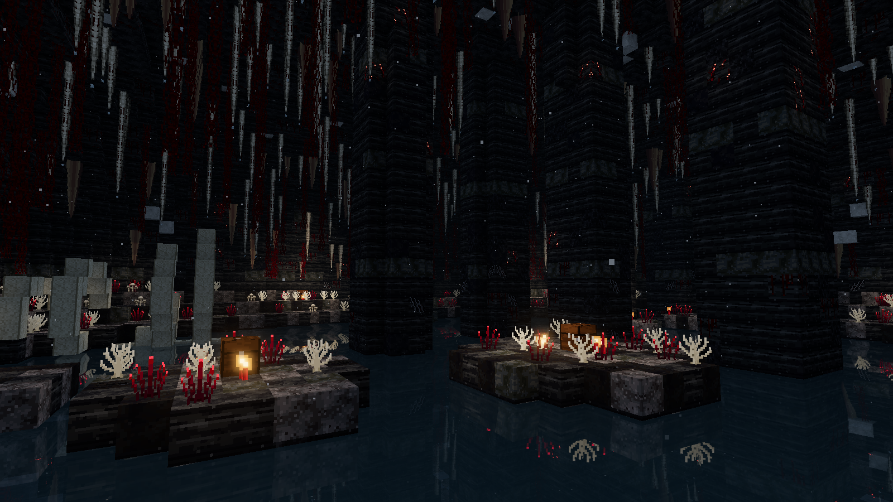
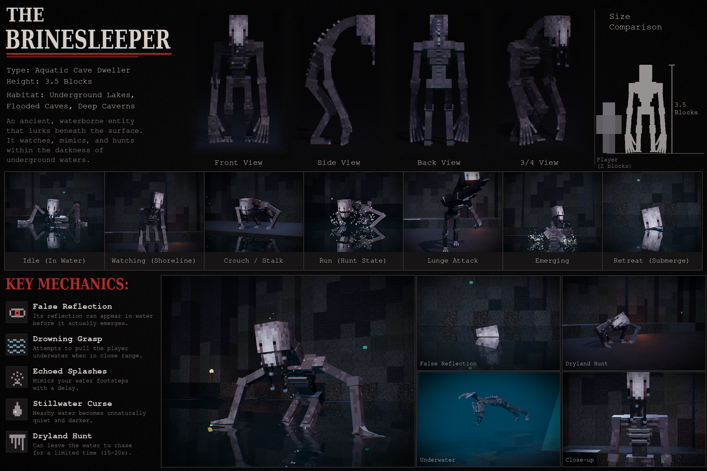
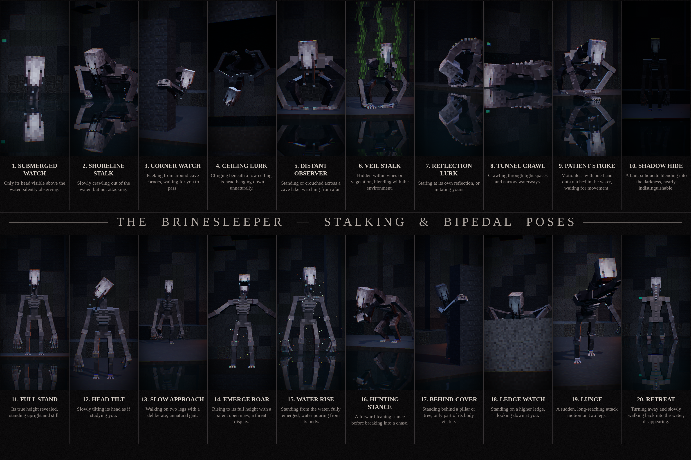
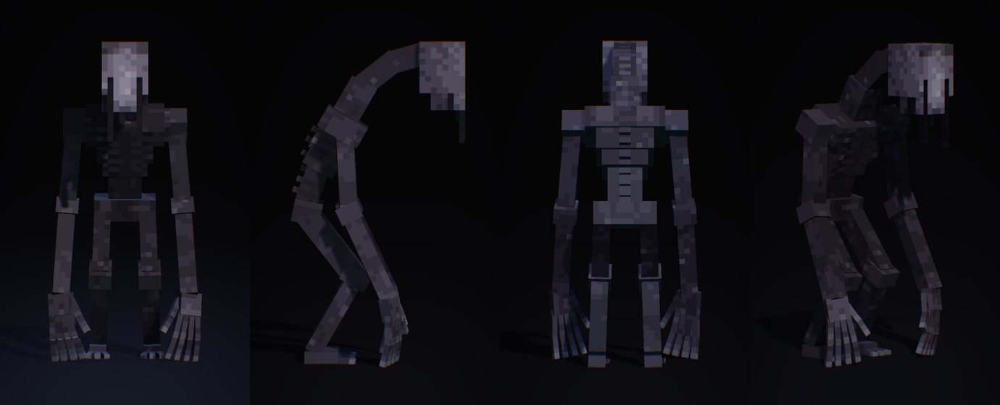
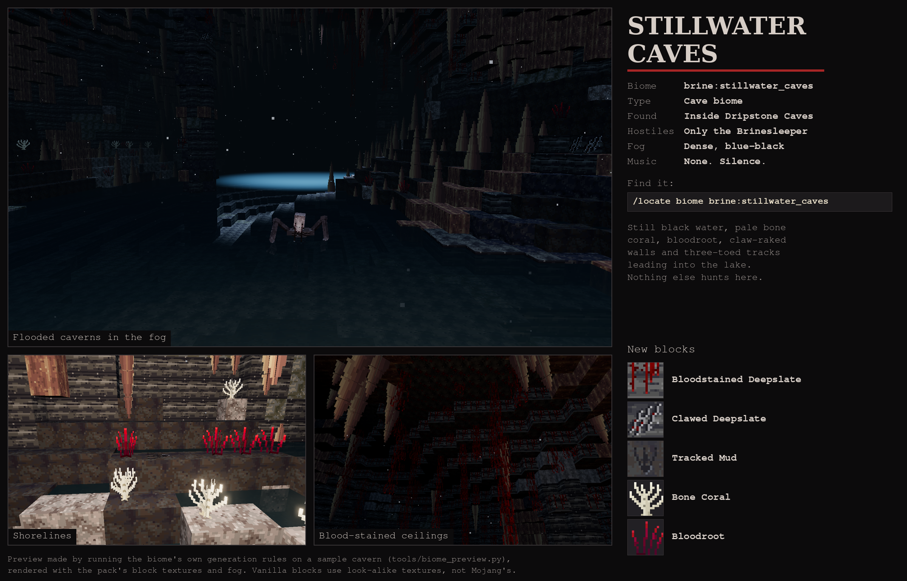
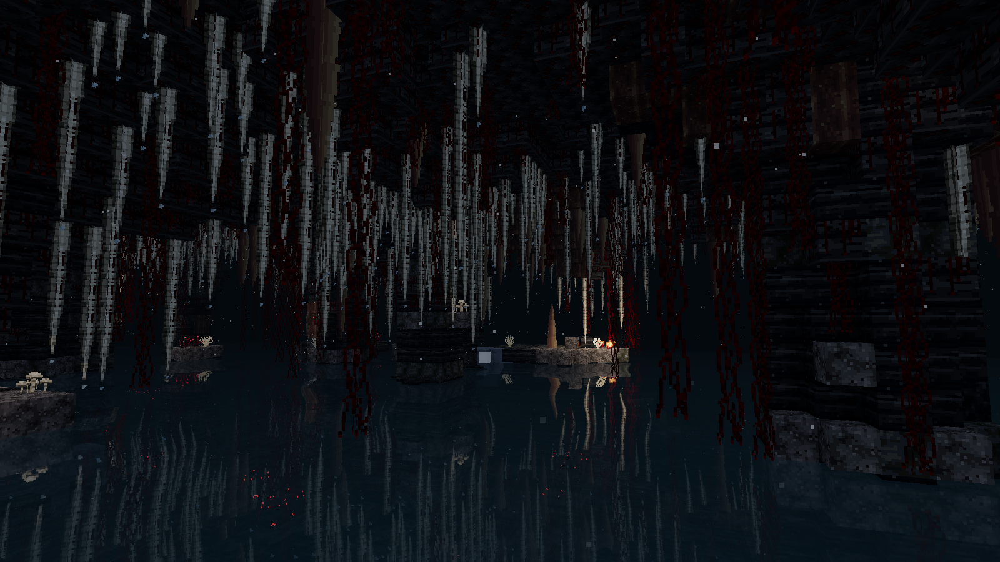

# The Brinesleeper — Minecraft Bedrock entity model

A vanilla-style Minecraft entity built from the *Brinesleeper* concept art: a 3.5-block-tall,
emaciated aquatic cave dweller. It has a long arched neck ridged with spines, a pale mask-like
face streaked with reddish tears that drip off its chin as glossy strands, a skeletal ribcage,
and arms long enough to drag its clawed hands on the ground.

It comes with its own cave biome, the [Stillwater Caves](#stillwater-caves-biome), where it is
the only hostile mob that spawns.

**Version 4.0, "The Great Water"**:
* **Every visit to its biome finds a vast flooded hall like the concept pictures.** It is
  80 × 80 blocks with a lake up to 12 deep, great pillars, islands, pale and red curtains,
  glowing veins, a sunken shrine, a ribcage, and 3–4 loot chests. The script builds one near you
  whenever you're in the Stillwater Caves, with its tunnel opening at your feet.
* **It's an aquatic predator now.** Its swimming and climbing are driven directly, so it never
  circles under a ledge again.
  * It lurks under the water and surfaces far away to watch you. Look at it and it's gone.
  * It crosses the lake toward your shore with its wake showing, then hauls itself out onto
    your ledge.
  * It stands off, then charges or dives back into the water.
  * In the water it swims at you much faster than you can, drags you down, and circles back.
  * On land, seen from far away, it vanishes.
* **Stronger, taller, with loot.**
  * It is 15% taller, just over 4 blocks, with a hitbox to match.
  * It always drops 1–3 diamonds, plus emeralds, gold, prismarine and experience bottles,
    sometimes a Heart of the Sea or an enchanted trident, and 80 XP.
* **The biome is bigger:** it replaces 90% of the Dripstone Caves, in larger regions.



**Version 3.0, "The Deep"**, gave the creature a mind of its own, wherever it is:
* It roams the water and the shores, stalks you on land and in the water, stands off and
  stares, then either runs or charges.
* It ambushes from the water at the edge, drags swimmers under, and circles them in the dark.
* Your heartbeat rises as it gets closer, and there are its eyes in the dark, a chase theme,
  the caves' own music, lures and whispers. It takes your lights.
* It has three threat levels and is faster.
* There is a *Brinesleeper Settings* wheel for everything.
* The biome now has murky water, and no other hostile mobs. Floating vines and leaking lake
  edges are repaired.

**Version 2.0, "The Water Remembers"**, made it a full horror add-on:
* A hidden director stages every encounter, with 26 mechanics.
* Most encounters are sightings: something watching from the water, a figure under the surface
  that is not your reflection, a hand rising from the lake, footsteps that copy yours. It
  almost never chases.
* Hunts are rare, short and fair.
* It uses only the stable Script API (Bedrock 1.26.40) and needs no experimental toggles.

See **[ADDON_REPORT.md](ADDON_REPORT.md)** for:
* the mechanics table
* AI states and pacing
* settings and presets
* the animation inventory
* testing status (static checks pass; still needs an in-game test)







* `preview/brinesleeper_preview.mp4` (1080p) shows a turntable, the fixed crawl, emerge and run,
  and all 20 stalking and bipedal poses, in a voxel cave with reflective water.
* `preview/viewer.html` is an interactive viewer where you can orbit the model and play every
  animation in a browser.

Every frame and still is rendered straight from the exported `.geo.json`, `.animation.json`
and texture, using the same conventions Blockbench uses, so what you see is what the files
contain.

## What's included

| File | What it is |
|---|---|
| `brinesleeper.bbmodel` | Blockbench project (Bedrock Entity format) with the texture and all animations embedded. Open it with **File → Open Model**. |
| `Brinesleeper.mcaddon` | One-tap import for Minecraft Bedrock: resource pack and behavior pack together. |
| `resource_pack/` | Geometry, texture, animations, animation controllers, render controller, client entity, the biome's fog, look, sounds and block textures, and the en_US names. |
| `behavior_pack/` | The creature (70 HP, script-driven AI modes and poses), its apparitions, the director script (`scripts/main.js`), the spawn rule, and the Stillwater Caves biome: biome, blocks, features, feature rules and structures. |
| `ADDON_REPORT.md` | Mechanics, states, pacing, settings, animation inventory, testing and compatibility report. |
| `preview/` | Preview sheet, poses sheet, turnaround strip, the MP4, `viewer.html`, and the biome preview. |
| `tools/` | The scripts that generate everything: model, texture, animations, packs, renders. |

## Model specs

* **Format:** Bedrock geometry `1.12.0`, identifier `geometry.brinesleeper`
* **55 bones, 77 cubes**, all integer-sized cubes on **box UV** (vanilla style, 1 texel = 1 pixel)
* **Texture:** 128×64, pixel-painted.
  * The long face has a grey streaky brow, two black pinhole eyes, and reddish tear tracks that
    run down the narrow jaw.
  * The ribcage has raised rib bars, and there are bony spines along the neck and upper back.
  * The limbs are a mottled wet grey, and the hands and claws are paler.
* **Height:** 56 px (3.5 blocks) in its default hunched pose. It is taller in `full_stand`.
* **Rig:** `root › body › pelvis › waist › chest › neck_lower › neck_mid › neck_upper › head › jaw`
  * Liquid strands hang from the jaw and cheeks. The two long ones have two segments, so they
    swing like goo.
  * Each arm has a hand, four two-segment fingers and a thumb. Each leg has a shin, a foot and
    three toes.
  * The jaw opens wide, showing fangs and a mouth inside.

## Animations (29, plus head tracking)

Every animation has a twitch-and-crack layer, so the creature never moves smoothly for long.
The layer adds:
* snap-and-hold head cracks,
* sudden flicks,
* finger spasms,
* jaw twitches,
* short tremor bursts,
* a lurching, stop-start upper body on the gaits.

The layer is deterministic and loops seamlessly. Hands and feet that touch something are solved
with IK, so they stay planted.

Every frame also passes through a set of joint limits:
* Elbows and knees only bend the natural way.
* Wrists stay within a realistic flex, tilt and forearm-twist range.
* Fingers settle onto whatever they touch (floor, ledge, ceiling, pillar or water) instead of
  passing through it.

`tools/audit.py` checks every animation frame by frame for these problems:
* limbs passing through the body or each other,
* joints bending backwards,
* wrists or fingers out of range.

All 29 animations pass.

### Core

| Animation | Loop | Length | Notes |
|---|---|---|---|
| `watch` | ✔ | 6.0 s | Shoreline idle: breathing, a slow head tilt that cracks back. |
| `idle_water` | ✔ | 4.0 s | Chest-deep with arms splayed on the surface, fingers drumming. |
| `walk` | ✔ | 2.4 s | Hunched walk with a lagging, lurching upper body. |
| `crouch_stalk` | ✔ | 3.2 s | Low four-legged creep that moves forward, with planted hands and feet. |
| `run` | ✔ | 0.72 s | Hunt-state gallop on all fours. |
| `grasp` | ✕ | 2.2 s | Drowning Grasp: reaches out, clenches, and drags its prey down while trembling. |
| `emerge` | ✕ | 2.8 s | Rises with arms flung wide, slams both hands down far out to the sides, and hauls itself up. |
| `submerge` | ✕ | 2.6 s | Sinks straight down, staring. |
| `swim` | ✔ | 1.8 s | Underwater breaststroke with a wave down the spine. |
| `look_at_target` | ✔ | — | Molang head and neck tracking. |

### Stalking & bipedal poses

| # | Animation | Loop | Length | Pose |
|---|---|---|---|---|
| 1 | `submerged_watch` | ✔ | 6.0 s | Only its head above the water, silently observing. |
| 2 | `shoreline_stalk` | ✔ | 4.0 s | Crawling out of the water, head carried high. |
| 3 | `corner_watch` | ✔ | 6.0 s | Peeking around a pillar, its long fingers wrapped round the edge. |
| 4 | `ceiling_lurk` | ✔ | 6.0 s | Clinging upside-down to a ceiling 4 blocks up, its head hanging down. |
| 5 | `distant_observer` | ✔ | 6.0 s | Crouched on all fours across the lake, watching. |
| 6 | `veil_stalk` | ✔ | 5.0 s | Swaying low behind vines. |
| 7 | `reflection_lurk` | ✔ | 6.0 s | Bent over the water, face inches from its reflection. |
| 8 | `tunnel_crawl` | ✔ | 2.8 s | Flattened lizard crawl through tight passages. |
| 9 | `patient_strike` | ✔ | 6.0 s | Motionless, one hand outstretched on the water. |
| 10 | `shadow_hide` | ✔ | 6.0 s | A thin, still silhouette in the dark. |
| 11 | `full_stand` | ✔ | 6.0 s | Unfolded to its true height. |
| 12 | `head_tilt` | ✔ | 5.0 s | Tilts its head 40°, then cracks it the other way. |
| 13 | `slow_approach` | ✔ | 3.2 s | Upright, high slow steps, head locked on you. |
| 14 | `emerge_roar` | ✕ | 3.4 s | Rises to full height, head thrown back, maw stretched open. |
| 15 | `water_rise` | ✕ | 3.2 s | Stands up out of the water. |
| 16 | `hunting_stance` | ✔ | 3.0 s | Coiled forward lean with one claw raised, rocking before a chase. |
| 17 | `behind_cover` | ✔ | 6.0 s | Standing behind a pillar, one arm reaching round to grip its edge. |
| 18 | `ledge_watch` | ✔ | 6.0 s | Hands on a ledge 2 blocks high, leaning over to look down. |
| 19 | `lunge` | ✕ | 1.6 s | Long two-legged strike: one arm flung at your face, claws splayed. |
| 20 | `retreat` | ✕ | 4.4 s | Turns its back and wades away, sinking out of sight. |

All animation names start with `animation.brinesleeper.`. Keyframes are linear, sampled from
procedural motion at 60 fps and simplified to within 0.35° and 0.03 px, so Blockbench and the
game play them identically.

The gaits are authored for these ground speeds:

| Gait | Speed (blocks/s) |
|---|---|
| walk | 1.09 |
| crouch_stalk | 0.33 |
| run | 5.6 |
| shoreline_stalk | 0.33 |
| tunnel_crawl | 0.45 |
| slow_approach | 0.89 |
| swim | 2.1 |

If you change the entity's movement speed a lot, add an `anim_time_update` to those
animations so the feet stay planted.

The client entity wires these up with three animation controllers:
* **Movement:** watch, hunting_stance (when it has a target), walk, stalk, run, idle_water and swim.
* **Attack:** lunge on land, grasp in water.
* **Look:** head tracking.

Every pose is registered on the entity, so you can trigger any of them with `/playanimation`:

```
/playanimation @e[type=brine:brinesleeper] animation.brinesleeper.ceiling_lurk
/playanimation @e[type=brine:brinesleeper] animation.brinesleeper.emerge_roar
```

## Stillwater Caves biome



The Brinesleeper's home is a flooded cave biome deep underground. Since version 1.4 it is built
around **flooded halls**: huge domed caverns over black lakes up to 10 blocks deep, with great
stone pillars standing in the water.



* **Identifier:** `brine:stillwater_caves`. Needs Minecraft Bedrock **1.26.30 or newer**.
  Custom biomes no longer need an experimental toggle.
* **Find it:** run `/locate biome brine:stillwater_caves` and teleport to the coordinates it
  prints. It replaces 70% of the vanilla Dripstone Caves, in big connected regions.
* **The halls:** carved at two waterlines, **y = -24** and **y = 12**. Each hall system is several
  overlapping domes, 40 to 60+ blocks across. Neighbouring chunks join into one long lake system
  (see `preview/stillwater_hall_map.png`).
* **Spawning:**
  * No vanilla hostile mob can spawn here. The biome has no `monster` tag (as with the Deep Dark)
    and no `dripstone_caves` tag (no drowned).
  * The Brinesleeper's spawn rule targets the biome's own `stillwater_caves` tag. It spawns in
    the lakes and on the dark shores, and nowhere else.
  * Passive bats and glow squid still appear. Mobs can wander in from neighbouring caves, and
    dungeon or mineshaft spawners that generate inside the biome still work.
* **Look and sound:**
  * dense blue-black fog from 8 to 96 blocks
  * dark water, drifting ash
  * no music (the Stillwater Curse), only cave mood sounds and distant echoing splashes and drips
* **Decorations:**
  * pale (bleached) dripstone curtains and vanilla pointed dripstone
  * blood-stained ceilings dripping red weeping vines
  * glowing crimson veins in the walls and lakebeds
  * silt, clay and gravel lakebeds
  * ribcages lying in the shallows, and bone fossils in the walls
  * sunken deepslate shrines, arches and walls where lit candles still burn
  * shores of bone coral, glowing bloodroot and pallid caps
  * three-toed footprint trails in the mud, and claw marks raked into the walls

New blocks are in the Creative inventory's Nature tab. Their textures are original pixel art in
vanilla's palettes and styles:

| Block | Where it generates |
|---|---|
| Bloodstained Deepslate | Ceiling patches with weeping vines, stained walls and pillars |
| Clawed Deepslate | Claw marks raked into the walls |
| Veined Deepslate | Crimson veins in walls and lakebeds (light 3) |
| Tracked Mud | Footprints in the mud |
| Bone Coral | Pale branching coral on shores |
| Bloodroot | Dark red reeds on shores (light 5) |
| Pallid Caps | Clusters of pale cave mushrooms (light 3) |
| Pale Dripstone (base, middle, frustum, tip) | Hanging curtains. Each piece hangs from the block above and breaks if that block goes |

**How the halls are made:** a custom biome can't reshape terrain, so the halls are carved by
structure features.
* Each hall piece (`biome_shapes.py`) is a rounded dome of air over a bowl of water. Structure
  void fills everything else, so it only carves.
* Every piece shares one waterline row, and the feature rule pins that row to a fixed world
  height. Overlapping pieces always agree, so they merge into one lake with rock left standing
  between them.
* Pillars and ribcages are placed after a probe that only succeeds in lake water, so they never
  plug an ordinary tunnel.
* Water placed by world generation can spill into lower caves where a lake cuts one open,
  forming waterfalls.

Test it in a **new** world:

```
/locate biome brine:stillwater_caves
/tp @s <x> <y> <z>
/summon brine:brinesleeper
```

The biome only generates in chunks created after the pack is added, so explored areas of an
existing world don't change. Back up a world before adding the pack to it.

**Tuning:** settings are at the top of `tools/biome.py`, then rebuild with `pack.py`.
* `AMOUNT` (0.7) is the share of Dripstone Caves taken over.
* `FREQUENCY` (0.3) is the `noise_frequency_scale`. Lower values give bigger, rarer regions.
* `LEVELS` sets the hall waterlines.
* Hall density is the `stillwater_halls_level*` rules' `scatter_chance` (3/5 and 1/2 of chunks).

Keep the `minecraft:` prefix on the replace target (`"minecraft:dripstone_caves"`). The docs
say otherwise, but the game resolves targets by full identifier: version 1.3.0 failed with
`No biome found with name: 'dripstone_caves'` until 1.3.1 added the prefix.

**How the pack is checked:**
* `tools/validate_packs.py <pack root> [mojang-blocks.json]` checks every file and
  cross-reference offline.
  * Given Mojang's block metadata (`bedrock-samples/metadata/vanilladata_modules/mojang-blocks.json`),
    it also checks every vanilla block and block state used by a feature or stored in a structure
    file: the name must exist, each state must be real with an allowed value, and no state may
    be missing.
* `tools/schema_check.py` runs the packs through Mojang's JSON schemas. Some of those schemas
  reject forms the game and Mojang's own samples use, such as weighted lists, plain block names
  and list-style `allowed_faces`. Treat its output as hints.
* Feature behaviour follows [featurelab](https://github.com/stirante/featurelab)'s in-game
  measurements. These cover the sequence probe, `rotate_around_center`, `ground_level`, the snap
  range key and the fossil fields.

The preview pictures come from `tools/biome_preview.py`. It runs the same hall pieces, rules and
numbers on a 112 x 112 block sample and bakes block light the way the game spreads it
(`viewer/biome.html` renders it). These are not in-game screenshots: world generation details
(where chunks meet, how spilled water flows) can differ in the real game.

## Use it

**Blockbench:** open `brinesleeper.bbmodel`. The **Animate** tab lists all the animations.
You can also import `resource_pack/models/entity/brinesleeper.geo.json` and the
`.animation.json` file directly.

**Minecraft Bedrock:**
1. Open `Brinesleeper.mcaddon`.
2. Activate **Brinesleeper Resources** and **Brinesleeper Behaviors** on a **new** world.
   No experimental toggles are needed.
3. Find the caves with `/locate biome brine:stillwater_caves`. Spend time there: nothing
   happens for the first 6–10 minutes.

The packs are version 4.0.0, so they import over older versions. They need Minecraft Bedrock **1.26.40 or
newer**, for the stable `@minecraft/server` 2.9.0 and `@minecraft/server-ui` 2.1.0 script
modules. The director has not been play-tested in-game yet; ADDON_REPORT.md lists what to check.

* **Settings:** operators get the *Brinesleeper Settings* wheel on first join, or with
  `/brine:wheel`. Use it, or run `/brine:settings`. It covers:
  * presets: Quiet Dread, Balanced Horror (default), Relentless, Nightmare, Observation Only
  * threat level
  * heartbeat, music, screen effects, whispers, lures
  * whether it takes your lights
  * the cave fixes
  * a test page
* **Testing:** with cheats on:
  * `/brine:hall` builds a great hall next to you at once.
  * `/brine:encounter <name>` stages any mechanic at once.
  * `/brine:status` shows the hidden director state.
* **Spawning:** with `/summon brine:brinesleeper` or the spawn egg, it starts stalking the
  nearest player within 5–15 seconds.
  * Play in **Survival** to see it properly. Mobs can't target Creative players, so it can't
    chase or grab you there.
  * Natural spawns stay at one per world.

**Java Edition:** Blockbench can convert the project to *Modded Entity* or OptiFine CEM with
**File → Convert Project**.

## Regenerating

```bash
cd tools
npm install                      # three.js and playwright for the headless renderer
python3 build.py out             # geometry + texture  -> out/
python3 anim.py out/brinesleeper.animation.json out/preview_meta.json
python3 audit.py                 # anatomy check of every animation
node shoot.js viewer/cinema.html jobs_sheet.json shots/v2sheet 690 1120
node shoot.js viewer/cinema.html jobs_poses.json shots/v2sheet 300 690
python3 make_sheet.py shots/v2sheet ../preview/brinesleeper_preview_sheet.png
python3 make_poses_sheet.py shots/v2sheet ../preview/brinesleeper_poses_sheet.png
python3 pack.py .. shots/v2sheet/face.png   # packs, biome, creature, director script and .mcaddon
python3 validate_packs.py .. mojang-blocks.json   # offline check of every pack file, reference, block state and script id
./typecheck.sh                   # the director script against the official @minecraft/server 2.9.0 / server-ui 2.1.0 typings
python3 schema_check.py <bedrock-schemas checkout> ..   # optional: Mojang's JSON schemas (some are buggy)
python3 biome_preview.py out_s12 12   # simulate the biome on a 112 x 112 sample -> scene, faces, map
python3 biome_preview.py out_s13 13
node shoot.js viewer/biome.html jobs_biome.json shots/biome 1600 900 "&assets=/out_s12"   # vista, lurk
node shoot.js viewer/biome.html jobs_biome_b.json shots/biome 1280 720 "&assets=/out_s13" # shrine, shore
python3 make_biome_sheet.py shots/biome out_s12/biome_map.png out_s12/biome_tex ../preview/stillwater_caves_preview.png
python3 export_bbmodel.py out/brinesleeper.geo.json out/brinesleeper.png out/brinesleeper.animation.json ../brinesleeper.bbmodel
python3 build_viewer.py          # preview/viewer.html
npm run video                    # MP4 (software WebGL, ~1.5 h at 1080p)
```

The video's soundtrack is mixed by `make_soundtrack.py` from this repository's own synthesized
audio in `assets/audio`.

Every texture pixel, cube, keyframe and preview was generated for this project; no Mojang assets
are included. Not affiliated with Mojang or Microsoft.
