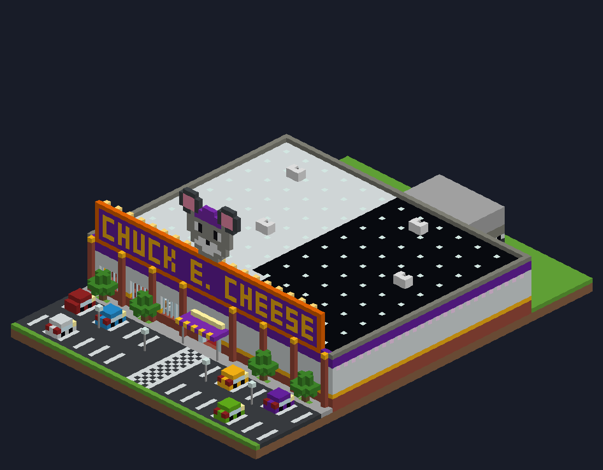
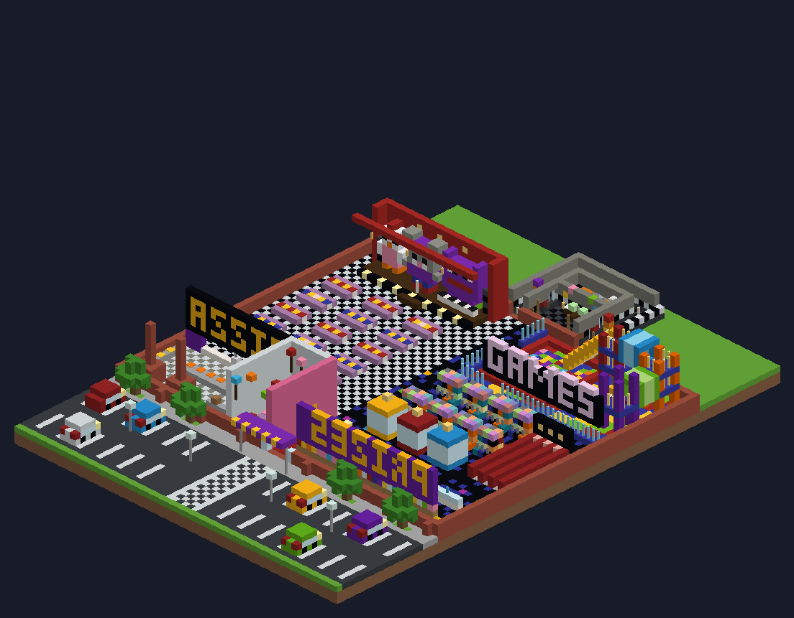

# Chuck E. Cheese map for Minecraft Bedrock

A fan-made Chuck E. Cheese pizza and arcade place you can build in Minecraft
Bedrock Edition (phone, tablet, Windows) with one command.




## What's inside

- **Parking lot** with parked cars, lamp posts and trees, and a big
  CHUCK E. CHEESE sign with the mouse on the roof
- **Showroom** with 15 party tables (pizza on every table) facing the
  **stage**, where the animatronic band plays: a mouse, a chicken and a purple
  monster on keyboards
- **Arcade** with 60 game cabinets (joysticks and buttons), 3 claw machines
  and 3 skee-ball lanes, under a glowing GAMES sign
- **Play zone** with a ball pit, three climbing towers with ladders, tubes,
  and two slides (one drops you into the ball pit)
- **Prize counter** with a wall of prizes and a giant teddy bear
- **Birthday party room** with cakes, balloons and presents
- **Kitchen** with brick pizza ovens and the PIZZA menu over the order window
- **Security office** behind the stage, in the back-of-house area. Get there
  through the hallway next to the stage or the one at the back of the play zone:
  - two iron doors, left and right. Flip the lever on the red panel next to a
    door to slam it shut, and flip it again to open it
  - a light switch by each door that turns on a lamp so you can see who's in
    the hallway. Look out the windows: a purple bunny waits in one hall and a
    chicken in the other
  - a desk with two camera screens, a desk fan and a cupcake
  - two vents: climb the ladders in the office corners. The left vent comes
    out on the stage behind the band, the right one in the play zone
  - a Parts & Service room with spare costumes and an endoskeleton

## How to install

1. Download `ChuckECheese.mcpack` on the device you play Minecraft on and open
   it. Minecraft starts and says the pack was imported.
   - iPhone / iPad: tap the file in the Files app (or Share → Minecraft)
   - Android: tap the file in your Downloads
   - Windows: double-click the file
   - Xbox, PlayStation and Switch can't import add-on files.
2. Create a new world:
   - Game Mode: **Creative**
   - Advanced → World Type: **Flat**
   - Turn on **Activate Cheats**
   - Behavior Packs → Available → **Chuck E. Cheese Map** → Activate
3. In the world, stand on the ground, open chat and type:

   ```
   /function chuckecheese
   ```

   The building appears around you and you're sent out to the parking lot,
   looking at the front door.

Turning on cheats or add-ons switches off achievements for that world (that's
normal for any add-on).

**Updating:** open the new `ChuckECheese.mcpack` the same way and it replaces
the old one. If an old world doesn't pick up the update, make a new flat world
with the pack turned on.

## Rebuilding

Everything is generated by `build_map.py` (needs Python 3 and Pillow):

```
python3 build_map.py
```

It writes the `.mcpack` and the preview images. The blocks are stored with
their Minecraft 1.18 names and version number; Bedrock upgrades them when the
structure loads, so the same pack works on old and new versions of the game.
