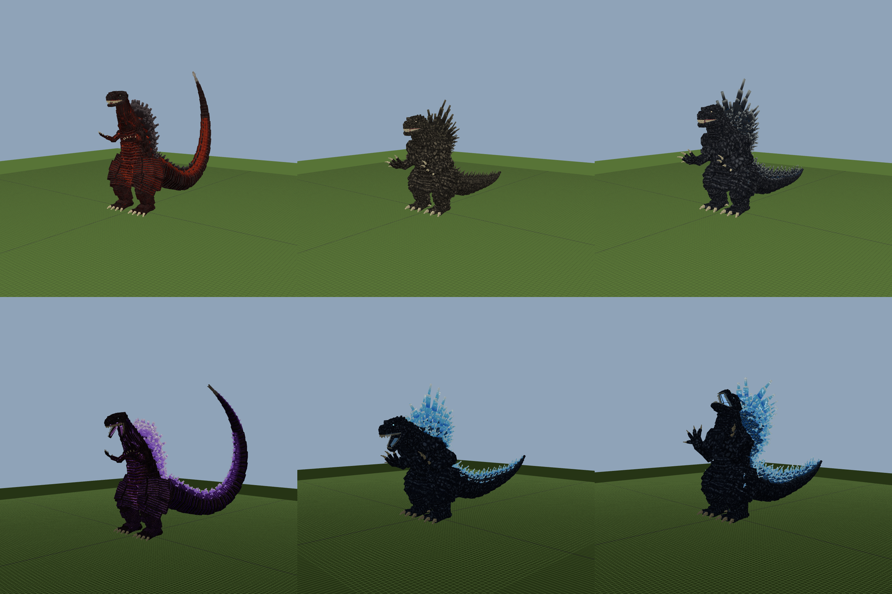

# Kaijus Srelz Pack — Minecraft Bedrock add-on

Giant monsters for Minecraft Bedrock, staged like their films. Version 1.0.0 has two kinds:

- **Shin Godzilla** (2016) in three of its forms, plus a rampaging 4th form that never tires.
- **Godzilla Minus One** and the larger **Godzilla Minus Zero**, with the heat ray and the
  blast it leaves behind.

The two kinds are enemies: put a Shin Godzilla and a Minus Godzilla in the same world and they
fight each other. Kaiju of the same kind leave each other alone.

**Install:** open `dist/KaijusSrelzPack.mcaddon` on the device (Minecraft imports both packs),
then enable *Kaijus Srelz Pack (Behavior)* and *Kaijus Srelz Pack (Resources)* on a world. No
experimental toggles are needed. Requires Minecraft Bedrock **1.21.90 or newer**.

**Coming from the older "Shin Godzilla" add-on:** this is a new pack with a new identity, so
Minecraft will not replace the old one by itself. Remove the old *Shin Godzilla* packs from
the world (and from storage if you like) and add these. Kaiju already standing in the world
are kept (the entity names did not change), but the Config Wheel and tablet settings start
again from their defaults.

## The kaiju

| Kaiju | Size | Behaviour |
|---|---|---|
| **Shin Godzilla, 2nd form** | ~55 blocks long | Lurches along on its belly, gills spraying red, bulldozes whatever is in front of it. Evolves into the 3rd form. |
| **Shin Godzilla, 3rd form** | ~24 blocks tall | Staggers upright, roars, smashes through buildings. Evolves into the 4th form. |
| **Shin Godzilla, 4th form** | ~48 blocks tall, ~100 block tail | Atomic breath, dorsal rays, tail ray, dormancy, the Yashiori Strategy. |
| **Shin Godzilla: RAMPAGE** | same | Never runs out of energy and never goes dormant. Mouth, tail and plates all fire at once. Cannot be frozen. 3000 health. |
| **Godzilla Minus One** | ~39 blocks tall, ~54 block tail | Fights with claws, jaws and tail, heals his wounds, and ends things with the heat ray. 1800 health. |
| **Godzilla Minus Zero** | ~43 blocks tall | Bigger and darker, a blue light never quite gone from his back. Taller fins, a faster heat ray, faster healing. 2800 health. |

### Godzilla Minus One / Minus Zero

He is built from the film: a small, low head with a knobbed crown, pale eyes with a yellow
centre set close on the front of the face under slanting brows, a deep blunt muzzle full of
uneven fangs, a thick plated neck, big arms with long claws, enormous thighs, and three rows of
tall jagged fins like flames down his back and tail.

- **The heat ray**, in the film's order: the dorsal fins thrust out of his back one after
  another, from the tip of the tail to the nape, each with a crack and a flash of blue; he
  rears and draws breath, pulling everything loose toward his mouth; the fins slam home and
  a blue-white beam goes out; and where it lands there is a flash, a fireball, a column and a
  cap of smoke that climbs for a minute, a blast wave across the ground, fires, and then
  black rain under an ash-coloured sky. His eyes and fins burn blue while it charges.
- **He does not fight like Shin Godzilla.** At close quarters he has his own moves:
  - **Claws** — two raking blows, the right and then the left, through everything in front.
  - **Jaws** — he seizes a creature, lifts it clear of the ground, shakes it and throws it;
    where it comes down there is a crater. Another giant is too big to lift, so it is held
    and worried instead.
  - **Tail whip** — he turns his whole body once round and the tail comes with it, flat and
    fast, through everything within its length. This is how he makes room for the heat ray:
    the tail hurls his enemy clear (or the jaws throw it), and the fins start to rise.
  - **Charge** — he does not jump. He puts his head down and comes straight through whatever
    is in the way, and arrives swinging.
  - **Stomp** for what is under his feet.
- **Regeneration**: left alone for a few seconds he heals, Minus Zero faster.
- **Death**: shafts of blue light break out through his hide before he falls.

About Minus Zero: his look here (larger, burnt darker, blue light in the seams of his back,
taller fins) is this pack's own take, not copied from film material.

### Shin Godzilla, 4th form

- **Atomic breath**, cut to one sound timeline (23 s): light races from the tip of the tail up
  the back, the plates catch purple and lightning crawls between them → the jaw unhinges and
  black smoke is driven down onto the ground in clouds the size of buildings → it catches, and
  fire floods out across everything below → the stream burns white, then magenta, and tightens
  as the lower jaw parts → the beam slams into the ground, narrows and sweeps across its
  target, **while the tail swings up over the back and fires a ray of its own** → it sputters out.
- **Dorsal rays** from the back plates at anything airborne, and a **tail ray** for what is
  behind him.
- **Duels**: with the breath ready and the enemy too close he **leaps back** to open the
  range and fires; with it spent he closes in (a **pounce** if the rival is far off) and
  fights with a lunging **bite**, a **tail sweep** and a **stomp**.
- **Energy and dormancy**: after spending his energy he freezes in place to cool down.
- **Yashiori Strategy**: while he is dormant, use **Yashiori Coagulant** on him 6 times to
  freeze him solid, permanently.

### Everything they share

- **Hostile by default**: they go after players and every mob near them, rival giants and
  bosses first. The tablet can switch them to "only fights back" or "peaceful".
- **Cinematic staging**: on a kaiju's first big attack (or every one, or never: the Config
  Wheel) nearby players are shown it as the film would cut it and get their own eyes back
  before the beam fires. The air changes colour under the fire, the beam and the fallout, the
  beams light the land at night, and the screen shakes and flashes with the big moments.
- **Their beams** do extra damage in proportion to the victim's health, so fights against
  other add-ons' kaiju are not one-sided.
- **Footstep quakes**, trampling, and they walk straight through terrain.
- **Boss bar and HUD**: each has its own boss bar frame, and a HUD line above the hotbar
  with exact health, energy or heat-ray countdown, and what the kaiju is doing right now.

### Items

- **Spawn eggs** for all six kaiju (creative inventory).
- **Config Wheel** — how strong they are and how their attacks are staged. Four presets
  (**Nerfed / Movie / Buffed / Titan**) or fine-tune it: health (x0.25 to x8), damage, attack
  rate, walking speed, beam power, stamina, and whether they leap and charge. A second page
  sets the cinematic camera, the fog, shake and flashes, the HUD, and particle density (lower
  it on a slow phone). Recipe: four iron ingots around an amethyst shard. Every player is
  handed a wheel and a tablet the first time they join.
- **Kaiju Control Tablet** — block destruction on/off, behaviour, evolution speed, kaiju size
  (full / half / quarter), summon any kaiju, command the nearest one (for a Minus Godzilla:
  roar, heat ray where you are looking, claws, jaws, tail whip, charge at me, stomp), remove
  all kaiju. Recipe: iron ingots around a glass pane and redstone.
- **Yashiori Coagulant** — crafted from a G-Cell Sample + glass bottle + snowball + slime
  ball (or glass bottle + blue ice + slime ball + redstone).
- **G-Cell Sample** — sometimes drops when you hit a kaiju; always drops when one falls.

**Tip:** block destruction is ON by default, and a heat ray levels a wide area. Turn it off in
the tablet before spawning one near something you care about.

**With other boss add-ons:** the custom boss bar is added to the game's own boss bar rather
than replacing it. If another pack redraws the boss bar too, put this resource pack above it
in the world's pack list; otherwise the ordinary purple bar with the kaiju's name is shown.

## How it was built

Everything is generated by `src/build.py` (Python 3 + numpy + Pillow, ffmpeg for audio):

- `form4.py`, `form2.py`, `minus.py` — the models, sculpted as lofted octagonal sections along
  a spine (`geo.py`) and skinned with continuous cylindrical "sleeve" textures.
- `tex.py` — procedural textures (Shin's keloid hide, Minus's scaled armour, plate and fin
  gradients; normal / charged / frozen variants). Alpha is the emissive mask.
- `anim.py` — Molang animations and animation controllers.
- `sounds.py` — synthesized sound effects, and the timelines the attacks are cut to.
- `fx.py` — particles, the boss-bar art and item icons.
- `scripts/` — gameplay (stable `@minecraft/server` 2.0.0 APIs only): `lib.js` (settings,
  effects, terrain), `beam.js` (beams, smoke and fire, lightning), `main.js` (abilities, the
  fights, the camera, the menus).

### Using your own audio

The packs in this repository use synthesized stand-in sounds. To use your own recordings
instead, put `roar.mp3` and `heat_ray.mp3` in `src/user_audio/` (that folder is git-ignored)
and run `python3 src/build.py`. Besides the normal output it writes
`local/KaijusSrelzPack-1.0.0.mcaddon` (also git-ignored) with Shin Godzilla's roar, growl and
breath phases cut from your files on the same timeline.

Checked with: TypeScript type-check of the script against the official Script API typings,
Blockception's Bedrock diagnoser, Mojang's `@minecraft/bedrock-schemas`, offline renders of
the models and animation poses, and the gameplay script run through whole fights against a
stand-in for the Script API (which checks every entity event, property, particle and sound
it uses against the packs). It has **not** been run inside Minecraft from this workspace, so
expect to tune things once you see it in game.

This is an unofficial fan project for personal use. Godzilla is a trademark of Toho Co., Ltd.
