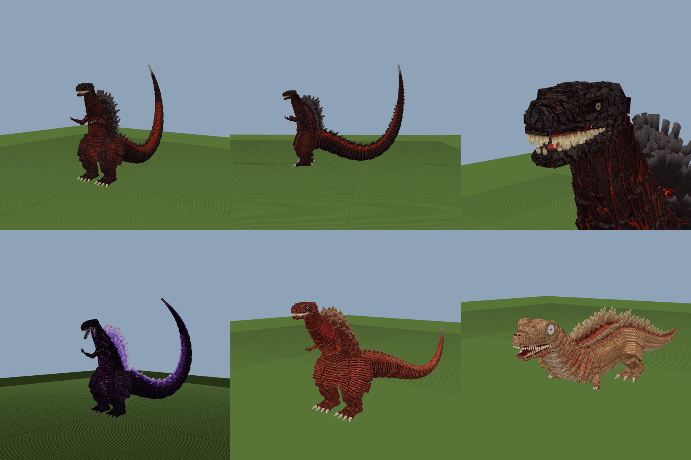

# Shin Godzilla — Minecraft Bedrock add-on

Shin Godzilla (2016) for Minecraft Bedrock, in three of its film forms, with the
atomic breath, dorsal rays, tail ray, evolution, dormancy and the Yashiori Strategy, plus a
rampaging 4th form that never tires.

**Install:** open `dist/ShinGodzilla.mcaddon` on the device (Minecraft imports both
packs), then enable *Shin Godzilla (Behavior)* and *Shin Godzilla (Resources)* on a
world. No experimental toggles are needed. Requires Minecraft Bedrock **1.21.90 or newer**.

## What's in it

| Form | Size | Behaviour |
|---|---|---|
| **2nd form — "Kamata-kun"** | ~55 blocks long | Lurches along on its belly, gills spraying red, bulldozes whatever is in front of it. Evolves into the 3rd form. |
| **3rd form — "Shinagawa-kun"** | ~24 blocks tall | Staggers upright, roars, smashes through buildings. Evolves into the 4th form. |
| **4th form** | ~48 blocks tall, ~100 block tail | The boss. See below. |
| **4th form: RAMPAGE** | same | A second Shin Godzilla that never runs out of energy and never goes dormant. It attacks everything alive, and when nothing is left it turns its fire on the land. Mouth, tail and dorsal plates all fire at once. It cannot be frozen: kill it (3000 health) or remove it with the tablet. |

### 4th form abilities
- **Atomic breath**, staged like the film and cut to one sound timeline (23 s):
  light races from the tip of the tail up the back, the plates stutter and catch purple,
  lightning crawls between them and strikes the ground around him, and energy streams into
  his throat (2 s) → the jaw unhinges and black smoke is driven down onto the ground, where it
  rolls outward in clouds the size of buildings (2.5 s) → it catches: fire roars from the
  mouth and floods out across everything below (5 s) → the stream burns white, then magenta,
  and tightens as the lower jaw parts (2 s) → a flash, and the beam slams into the ground
  wide, then narrows and lifts to sweep across its target, **while the tail swings up over
  the back and fires a ray of its own** (9 s) → it sputters out (2.5 s).
- **The beam** is drawn as one continuous shaft from the mouth to the impact: a soft violet
  glow, a turbulent plasma sheath and a white-hot core, with light pulsing along it, rings
  and small lightning thrown off it, a flare at the mouth and a boiling blast where it lands.
- **Cinematic staging**: on the first breath of each kaiju (or every breath, or never: the
  Config Wheel) nearby players are shown it as the film would cut it, from under the glowing
  plates, then a long side view of the smoke, then high over the fire, and get their own eyes
  back before the beam fires. The air turns to ember dusk under the fire and violet night
  under the beam, the fire and beams light the land at night, and the screen shakes and
  flashes with the big moments.
- **Dorsal rays**: beams from the back plates that hunt anything airborne.
- **Tail ray**: fired on its own from the tip of the raised tail at targets behind it. The
  tail visibly leans toward what it is shooting at.
- **Duels**: against another giant or a boss he fights like one. With the breath ready and
  the enemy too close to use it, he **leaps back** to open the range and fires; with it
  spent he closes in (a **pounce** if the rival is far off) and fights at arm's length:
  a lunging **bite** and claw rake for what is in front, a **tail sweep** through everything
  behind and beside him, a **stomp** for what is underfoot. His beams do extra damage in
  proportion to the victim's health, so fights against other add-ons' kaiju are not one-sided.
- **Hostile by default**: he goes after players and every mob near him, rival giants and
  bosses first. Small animals just get walked over. The tablet can switch him to "only
  fights back" or "peaceful".
- **Footstep quakes**, trampling, and he walks straight through terrain.
- **Energy and dormancy**: after spending his energy he freezes in place to cool down.
- **Yashiori Strategy**: while he is dormant, use **Yashiori Coagulant** on him 6 times to
  freeze him solid, permanently.
- **Boss bar and HUD**: his own boss bar (black glass edged in violet, red for the rampaging
  one), and a HUD line above the hotbar with exact health, atomic energy and what he is
  doing right now.

### Items
- **Spawn eggs** for all three forms and the rampaging 4th form (creative inventory).
- **Config Wheel** — how strong he is and how his attacks are staged. Four presets
  (**Nerfed / Movie / Buffed / Titan**) or fine-tune it: health (x0.25 to x8), damage,
  attack rate, walking speed, beam power (thickness, reach and blast), stamina, and whether he
  leaps. A second page sets the cinematic camera (off / first breath / every breath), the
  fog, shake and flashes, the HUD, and particle density (lower it on a slow phone).
  Recipe: four iron ingots around an amethyst shard. Every player is handed a wheel and a
  tablet the first time they join.
- **Kaiju Control Tablet** — settings menu: block destruction on/off, behaviour
  (hostile / only fights back / peaceful), evolution speed, kaiju size (full / half /
  quarter), screen shake and flashes, the HUD, summon a kaiju (including the rampaging one),
  command the nearest one (roar, atomic breath where you are looking, dorsal rays, tail ray,
  dormancy, thaw), remove all kaiju.
  Recipe: iron ingots around a glass pane and redstone.
- **Yashiori Coagulant** — crafted from a G-Cell Sample + glass bottle + snowball + slime
  ball (or glass bottle + blue ice + slime ball + redstone).
- **G-Cell Sample** — sometimes drops when you hit a kaiju; always drops when one falls.

**Tip:** block destruction is ON by default. Turn it off in the tablet before spawning one
near something you care about (that also switches off the temporary light the beams cast).

**Updating from an older version:** import the new `.mcaddon`, then in the world's settings
remove the old Shin Godzilla packs and add the new ones (version 1.3.0) if Minecraft did not
swap them itself.

**With other boss add-ons:** the custom boss bar is added to the game's own boss bar rather
than replacing it. If another pack redraws the boss bar too, put Shin Godzilla's resource
pack above it in the world's pack list; if his frame still does not appear, the ordinary
purple bar with his name is shown instead.

## How it was built

Everything is generated by `src/build.py` (Python 3 + numpy + Pillow, ffmpeg for audio):

- `form4.py`, `form2.py` — the models, sculpted as lofted octagonal sections along a spine
  (`geo.py`) and skinned with continuous cylindrical "sleeve" textures.
- `tex.py` — procedural textures (keloid hide, belly scutes, plate gradients; normal /
  charged-purple / frozen variants). Alpha is the emissive mask.
- `anim.py` — Molang animations and animation controllers.
- `sounds.py` — synthesized sound effects, and the single breath timeline everything is
  cut to.
- `fx.py` — particles, the boss-bar art and item icons.
- `scripts/` — gameplay (stable `@minecraft/server` 2.0.0 APIs only): `lib.js` (settings,
  effects, terrain), `beam.js` (beams, the smoke-and-fire pour, lightning), `main.js`
  (abilities, the fight, the camera, the menus).

### Using your own audio

The packs in this repository use synthesized stand-in sounds. To use your own recordings
instead, put `roar.mp3` and `heat_ray.mp3` in `src/user_audio/` (that folder is git-ignored)
and run `python3 src/build.py`. Besides the normal output it writes
`local/ShinGodzilla.mcaddon` (also git-ignored) with the roar, the growl and the breath
phases cut from your files on the same timeline.

Checked with: TypeScript type-check of the script against the official Script API typings,
Blockception's Bedrock diagnoser, Mojang's `@minecraft/bedrock-schemas`, offline renders of
the models and animation poses, and the gameplay script run through whole fights against a
stand-in for the Script API (which checks every entity event, property, particle and sound
it uses against the packs). It has **not** been run inside Minecraft from this workspace, so
expect to tune things once you see it in game.

This is an unofficial fan project for personal use. Godzilla is a trademark of Toho Co., Ltd.
