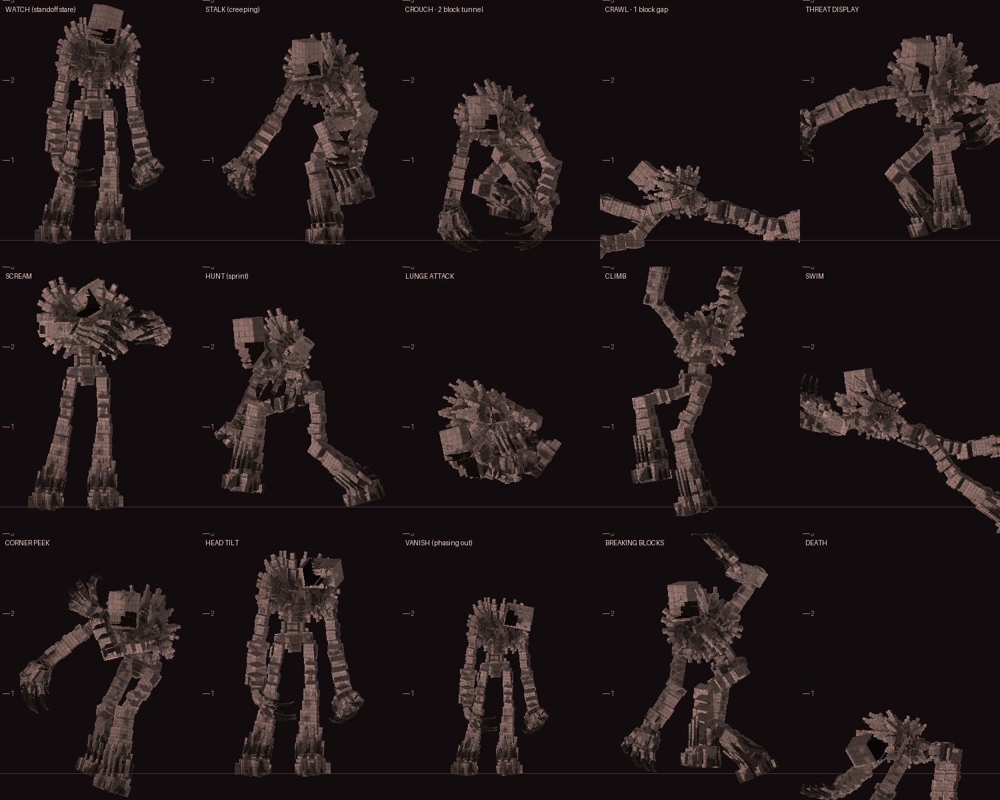

# The Shaftbreaker: a cave dweller horror add-on for Minecraft Bedrock

The Shaftbreaker is a tall, gaunt thing that lives in the caves. It doesn't just chase you. It
watches how you move through its tunnels, tests how you react, learns your habits, and becomes
dangerous when you disturb what belongs to it.

**Download:** `dist/The_Shaftbreaker.mcaddon`. Open it with Minecraft to import both packs.

* **No experimental toggles.** Only stable formats are used, plus the stable Script API (`@minecraft/server 2.4.0`, `@minecraft/server-ui 2.0.0`).
* **Requires** Minecraft Bedrock 1.21.130 or newer (this includes the 26.x versions).
* **Activation:** turn on **both** packs on the world (behavior pack + resource pack). The behavior pack already depends on the resource pack.
* **First join:** you get a **Config Wheel** (settings) and a **Spelunker's Field Journal**.



---

## The creature

* **One creature per world, in multiplayer too.** It is your model, scaled to about 3 blocks tall (it was 5.3).
* **One anatomy for every phase.** Each phase changes its posture, sound and behaviour, never the monster itself.
* **Eyes in the dark.** Its eyes glow amber. They go dark when it is hiding and turn red when it is enraged.
* **It fits where you fit.** It crouches in 2-block tunnels and army-crawls on its long arms through 1-block gaps. It also climbs walls and swims.
* **It moves physically.** Vanilla pathfinding walks it to vantage points and chases you. It only teleports when nobody can see it, for example to change hiding spots or to work around terrain it can't cross.
* **It can be hurt and killed.** Weapons, potions, wolves and iron golems all work. When badly hurt it shrieks, knocks you back and phases out to heal. Killing it drops **Shaftbreaker's Claw**.

### Phases

| Phase | What it does |
|---|---|
| **Dormant** | Nothing is hunting you, but the caves still have signs of it. Sometimes it rests inside a Dwelling (the "occupied shelter"). |
| **Stalking** | It watches from cave floors, ledges, the ends of side passages, around corners (peeking), and just past the edge of your light. It creeps closer when you aren't looking. When you spot it, it might stare, tilt its head, back slowly into the dark, duck behind cover, walk toward you, or phase out and reappear somewhere else. |
| **Tunnel watcher** | If you strip-mine, it likes to appear crouched at the **far end of your tunnel**, watching. Walk up to it and it attacks if you touch it. Stare too long and it may attack. It may also attack just for fun, or vanish. |
| **Standoff** | When you get close or hold eye contact, it stares you down. Eye contact makes it more aggressive the longer it lasts. Look away and it may get closer, back off, or vanish. Before attacking it gives a warning: a growl, then a threat display (it stands tall and flares its mane). It may also fake a lunge, stopping short. Touching it, or hitting it, starts the hunt. Every standoff has a time limit. |
| **Engage (hunt)** | It screams and hunts. It sprints in bursts, then slows to recover, so corners and dodges matter. Attacks include a committed lunge (dodge it to gain distance), a long overhead strike that reaches players up to 4.9 blocks above it, and normal melee hits. It can disable your shield and its hits cause Darkness. It opens doors, climbs, crawls, swims against currents, smashes natural stone or basic walls, and breaks boats and minecarts you're riding in. It puts out torches along its path, and follows you to the surface if it has learned to. |
| **Search** | If it loses you, it goes to where it last saw you, then checks likely hiding places, including spots you've hidden in before. It stops to listen and sniff. Sometimes it pretends to leave and waits along the way out (a "false retreat"). |
| **Recovery** | A real quiet period follows every encounter. |

### Adaptive AI (it learns you)

It keeps small, decaying scores for things it actually witnessed. Only the strongest **three** adaptations are active at once, habits fade when you stop repeating them, and it still makes mistakes. Open the Field Journal and choose **"What it has learned about you"** to see the current list. Examples:

* **Pillaring.** If you escape by pillaring up, it starts climbing.
* **Walling off.** If you seal tunnels behind you, it smashes through walls.
* **Doors.** If you shelter behind doors, it learns to open them, and sometimes opens and closes them just to taunt you.
* **Heavy torch use.** It puts your torches out.
* **Surface escapes.** If you keep running to the surface, it follows you further.
* **Same route.** If you always escape the same way, it waits along that route.
* **Strip-mining.** It watches from the far end of your tunnels.
* **Looking behind you often.** It approaches from the side instead.
* **Explosions.** They scare it at first, less each time.
* **Repeated tricks.** The same Rattlebone lure or flare works less and less.
* **Encounters.** Aggression slowly grows with each encounter (capped).

### Illusions and environment manipulation

* **The Extra Pickaxe.** After you stop mining, your mining continues somewhere else, in your own rhythm.
* **The Delayed Footstep.** One step too many lands behind you.
* **The Answering Knock.** Something knocks back from deeper in the rock.
* **Unfinished Approach.** Footsteps come toward you and stop short.
* **Eyes in the dark.** A pair of glowing eyes that only the target player can see.
* **False sightings.** It's standing right there; look again and it's gone.
* **Torches going out** one by one. The torch item drops, so you lose the light, not the torch.
* **Doors** creaking or moving.
* **Claw marks** appearing in natural stone. They get more elaborate with every encounter.
* **Sinew sealing** the passage behind you (inside its territory only, and easy to break).
* **Cave dust and rumbles**, distant screams, and whispers right behind you.
* **The Missing Beat.** The cavern's pulse stops just before it moves.
* **The Silent Escort.** It walks you to the cave mouth and watches you leave.

### Sound design (99 original synthesized sounds)

* **Heartbeat.** Gets **faster and louder as it gets closer**, and can give false alarms near illusions.
* **Encounter music** that escalates: stalking, then standoff, then chase.
* **A final-confrontation theme.**
* **Ambience:** cave drone beds, flesh-territory ambience, organ pulses, drips and rumbles.
* **Its movement:** footsteps, claw scrapes, crawling, climbing and smashing. Its movement sounds can come from the wrong side to mislead you.
* **Vocal sounds:** breathing, clicks, growls, a signature screech and distant screams.
* **The spotted stinger** when you see it, sometimes with tinnitus.
* **Grinning Moth** giggles and flutters.

---

## Its territory: the Hollow

Each world contains rare, large infected cave regions, placed deterministically per world and kept
at least 330 blocks from world spawn. A region is generated chunk by chunk as you approach. It
contains:

* a **great central cavern** (about 60 × 55 blocks, around 20 blocks tall), connected to natural caves by winding tunnels;
* **infected stone**: stone becomes Veinstone and deepslate becomes Deep Veinstone, with fleshy and glowing seams;
* **decorations attached to real surfaces**. Dripfang stalactites, Bloodroot Vines and Hanging Tissue hang from ceilings. Bloodmoss, Crimson Cave Thorns, Glowspore Clusters, Skull Piles and Dweller Droppings sit on floors. Organ Cores, Pulsing Flesh, ribstone fossils and old claw marks are set into walls. Grounded ribstone arches stand on the floor.
* **Watcher Pods** (listening organs) that open when you come near and report what they hear;
* **the Dwelling** at its heart: a nest of flesh and rib arches with a beating **Dwelling Heart**, bones, droppings, hanging tissue and a sinew curtain.

Nothing floats: every hanging or floor decoration has a placement filter, so it breaks if its
support is removed. The simulator's support check found zero unsupported decorations.

**Inside its territory:**

* **Wildlife avoids it.** Natural mob spawns mostly fail, wandering mobs are pushed back out, and Grinning Moths live there.
* **The creature is stronger.** It is faster, hits harder, regenerates, comes sooner, uses more illusions, and its hearing is relayed by the Watcher Pods.
* **The more you destroy, the angrier it gets.** Breaking organs makes it furious and it comes for you. With fewer organs left, the territory weakens it afterwards. An **Organ Muffler** quiets an organ for 5 minutes, and breaking a muffled organ angers it much less.

### Dwellings

* **Hollow Dwellings.** Every Hollow has one large Dwelling at its centre.
* **Lone Dwellings.** Small ones appear rarely in ordinary caves.
* **Destroying the heart.** Mining, burning or blowing up a **Dwelling Heart** stops the creature spawning within the protected radius (default 64 blocks, configurable). It also has a chance (default 75%) to trigger a **final confrontation**: a relentless hunt with its own music. Kill it during that hunt and the area is cleansed for good.

### Grinning Moths

* **Look:** moths with a little face like its face, with glowing amber eyes and a wide grin. When their wings spread, the markings form a second grinning face.
* **Behaviour:** they drift around, perch on walls to stare, and flutter away if you get close.
* **They are its eyes.** When one giggles while watching you, the creature learns where you are.

---

## Survival tools (crafting table, shapeless)

| Item | Recipe | Use |
|---|---|---|
| Config Wheel | iron ingot + redstone | Settings menu (also given on first join) |
| Spelunker's Field Journal | book + ink sac | Entries unlock from what you experience, plus "what it has learned about you" |
| Rattlebone ×2 | 2 bones + string | Throw it: the noise draws the creature to investigate (less effective each time) |
| Glowspore Flare ×2 | stick + Glowspore Cluster (or 2 Moth Dust) + gunpowder | A burst of light: it recoils and may retreat. Gives nearby players night vision for 10 s |
| Organ Muffler ×2 | white wool + string + Organ Tissue | Use on an organ to quiet it for 5 minutes |
| Bone Chime | 3 bones + string + iron nugget | Hang it from a ceiling. It rattles when the creature passes nearby |
| Veinstone ×4 | 4 cobblestone + Veinstone Shard (or Organ Tissue) | Building block |
| Fleshstone ×2 | 2 cobblestone + 2 Organ Tissue | Building block |

Holding **Shaftbreaker's Claw** lets you sense the creature: its position glints red for you.

## Config Wheel settings

Use the Config Wheel, or run `/scriptevent shaftbreaker:menu`. By default only operators can
change settings.

* **Presets.** Atmospheric, Balanced (default), Relentless, Harmless Preview (it watches and vanishes but never attacks or edits the world).
* **Encounters & Pacing.** Master switch, grace period, frequency, minimum gap between encounters, quiet period after a hunt, maximum hunt length, minor events.
* **The Creature.** Toughness (Easy 110 HP / 5 dmg, Normal 160 / 7, Brutal 240 / 10), aggression (0 = harmless), chase speed, surface pursuit, fleeing when wounded, shield disabling, Darkness on hit.
* **Adaptive AI.** Learning on or off, learning speed. "Reset what it learned about me" is in Admin tools.
* **Illusions & Environment.** Illusions and their frequency, false sightings, torch extinguishing (off / during encounters / frequent), doors, block breaking (never / natural stone only / natural stone plus cobblestone, dirt, planks and glass), claw marks, path sealing.
* **Territory & Dwellings.** Territory generation, frequency and size (for areas not yet generated), mob fear, moths, Dwellings, lone Dwellings, protected radius, final-confrontation chance.
* **Audio.** Heartbeat, ambience and scream volume; music mode (off / music channel / sound-effect channel), music volume.
* **Accessibility.** Screen effects (Darkness pulses), reduced particles, sound captions in the action bar.

### Block safety

Everything that edits the world uses a whitelist. It never touches containers, beds, portals,
redstone or ores outside its territory. Block breaking only affects natural stone and (if
enabled) basic wall blocks. Turning the master switch off removes the creature and stops all of
its sounds.

## Admin / testing commands

```
/scriptevent shaftbreaker:spawn stalk        (or standoff / hunt) - summon it near you, out of sight
/scriptevent shaftbreaker:phase standoff     (stalk / standoff / hunt / search / leave / vanish)
/scriptevent shaftbreaker:cancel
/scriptevent shaftbreaker:illusion eyesInDark   (extraPickaxe, delayedFootstep, answeringKnock, unfinishedApproach,
                                                 phantom, torches, door, scratches, whisper, caveIn, distantScream,
                                                 lightDim, footstepEcho, movement, seal)
/scriptevent shaftbreaker:locate             - coordinates of the nearest Hollow
/scriptevent shaftbreaker:hollow_here        - grow a Hollow around you (testing)
/scriptevent shaftbreaker:dwelling_here      - build a lone Dwelling on the cave floor you stand on
/scriptevent shaftbreaker:info
/scriptevent shaftbreaker:preset harmless    (atmospheric / balanced / relentless / harmless)
/scriptevent shaftbreaker:enable | disable | reset_memory
```

**Quick test:** go into a cave in Survival mode and run `/scriptevent shaftbreaker:spawn stalk`.
Normally the first encounter waits for a 12-minute grace period of play, which you can change.

## IDs

**Entities**

* `shaftbreaker:shaftbreaker` (has a spawn egg)
* `shaftbreaker:grinning_moth` (has a spawn egg)
* `shaftbreaker:phantom` (illusion)
* `shaftbreaker:waypoint` (invisible movement marker)
* `shaftbreaker:rattlebone_projectile`

**Blocks**

* Stone family: `veinstone`, `deep_veinstone`, `cracked_veinstone`, `scored_stone`, `scored_deepslate`
* Flesh and organs: `fleshstone`, `pulsing_flesh`, `organ_core`, `cracked_organ_core`, `dwelling_heart`, `watcher_pod`, `watcher_pod_open`, `sinew_membrane`
* Hanging decorations: `dripfang`, `bloodroot_vines`, `hanging_tissue`, `bone_chime`
* Floor decorations: `bloodmoss`, `bloodmoss_carpet`, `crimson_thorns`, `glowspore_cluster`, `skull_pile`, `dweller_droppings`
* Other: `ribstone`

All block IDs use the `shaftbreaker:` prefix.

**Items:** `config_wheel`, `field_journal`, `rattlebone`, `glowspore_flare`, `organ_muffler`, `organ_tissue`, `shaftbreaker_claw`, `moth_dust`, `veinstone_shard`. All use the `shaftbreaker:` prefix.

**Entity properties** (for other creators): `shaftbreaker:state` (16-value enum), `shaftbreaker:pose`, `shaftbreaker:attack`, `shaftbreaker:eyes`, `shaftbreaker:tilt`, `shaftbreaker:materialize`.

**Animations:**

* The original 10 animations are used unchanged.
* 20 more were added on the same rig: `crouch_*` and `crawl`, `climb`, `swim`, `scream`, `threat_rear`, `peek_left` and `peek_right`, `stalk_walk_back`, `vanish` and `appear`, `head_tilt`, `jaw_chatter`, `twitch`, `stagger`, `death`, `false_lunge`, `heavy_strike`.
* Seven animation controllers drive them from the entity properties.

## How it was built and verified

* `tools/` regenerates everything: textures, sounds, animations, the moth, the pack JSON, the particle atlas and the `.mcaddon` (`python3 tools/build_mcaddon.py`).
* All scripts are **type-checked against the official `@minecraft/server` 2.4.0 type definitions**, with zero errors.
* `tools/validate.py` cross-checks every reference: textures, geometry, animations, controllers, render controllers, particles, sounds, loot tables, recipes, events, properties, enum values and language keys.
* `tools/sim/` runs the real scripts headlessly against a mock Minecraft API (a voxel cave world, a scripted player, mob movement and events) for tens of thousands of ticks.
  * It exercises natural encounters, every phase, attacks, search, the wounded escape, death, territory and Dwelling generation, organ and heart destruction and the final confrontation, all illusions, the items and the menus.
  * It finishes with zero runtime errors and zero unsupported decorations.

## Known limitations (honest notes)

* **Not yet playtested in Minecraft.** It was verified by type-checking, cross-reference validation and simulation. Some tuning (speeds, frequencies, volumes) may need adjusting by feel, which the Config Wheel makes easy.
* **The Hollow is not a registered biome.** Custom biomes still require an experimental toggle, so to stay experiment-free the Hollow is a script-generated territory. The F3 biome name stays vanilla.
* **Generation timing.** The territory is generated chunk by chunk when players come within about 4 chunks. On very slow devices you may occasionally notice a distant cave wall changing as it generates.
* **Waypoint fallback.** If walking to a waypoint fails in some game version, the creature falls back to teleporting while unseen. Stalking still works, just with less visible walking.
* **Music channel.** Encounter music uses the music channel by default, so if your Music volume is at 0, switch Audio → Encounter music to "Sound-effect channel".
