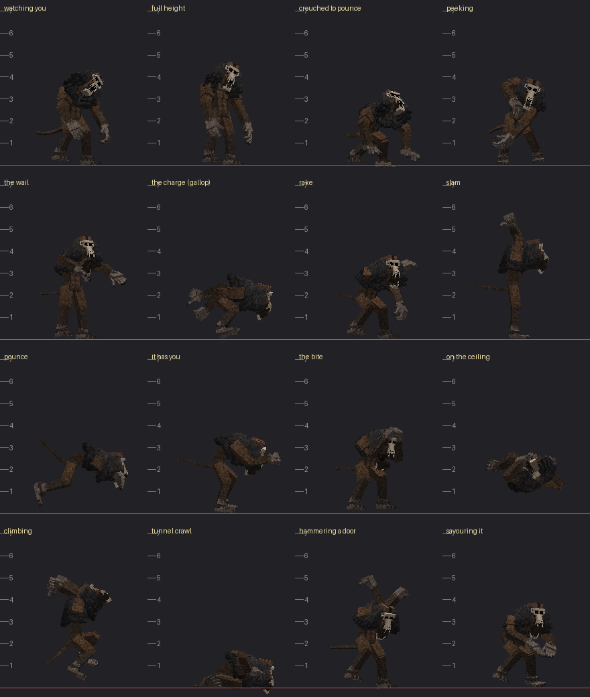

# TAILWAIL

*It lives in the dark under the world. It listens. It rehearses you.*

An original dweller-style horror add-on for **Minecraft: Bedrock Edition**, built around one
creature: Tailwail, a 16-foot primate-like thing that folds itself small to fit in caves,
repeats the sounds you make, moves only when you are not looking, copies your gestures a
second too late, and when it finally stops pretending, rises to its full height and screams.

Ordinary behavior + resource packs. Stable scripting only, **no experimental toggles**, no
cheats needed to play.

| | |
|---|---|
| Version | **2.0.0** |
| Game | Bedrock **1.26.60** or newer (manifest `min_engine_version [1, 26, 60]`); runtime-tested on Bedrock Dedicated Server **1.26.61.1** |
| Script modules | `@minecraft/server` **2.11.0**, `@minecraft/server-ui` **2.3.0** (both stable) |
| Download | [`dist/Tailwail_2.0.0.mcaddon`](dist/) (+ separate `.mcpack`s and `SHA256SUMS.txt`) |
| Ids | creature `tailwail:tall_wail` · spawn egg "Tailwail Spawn Egg" · journal `tailwail:field_guide` |



## Install

1. Open `Tailwail_2.0.0.mcaddon` on the device that runs Minecraft (it imports both packs).
2. World settings → **Behavior Packs** → activate **TAILWAIL (Behavior)**. The resource
   pack comes with it. Leave every experiment off.
3. Play in Survival. Go underground (or stay outside at night). Every player gets a
   **Torn Journal** once (`/tailwail:journal` opens it too).

**Want to see it right away?** Use the spawn egg in a dark cave and look at it. An egg
Tailwail skips the slow build-up and goes straight into the stand-off.

## What it does

**Before you ever see it (the haunting).** Within the first minute underground, things start
happening that only *you* hear or see:
- footsteps behind you that stop when you stop, and then take one more step;
- the sound of your pickaxe, your door, your chest or your eating, repeated from the dark a
  second later;
- three knocks;
- breathing right behind your head;
- your name, whispered;
- a torch behind you going out;
- a door opening by itself;
- a tall shape at the edge of the light that is gone when you look straight at it;
- a face peeking around a corner;
- a fake "*you* joined the game";
- the bed visit: you wake up and it is standing at the foot of your bed.

It escalates through four stages (unease, watched, hunted, obsessed) the more you play.

**The encounter.**
1. **Stalking.** It moves through the dark around you. When you see it, it freezes, in a
   pose no animal should hold. Stare, or walk up to it, and the stand-off starts.
2. **The stand-off.** The core rule: **it only moves when nobody has it on screen.** Look
   away and you hear it skitter. Look back and it is closer, frozen in a different pose,
   and its bones creak. But staring makes it angry. You see the agitation rise:
   - its breathing gets heavier;
   - its tail starts twitching, then curls up over its back;
   - its throat clicks faster;
   - its head tilts, its neck stretches toward you, its head turns all the way around, its
     jaw unhinges.

   It copies your crouches, glances and stops a second late. It replays gestures it
   remembers from earlier encounters. Music drones, a dread fog closes in, your heartbeat
   gets louder and your view narrows.
3. **The unfolding.** Stare too long, let it creep within ~4 blocks, or hit it, and the
   world goes silent. It rises to its full height, holding its breath. Then it **screams**:
   - the screen shakes and darkness pulses;
   - every torch around it goes out;
   - it drops onto all fours.
4. **The chase.** It is faster than you in the open, with war-drum chase music. It squeezes
   through 2-high tunnels on its belly and puts out torches as it passes. If it reaches
   you, **it picks you up and holds you at its face.** Mash **Jump** to tear free.
   Otherwise it throws you, or the second time, bites.
5. **Losing it.** Break line of sight and get distance, and it searches. It sniffs and
   listens: breaking blocks, doors and bows give you away. Crouch in the dark and it walks
   past. When it gives up, it rears up and howls, then leaves. Sometimes it walks away
   with its head turned all the way round, still watching you.

**Torches it puts out stay out** (a burnt-out stick) until you relight them with flint and
steel, a fire charge or another torch. Breaking one gives the torch back.

**It remembers.** It learns which gestures you use and how you react, and it opens later
encounters with them.

## Surviving it (spoilers)

- A glance is safe. A stare is not.
- If you look away, it comes closer. Back off slowly *while* watching it: past ~24 blocks
  a calm Tailwail lets you go.
- Crouch in a dark corner and it may lose you. Light is not your friend here.
- In a chase, break line of sight: corners, water, 1-block gaps it cannot fit through. It
  will not hit through walls.
- If it grabs you, mash Jump. Friends can make it drop you by hitting it.

## Settings

The journal's **Settings** page (or `/tailwail:settings`) has two sections.
- **Per player:** volume, camera effects (off / reduced / full), music, fog, captions,
  forget-me.
- **Operators:** difficulty (Calm / Standard / Nightmare / Custom), encounter frequency,
  haunting (off / rare / normal / constant), grab or plain strikes, jumpscares, fake chat,
  torch snuffing, cave and night encounters, doors, damage, Jump presses to break free,
  pursuit length and max creatures.

Full list: [docs/CONFIGURATION.md](docs/CONFIGURATION.md). Operator diagnostics:
`/tailwail:debug status | spawn [setup] | presence [event] | stage <0-3> | end | restore`.

## What has been verified (and what has not)

- **Static:** `tools/validate.py` passes all 14 check groups with 0 errors:
  - the TypeScript check against the stable 2.11.0 / 2.3.0 typings;
  - every vanilla sound id checked against the 1.26.60 vanilla pack;
  - generator reproducibility.
- **Mojang Creator Tools 0.20.0:** 0 errors. Two warnings remain, both "vanilla item not
  in this pack" false positives.
- **Client:** `tools/client_sim.py` parses every Molang string and simulates the
  controllers at 60 fps: all 756 pose-to-pose transitions, random schedules, grounding of
  every state and every tail state in every posture. 0 errors.
- **Unit tests:** 40/40 (`node --test tests/*.test.mjs`).
- **Runtime on BDS 1.26.61.1** with a scripted stand-in player:
  - statue creep, commit sequence, torch snuff and relight;
  - grab, struggle-free and bite, with input locks restored;
  - hiding, escape, tunnel, all presence events, death;
  - performance: 2.3 ms average per decision tick for three encounters.
- **Not verified:** nothing has been played on a real game client. Animations, sounds,
  fog, music and camera effects have only been checked offline (simulation, spectrograms,
  renders). See [docs/TESTING.md](docs/TESTING.md) and [docs/LIMITATIONS.md](docs/LIMITATIONS.md).

## Documentation

| | |
|---|---|
| [docs/PLAYER_GUIDE.md](docs/PLAYER_GUIDE.md) | Everything it does, every cue, every way out |
| [docs/CONFIGURATION.md](docs/CONFIGURATION.md) | Settings, presets, preferences, commands |
| [docs/DESIGN.md](docs/DESIGN.md) | Architecture, state machine, presence, escalation, cleanup guarantees |
| [docs/ANIMATION_AUDIO.md](docs/ANIMATION_AUDIO.md) | Poses, controllers, Molang, the synthesized sound palette |
| [docs/TESTING.md](docs/TESTING.md) | How to run every check, and the results |
| [docs/ASSETS.md](docs/ASSETS.md) | Asset inventory, generators, what changed in the supplied files |
| [docs/TARGET_VERSIONS.md](docs/TARGET_VERSIONS.md) | Version choice and the stable APIs used |
| [docs/COMPETITIVE_BASELINE.md](docs/COMPETITIVE_BASELINE.md) | What the genre does, and how Tailwail answers it |
| [docs/LIMITATIONS.md](docs/LIMITATIONS.md) | Known limitations |
| [docs/PROJECT_STATUS.md](docs/PROJECT_STATUS.md) | Status and next steps |

## Building from source

```bash
python3 -I tools/anim_studio.py
```

```bash
python3 -I tools/gen_client_v2.py
```

```bash
python3 -I tools/gen_assets_v2.py
```

```bash
python3 -I tools/gen_audio_v2.py
```

```bash
python3 -I tools/package.py
```

The first four regenerate, in order: the clips; the client entity, controllers and script
ids; the block, fog, particle and lang files; and every sound. `package.py` validates, then
writes `dist/`.
