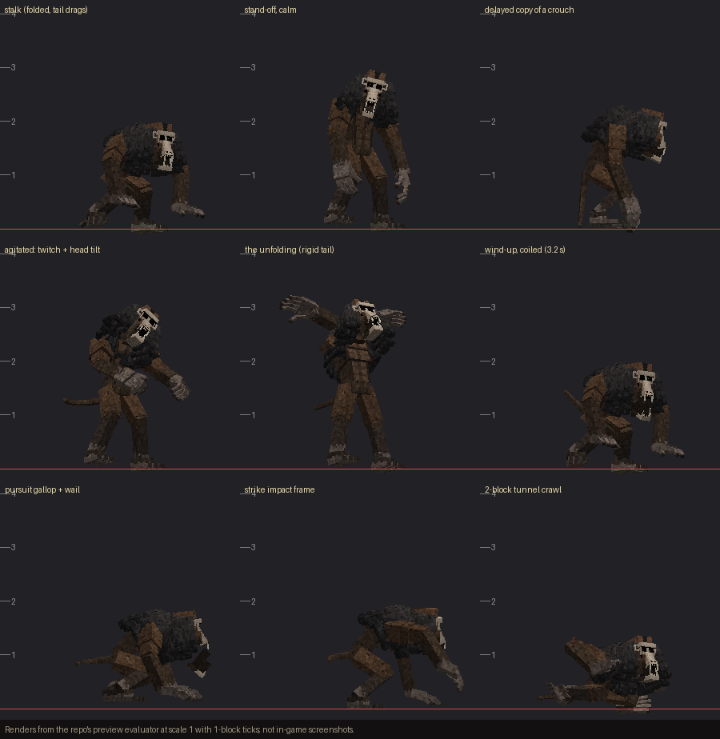

# TAILWAIL: THE REHEARSAL

*It watches you. It rehearses you. Then it stops pretending.*

An original horror add-on for **Minecraft: Bedrock Edition** built around one creature —
Tailwail, a towering, patient primate-like predator that stalks dark caves, copies the
player a second too late, remembers what it has seen them do, and finally unfolds to its
full height and wails before a real pursuit.

Ordinary behavior + resource packs, stable scripting only, **no experimental toggles**,
no cheats needed for normal play.

| | |
|---|---|
| Target game version | **Bedrock 1.26.60** (manifest `min_engine_version [1, 26, 60]`); runtime-tested on Bedrock Dedicated Server **1.26.61.1** |
| Script modules | `@minecraft/server` **2.11.0** (stable), `@minecraft/server-ui` **2.3.0** (stable) |
| Experiments | none — see [docs/TARGET_VERSIONS.md](docs/TARGET_VERSIONS.md) |
| Download | [`dist/Tailwail_The_Rehearsal_1.0.0.mcaddon`](dist/) (+ individual `.mcpack`s, `SHA256SUMS.txt`) |
| Summon id | `tailwail:tall_wail` (spawn egg: "Tailwail Spawn Egg") |

## Install

1. Open `Tailwail_The_Rehearsal_1.0.0.mcaddon` on the device running Minecraft (it imports both packs).
2. Create or edit a world → **Behavior Packs** → activate *Tailwail: The Rehearsal (Behavior)*
   (the resource pack is added automatically). Leave every experiment off.
3. Play in Survival or Adventure. New players get a 10-minute grace period; encounters
   happen underground in the dark. Every player receives a **Tailwail Field Guide** once
   (craftable from a book + a bone; also `/tailwail:guide`).

Existing worlds work too; nothing in the add-on changes vanilla mobs, blocks or terrain.



## What happens in game (short)

1. **Watching** — breathing far off, a tail dragging over stone, a hand at a pillar's edge.
   It freezes while you look straight at it and moves when you look away.
2. **Stand-off** — it steps into view 8–12 blocks away and copies your crouch, head tilt or
   stop-start a moment late. Dragging tail = calm; twitching tail + throat clicks = agitated.
3. **The unfolding** — imitation stops, the tail goes rigid, it rises as tall as the cave
   allows, silence… the 3.2 s wind-up, then **the wail**, then pursuit.

Escape is always possible: it is fast in the open but its pursuit is finite, it loses you
after ~8 s out of sight with real distance, it never hits through walls, and it cannot fit
through a one-block-high gap. Full player guide: [docs/PLAYER_GUIDE.md](docs/PLAYER_GUIDE.md).

## Documentation

| Document | Contents |
|---|---|
| [docs/PLAYER_GUIDE.md](docs/PLAYER_GUIDE.md) | Cues, rules, escape, settings, troubleshooting |
| [docs/CONFIGURATION.md](docs/CONFIGURATION.md) | Every setting, presets, permissions, commands |
| [docs/DESIGN.md](docs/DESIGN.md) | Architecture, state machine, setups, memory, multiplayer rules |
| [docs/ANIMATION_AUDIO.md](docs/ANIMATION_AUDIO.md) | State→clip map, bone ownership, Molang variables, sound palette |
| [docs/ASSETS.md](docs/ASSETS.md) | Asset inventory, changes to supplied assets, scale, attribution |
| [docs/COMPETITIVE_BASELINE.md](docs/COMPETITIVE_BASELINE.md) | Marketplace baseline and acceptance tests |
| [docs/TESTING.md](docs/TESTING.md) | How to validate/test, and the results (what is and isn't verified) |
| [docs/LIMITATIONS.md](docs/LIMITATIONS.md) | Known limitations and outstanding polish |
| [docs/TARGET_VERSIONS.md](docs/TARGET_VERSIONS.md) | Version selection and stable-API evidence |
| [docs/PROJECT_STATUS.md](docs/PROJECT_STATUS.md) | Status, decisions, next actions |

## Rebuild from source

Requirements: Python 3.10+ with numpy and Pillow, Node 18+, ffmpeg with libvorbis.

```bash
python3 -I tools/build_assets.py      # model/animation assets from source_assets/original (untouched zip)
```

```bash
python3 -I tools/gen_controllers.py   # animation controllers, render controllers, lure client files
```

```bash
python3 -I tools/gen_audio.py         # synthesised sound palette + sound_definitions.json
```

```bash
python3 -I tools/gen_icons.py         # pack icons and item icons
```

```bash
node --test tests/*.test.mjs          # unit tests (state machine, rules, memory, scheduler)
```

```bash
python3 -I tools/package.py           # runs tools/validate.py, then writes dist/*.mcaddon / *.mcpack
```

Optional runtime checks need a scratch copy of Bedrock Dedicated Server (see
[docs/TESTING.md](docs/TESTING.md)).

## Layout

```
packs/TailwailBP/        behavior pack: entities, items, recipe, scripts (scripts/core = pure logic, scripts/mc = game adapters)
packs/TailwailRP/        resource pack: model, texture, animations, controllers, sounds, icons, text
source_assets/original/  the supplied TallWail_Blockbench_v3.zip, byte-identical
tools/                   asset builders, validator, packager, BDS runners, preview renderer
tests/                   node:test unit tests
devtests/                BDS-only runtime harness (never shipped)
docs/                    documentation and test logs
dist/                    packaged add-on
```
