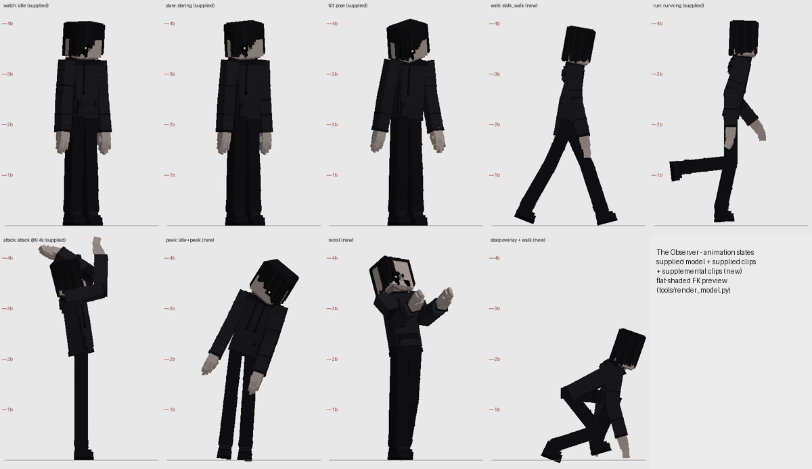

# The Observer — a Minecraft Bedrock horror add-on

> It follows you wherever you go. You rarely notice it directly. You notice that something around you is wrong.
> Over time, you realize it can manipulate your surroundings — and that the changes have a purpose.

The Observer is a tall, mouthless figure (the supplied *Hollow Dweller* model and animations) that studies one player
at a time. It follows you across the overworld, caves, water, sky bases, the Nether and the End; it imitates your
footsteps and your habits; it rearranges your home, seals the tunnel behind you, changes your familiar routes and takes
your light — always deliberately, always reversibly — and watches what you do about it. It has a home: the
**Weeping Mire**, a swamp of weeping trees and bone roots where it watches from between the trunks.



## Install
1. Open **`dist/TheObserver.mcaddon`** with Minecraft Bedrock 1.26.50+ (or import the two `.mcpack` files).
2. Activate **The Observer (Behaviour)** on a world (the resource pack follows as a dependency). No experiments needed.
3. Join: a chat message confirms it is running and you receive the **Observer Config Wheel** (operators / the only
   player). Use it to **See it now**, start it early, switch encounters on or off, or change any setting.
4. Play. Nothing happens for the first 12 minutes on the Standard preset. Details: [docs/PLAYER_GUIDE.md](docs/PLAYER_GUIDE.md).

## Status
Server-side behaviour is verified on Bedrock Dedicated Server 1.26.52.3: the final 1.0.8 integration run passed 319 of
319 checks (73 test groups) with no content-log or script errors, restart recovery passed, and the server held 20 TPS
with and without the add-on. A separate run on a fresh world with every experiment switched off (and no test kit)
loaded everything with zero errors — no experiments are needed; the same holds for the merged Weeping Mire, which
generates on a fresh world with every experiment off. The first load in a game client reported three resource-pack errors, which are fixed in this build and now
caught by a comparison with Mojang's vanilla files. How it looks and sounds in a client still has to be confirmed: see
[docs/TEST_REPORT.md](docs/TEST_REPORT.md) §6 and [docs/RELEASE_READINESS.md](docs/RELEASE_READINESS.md).

## What's inside
* **One physical Observer** built on the supplied model: 5 supplied clips + 9 supplemental clips (stalking walk, peek,
  recoil, stoop crouch for low ceilings, head tracking, and in 1.0.6 two floating clips — the drift twitching and
  cracking in jerks — and a climb; in 1.0.8 a hanging overlay so it strikes and recoils in mid-air), state-driven
  animation controllers, eyes that glow in the
  dark, a glowing wisp aura, a crimson vanish burst, and its own voice, arrival, notice, shriek and vanish sounds.
* **A horror director**: grace period, five escalating stages, per-player and global cooldowns, quiet periods,
  recovery after deaths, anti-repetition, context-weighted selection, fair multiplayer targeting.
* **Its home, the Weeping Mire** (1.0.7): the Weeping Mire biome (your own add-on, merged in) generates near where
  you start — often right beside the world spawn (1.0.8) — but you never start inside it: a first spawn in the Mire
  is moved just outside it, facing it. Weeping trees and giant weeping trees, bone roots and bone grass, mire moss, silt ponds, abandoned
  cabins, black fog, wind gusts and falling leaves, and eight torn pages to find. The Mire's watcher is now the Observer
  itself: it stands among the trees 20–48 blocks off and is gone in black mist when you look at it or come within 9
  blocks; a torn page may bring it up behind you, and the last of the eight always does. In the Mire it comes sooner
  and more often: the grace period ends after 30 seconds there, the gaps between encounters are shorter, and it acts as
  if you were one stage further along.
* **23 encounter types**, including three signature encounters (*Out of Step*, *Someone Was Home*, *The Closed Path*)
  and *Closer Each Time* (it only moves while unwatched), *It's Inside* (the dark corner of your own room), *Signs*
  (by your bed or door), *Borrowed Eyes* (a creature that turns its head to follow you) and *In the Mire*; a lunge when it is spotted,
  a fast, relentless attack once it reaches you, a too-close reaction, and harmless shadows in taiga forests that
  vanish when looked at, plus 17 further designed concepts — see [docs/ENCOUNTERS.md](docs/ENCOUNTERS.md).
* **It never runs** (1.0.6–1.0.8): the chase, the lunge, the attack once it reaches you and the strike when you walk
  up to it all float — a block off the ground, no footsteps, only a rush of air — and it strikes from the air with its
  legs hanging. In *Breathing Room* it surges at you when you look away, drifts while you watch, and stops at the
  water's edge to hover there. **It climbs**: get up on a pillar, a ledge, a roof or a ladder and it climbs the wall
  after you and strikes from it. Previews: [docs/media/1.0.6/](docs/media/1.0.6/), [docs/media/1.0.8/](docs/media/1.0.8/).
* **It learns how you escape**: light, water, a stare, the lens, a blow, running, breaking through, a flare — use one
  three times and it adapts to that one (one at a time, and it wears off). From stage 4 **the world goes quiet** before
  it attacks: your music stops and a faint ringing rises (sometimes nothing follows). It writes **pages you didn't
  write** into your Field Notes from what you actually did, and **returns what you threw away** to your doorstep.
* **8 environmental manipulation mechanics** (doors, lights, turned objects, Veil obstructions, mimic route changes,
  effigies, temporary openings, animals turning) through a **restoration ledger**: recorded, locked, reload-safe,
  dupe-proof, and the player's own changes always win.
* **Bounded memory** of each player: breadcrumbs, home, familiar routes, habits, a favoured bearing.
* **Progression**: 24 discoveries written in the Field Notes; Tally Chalk, Witness Lens, Ward Lantern, Vestiges, and
  the **Flare** (thrown; its glare drives it off within 16 blocks, even mid-attack); the Vigil as the long-term goal;
  three post-ending modes.
* **Config Wheel**: one item for status, a harmless *See it now* preview of the creature and all its animations,
  start-now, presets (Atmosphere / Standard / Relentless), every individual setting (frequency, aggression,
  manipulation, sudden scares, camera effects, captions, grace period, and on/off switches for each 1.0.5 feature), a
  toggle per encounter type, *Test an encounter*, and *Undo its changes*.
* **47 original synthesized sounds**, 10 particles of its own (two from user-supplied sprite sheets), 3 fogs, original
  item and block art; plus the Weeping Mire's 12 blocks, 5 particles, fog, lighting, colour grading and water.
* **No experiments**: stable script APIs only; verified on a fresh world with every experiment toggle off.

## Documentation
| Document | Contents |
|---|---|
| [docs/PLAYER_GUIDE.md](docs/PLAYER_GUIDE.md) | installing, tools, settings, accessibility, multiplayer, removal |
| [docs/DESIGN.md](docs/DESIGN.md) | identity, rules, systems, manipulation specs, director, signature encounters |
| [docs/ENCOUNTERS.md](docs/ENCOUNTERS.md) | the encounter library (23 implemented, 17 planned) |
| [docs/DEVELOPER_GUIDE.md](docs/DEVELOPER_GUIDE.md) | architecture, adding encounters, testing, tuning |
| [docs/FEATURE_MATRIX.md](docs/FEATURE_MATRIX.md) | feature → files → trigger → expected → test → status |
| [docs/TEST_REPORT.md](docs/TEST_REPORT.md) | what was tested, how, and the results; manual in-game procedure |
| [docs/RELEASE_READINESS.md](docs/RELEASE_READINESS.md) | known limitations and an honest release assessment |
| [docs/ASSET_RECORDS.md](docs/ASSET_RECORDS.md) | provenance of every shipped asset |

## Build and verify
```bash
npm install
npm run typecheck && npm run validate     # official typings + official JSON schemas + cross-references
python3 tools/build.py                    # -> dist/TheObserver.mcaddon, .mcpack files, SHA256SUMS.txt
python3 tests/bds/run_bds.py --bds <bedrock-server dir> --testkit --fresh --world suite \
        --scenario tests/bds/scenarios/suite_full.txt     # runtime tests on a dedicated server
```
