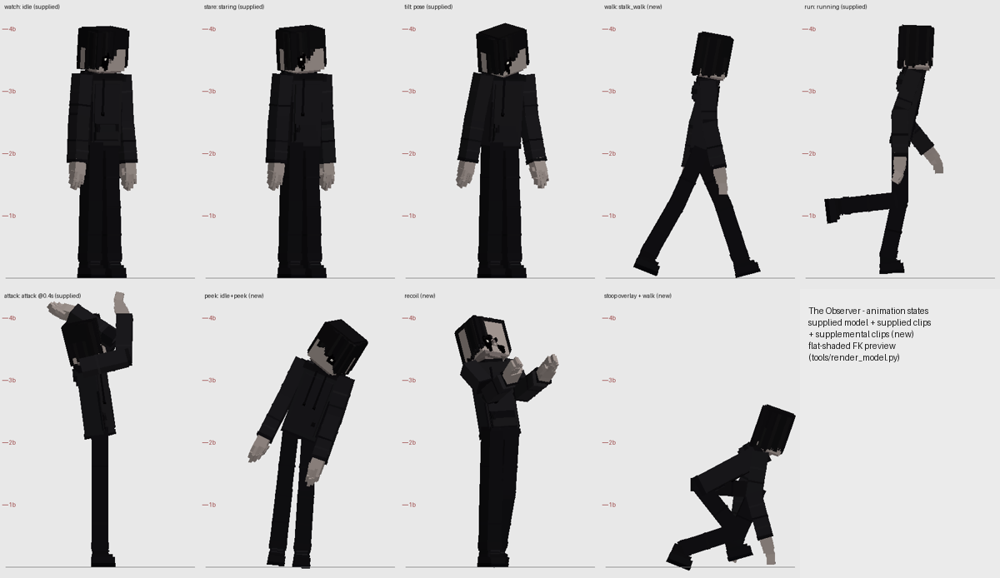

# The Observer — a Minecraft Bedrock horror add-on

> It follows you wherever you go. You rarely notice it directly. You notice that something around you is wrong.
> Over time, you realize it can manipulate your surroundings — and that the changes have a purpose.

The Observer is a tall, mouthless figure (the supplied *Hollow Dweller* model and animations) that studies one player
at a time. It follows you across the overworld, caves, water, sky bases, the Nether and the End; it imitates your
footsteps and your habits; it rearranges your home, seals the tunnel behind you, changes your familiar routes and takes
your light — always deliberately, always reversibly — and watches what you do about it. It has a home: the
**Weeping Mire**, a swamp of weeping trees and bone roots where it watches from between the trunks. Since 1.6.0 three
creatures of yours answer to it — the Goatwalker, the Shaftbreaker and the Brinesleeper — and now and then a rift tears
open into **the Rift**, a world of its own where it hunts whoever comes for its loot.



## Install
1. Open **`dist/TheObserver.mcaddon`** with Minecraft Bedrock 1.26.50+ (or import the two `.mcpack` files).
2. Activate **The Observer (Behaviour)** on a world (the resource pack follows as a dependency). No experiments needed.
3. Join: a chat message confirms it is running and you receive the **Observer Config Wheel** (operators / the only
   player). Use it to **See it now**, start it early, switch encounters on or off, or change any setting.
4. Play. Nothing happens for the first 12 minutes on the Standard preset. Details: [docs/PLAYER_GUIDE.md](docs/PLAYER_GUIDE.md).

## Status
Server-side behaviour is verified on Bedrock Dedicated Server 1.26.52.3: the final 1.5.1 integration run passed 617 of
619 checks (122 test groups; the two, the tests' own measurements, were corrected and then passed) with no content-log
or script errors, restart recovery passed, and the server held 20 TPS
with and without the add-on. A separate run on a fresh world with every experiment switched off (and no test kit)
loaded everything with zero errors — no experiments are needed; the same holds for the merged Weeping Mire, which
generates on a fresh world with every experiment off. The first load in a game client reported three resource-pack errors, which are fixed in this build and now
caught by a comparison with Mojang's vanilla files. How it looks and sounds in a client still has to be confirmed: see
[docs/TEST_REPORT.md](docs/TEST_REPORT.md) §6 and [docs/RELEASE_READINESS.md](docs/RELEASE_READINESS.md).

## What's inside
* **One physical Observer** built on the supplied model: 5 supplied clips + 11 supplemental clips (stalking walk, peek,
  recoil, stoop crouch for low ceilings, head tracking, and in 1.0.6 two floating clips — the drift twitching and
  cracking in jerks — and a climb; in 1.0.8 a hanging overlay so it strikes and recoils in mid-air; in 1.0.9
  hanging from a ceiling and crawling), state-driven
  animation controllers, eyes that glow in the
  dark, a glowing wisp aura, a crimson vanish burst, and its own sounds — since 1.1.2 your recordings for its arrival, scream, the sting
  when you spot it, its whisper and its vanish, and two themes of its own.
* **A horror director**: grace period, five escalating stages, per-player and global cooldowns, quiet periods,
  recovery after deaths, anti-repetition, context-weighted selection, fair multiplayer targeting.
* **Its home, the Weeping Mire** (1.0.7; in 1.1.0 its wood burns as fuel and smelts into charcoal like any log,
  and Bone Root crafts into bone meal): the Weeping Mire biome (your own add-on, merged in) generates near where
  you start — often right beside the world spawn (1.0.8) — but you never start inside it: a first spawn in the Mire
  is moved just outside it, facing it. Weeping trees and giant weeping trees, bone roots and bone grass, mire moss, silt ponds, abandoned
  cabins, black fog, wind gusts and falling leaves, and eight torn pages to find. The Mire's watcher is now the Observer
  itself: it stands among the trees 20–48 blocks off and is gone in black mist when you look at it or come within 9
  blocks; a torn page may bring it up behind you, and the last of the eight always does. In the Mire it comes sooner
  and more often: the grace period ends after 30 seconds there, the gaps between encounters are shorter, and it acts as
  if you were one stage further along.
* **32 encounter types**, including three signature encounters (*Out of Step*, *Someone Was Home*, *The Closed Path*)
  and *Closer Each Time* (it only moves while unwatched), *It's Inside* (the dark corner of your own room), *Signs*
  (by your bed or door), *Borrowed Eyes* (a creature that turns its head to follow you) and *In the Mire*; a lunge when it is spotted,
  a fast, relentless attack once it reaches you, a too-close reaction, and harmless shadows in taiga forests that
  vanish when looked at, plus 16 further designed concepts — see [docs/ENCOUNTERS.md](docs/ENCOUNTERS.md).
* **It knows you** (1.1.0): everything you do that it sees is remembered, and every repetition teaches it more —
  stare it down and it snaps sooner; look away and it closes in further each time; run at it and it stands its
  ground; shoot it and it keeps its distance behind cover; outrun it and the chase starts closer; never notice it and
  it comes closer and lets you hear it. It learns where you spend your time (caves, home, the road), when, how much
  light you put down, and which of its tricks get a reaction out of you — and chooses accordingly. Your Field Notes
  say what it knows. **Run at it** and it decides on the spot: attack, or be gone before you arrive and wait for a
  better moment — night, a cave, you hurt — and come back at once, and worse.
* **It rules them** (1.2.0): every hostile creature — Minecraft's own or any other add-on's — answers to it. When it
  comes they stop, the nearest first, turn to it and go still, back away (never toward you, and harmless while they
  do), and once nobody is looking they are gone. Kinds you mark as its rivals it tears apart; from the third stage, a
  creature that hurts you may find it standing behind it (*Not Yours*). It takes nothing from other add-ons — it acts
  on their creatures only through the world they share. Tamed, name-tagged, boss and 300+-health creatures, and kinds
  marked "leave it alone" (Config Wheel → Other creatures), are never touched; one setting switches it all off.
  **They are its** (1.2.1): from the third stage it keeps three of them (four at the fifth) — they go to stand
  around you, spread out, and stare at you with its eyes, quite still, and leave with it; from the fourth stage they
  come closer only while you are not looking at them (never nearer than four blocks, never able to hurt you). A
  creature may be *its eyes*: it stops and stares at you, and when you look back it comes apart and it is standing
  there. And when it snaps into its rage, the creatures it holds near you are let go and come for you with it.
* **Its puppets** (1.3.0): it takes creatures for its own — any creature, Minecraft's own or any other add-on's —
  and uses them, then gives them back as they were. Mark a kind "Its puppet" on the Config Wheel (another add-on's
  cave creature, say) and it takes one in its cave, brings it up after you to the surface, sets it lurking at the
  edge of your sight (moving only while you are not looking), turns it loose on you — stronger, faster, unable to
  turn back — and puts it back where it was. You can tell: its eyes in them, its wisps off them, crimson shreds as they
  move, its twitches, its voice out of them, your heart and its music near them, the animals and the other creatures
  keeping away — and the Witness Lens, through which one flares (Field Notes keeps count, in its hand). With them it
  knocks at your door at night, makes a villager cry out from the dark to lure you, hides as one of a group, hunts its
  rivals out of sight (you find what was left), sends a herald ahead of its heavier encounters, posts guards in the
  Mire, makes one of your farm animals its own (hit it to tear it out), learns where you are from anything of its that
  sees you, leaves behind things you threw away — and once, at the very end, makes every creature around your home turn
  to face it all night. Nothing of any other add-on is read, copied or changed: it acts on their creatures only in the
  world they share, and a creature still held when the game stops is given back when it loads.
* **Its hold** (1.4.0): nothing takes one of its puppets from it. While it has a creature, the creature's own legs
  do nothing — it moves it itself — so the creature's own mind cannot walk it off or turn it away. Teleported away by
  anything else (to you, far off, into another dimension) it is pulled straight back, with a neck-crack and its shreds
  where it went. Held means harmless: any harm to you from a creature it holds is undone before it lands — its blows,
  its arrows, harm another add-on's scripts deal in its name, and harm from nowhere right beside it; only a puppet it has
  turned loose can hurt you. Nothing but you can harm one of its own; nothing can make one invisible; and one deleted or
  killed by whatever made it is brought back — the same kind, where it was, its eyes already in it. Killed by you, it
  stays dead and leaves a **cold eye**; four on a string make a **Charm of Cold Eyes**, which hums when one of its
  puppets is near (louder the nearer, and when you face it — even one hiding among its kind). It learns each kind: those
  that fight its hold are held tighter from the first moment, a kind taken back from it on the surface is kept below,
  and your Field Notes say so in its hand. **The chase**: a hunting puppet comes about as fast as you can sprint
  (faster on High), quicker as it goes — straight at you when the way is open, otherwise along a route it finds round
  walls, up steps and down drops, through doors it opens and up walls it climbs, twitching forward when stuck, and
  lunging the last few blocks. **Its pack**: in its rage, the creatures it holds near you hunt you as one — the nearest
  straight at you, the next cutting you off where you run, the rest waiting in the doorways ahead. **The Mirror**: a
  creature ahead of you moves like your reflection until you walk up to it. **The Guide**: a creature looks at you, walks
  off, and waits for you whenever you fall behind — leading you to something of yours, one of its pages, or it.
  **The Procession** (stage 4+): one night a village's villagers walk out and stand in a line at its edge, facing the
  Mire, until dawn. **Mine first**: when another creature is about to reach you, it stops it dead, turns it to look at
  you, and walks it off into the dark — it does not share you.
* **It is overwhelming now** (1.5.0): it starts within minutes (a four-minute grace on Standard), moves through its
  stages far faster, and comes back sooner and more often, with shorter quiet spells; **Nightmare** sits above
  Relentless. **It talks to you**: in your chat, in whispers across the bottom of your screen, and in great broken
  letters across your view — about *you*: your name, where your home is, how many times you have died, how long since
  you slept, what you are holding, where you are standing. Its words break up as it speaks (scrambled letters, stutters),
  more the further it has come. It answers what you do (you escape it, look at it through the lens, kill one of its own,
  die, lie down to sleep, walk into its home, reach a new stage), and now and then, somewhere quiet, it **asks you
  something** and waits — and what you choose (or not answering at all) changes what it does next. Optional
  **fourth-wall scares**: "The Observer joined the game", a chat line in your own name you never typed, the screen
  cutting to static and an error. **It is never whole**: torn, flickering fragments hang about it; everything it holds
  glitches — jolts sideways, freezes mid-step, snaps its head round, its name turns to scrambled letters, bursts of
  static. **The takeover**: every creature around you at once is its — they stop, flicker, turn to look at you; one
  comes to stand beside you with *your name* over its head; from the fourth stage the hostile ones then hunt you as its
  pack. **The corruption**: the ground around you breaks up into black and blood-red for a few seconds, then is exactly
  as it was. **It is ahead of you**: run from it and get away, and it is suddenly in front of you — or waiting where you
  hid last time; stuck a long way round, it glitches along its own route to you. It takes marked creatures from further
  off and far more often. **Its broken music** (original, made for it): from the fourth stage a slowed, detuned,
  bit-crushed tune with a music box and a drone; a driving chase theme whenever it or its pack comes for you; its own in
  the Mire; and at the fifth stage a cheerful little tune that falls apart a little more each time round. **The Mire's
  ruins**: a drowned chapel, a watcher's spire, a bone altar, a sunken archive and the surveyors' last camp, with chests
  of decent loot (diamonds, enchanted books and gear, golden apples, its own items) and journals.
* **1.5.1**: it only ever **peeks from behind real cover** — a trunk, a house wall or corner, a pillar, all of it hidden
  and only its head round the edge (never from beside a bush, never from nothing); floating at you, **its speed follows
  yours** (you stand, it creeps; you sprint, it comes fast); the **Weeping Mire is far bigger** and unbroken; the
  **Mire Eyebloom**, three blocks tall with an eye for a flower that looks about, blinks, weeps red, and turns to face
  you whenever you are not looking; and a **Sound Test** in the Config Wheel to hear all of its music and sounds.
* **1.6.0 — its dwellers**: three creatures of your own are merged into this one pack, each still itself — the
  **Goatwalker** (its servant of the woods, with the Stellar Taiga, and its fourth-wall scares), the **Shaftbreaker**
  (of the caves, with the Hollows) and the **Brinesleeper** (of the water, with the Stillwater Caves). On the Config
  Wheel (*Its dwellers*) each can be switched on or off on its own, with "how often" and "how dangerous" chosen from
  its own fixed steps (nothing can be set out of range) and its own full settings one tap away; their music shares
  one channel, so none cuts another off. **Whenever the Observer is near one, it answers to it**: stronger, faster,
  harder to hurt, glitching with its glow, and sent after the one it has come for. The Stellar Taiga, the Hollows and
  the Weeping Mire never overlap any more (each takes different vanilla biomes); every biome still generates.
* **1.6.0 — the Rift**: now and then a tear opens in the world near someone — a tall oval of violet void full of
  stars, glowing and sparking, a crimson eye opening in it. Walk in and you are in **the Rift**, a dimension of its own
  (no experiments): the Stellar Taiga and the Mire torn into one — dead pines in mist and endless rain, lightning,
  puddles and boulders, void trees and weeping trees among them, bodies, blood, skeletons and the hanged; a **ruined
  church** (crypt, bell tower, graveyard, mausoleum) and a **castle** (gatehouse, gallows, a keep with a throne room,
  treasury, armoury and library, and a dungeon), with chests of **the best loot in the game** (maxed netherite gear,
  elytra, maces, tridents, totems, enchanted golden apples, nether stars, beacons, Mending books). Nothing lives there
  but it, and in there it never stops: glimpsed in the trees, laughing in the rain, right behind you when the
  lightning flashes, the trees bleeding round you, then coming through the air and striking. The Config Wheel's
  *The Rift* page sets how often rifts open — never, rarely, sometimes, often, very often, constantly — and **the more
  often they open, the harder, faster, stronger and cleverer it is in there** (from 4.6 blocks a second and 2 hearts a
  blow on *rarely* to 8+ blocks a second and 6½ hearts on *constantly*, cutting you off, guarding the way out, waiting
  at the chests). The stones where you land are the way back. The realm is laid out afresh, shuffled and restocked,
  each time a rift opens.
* **Its voice and its music** (1.1.2, your recordings): while it is around, its own theme replaces the game's music
  — *lurking* in the Weeping Mire, its home — and the game's music fades back once it has gone. A sting when you spot
  it, a scream when it snaps or comes for you (and over the blow that kills), a grunt as it arrives out of nowhere, its
  own sound as it vanishes, and, now and then when it is close and you have not seen it, a whisper. The rest of the
  sounds were rebalanced around them.
* **Its presence, felt** (1.1.0): while it is around, your music stops completely, and fades back in once it is gone.
  When it is near — seen or not — you hear your own heartbeat, faster the closer and angrier it is, and when it is
  close and meaning harm the view trembles on the beat (lightly; it follows the camera-effects setting).
* **At the foot of the bed** (1.1.1): now and then you lie down and do not sleep through. You wake in the night
  unable to move — the view from your pillow, your heart loud — and it is standing at the foot of the bed, bent
  under the ceiling, looking at you. You try to turn your head and cannot; it tilts its head and leans a little
  closer; you blink and it is gone, and you are standing beside the bed looking at where it stood. No damage, and the
  night is not skipped. Stage 3+, about one sleep in three when it is free to come, never twice within 90 minutes of
  play; needs camera effects on.
* **The animals know** (1.1.1): when it comes, seen or not, the animals near it turn to face it and go still — the
  nearest first, so it ripples through a herd. Grazing animals then edge a few blocks away and look back; dogs growl
  at it, cats hiss, one of a herd may call out; a tamed dog whines once it has gone. Watch the animals and they show
  you where it is hiding. At most eight at a time and twelve per appearance; never off a ledge or into water.
* **It hides behind trees** (1.1.0): it finds real trunks and stands behind them, its body hidden, looking round the
  edge at you with a hand on the bark and its head following you. Look straight at it and it ducks back; look away
  and it looks round again — from the other side, once it learns where you look.
* **Stalking, the standoff, and the attack** (1.0.9): it arrives silently and stays perfectly still — on the
  ground, on a high ledge above you, or hanging upside down from a cave ceiling. Spot it, or walk toward it, and the
  standoff begins: it watches, tests you (a crack of the neck, a tilt of the head, one slow step while you look),
  and every time you look away it is a little closer. Look at it, but do not stare: the longer and closer you hold
  its gaze, the angrier it gets, and shooting it or hitting it is worse. In the end it is simply gone — or it snaps,
  and comes for you faster than a sprint, screeching. Nothing stops it getting to you: it opens doors, breaks glass
  and leaves out of its way (put back afterwards), and crawls flat through gaps a single block high. When it is done
  it does not walk off: it is just gone. Previews: [docs/media/1.0.9/](docs/media/1.0.9/).
* **It never runs** (1.0.6–1.0.8): the chase, the lunge, the attack once it reaches you and the strike when you walk
  up to it all float — a block off the ground, no footsteps, only a rush of air — and it strikes from the air with its
  legs hanging. In *Breathing Room* it surges at you when you look away, drifts while you watch, and stops at the
  water's edge to hover there. **It climbs**: get up on a pillar, a ledge, a roof or a ladder and it climbs the wall
  after you and strikes from it. Previews: [docs/media/1.0.6/](docs/media/1.0.6/), [docs/media/1.0.8/](docs/media/1.0.8/).
* **It learns how you escape**: light, water, a stare, the lens, a blow, running, breaking through, a flare — use one
  three times and it adapts to that one (one at a time, and it wears off). From stage 4 **the world goes quiet** before
  it attacks: your music stops and a faint ringing rises (sometimes nothing follows). It writes **pages you didn't
  write** into your Field Notes from what you actually did, and **returns what you threw away** to your doorstep.
* **8 environmental manipulation mechanics** (doors, lights, turned objects, Veil obstructions, mimic route changes,
  effigies, temporary openings, animals turning) through a **restoration ledger**: recorded, locked, reload-safe,
  dupe-proof, and the player's own changes always win.
* **Bounded memory** of each player: breadcrumbs, home, familiar routes, habits, a favoured bearing.
* **Progression**: 44 discoveries written in the Field Notes; Tally Chalk, Witness Lens, Ward Lantern, Vestiges, and
  the **Flare** (thrown; its glare drives it off within 16 blocks, even mid-attack); the Vigil as the long-term goal;
  three post-ending modes.
* **Config Wheel**: one item for status, a harmless *See it now* preview of the creature and all its animations,
  start-now, presets (Atmosphere / Standard / Relentless), every individual setting (frequency, aggression,
  manipulation, sudden scares, camera effects, captions, grace period, and on/off switches for each 1.0.5 feature), a
  toggle per encounter type, *Test an encounter*, and *Undo its changes*.
* **47 original synthesized sounds**, 10 particles of its own (two from user-supplied sprite sheets), 3 fogs, original
  item and block art; plus the Weeping Mire's 12 blocks, 5 particles, fog, lighting, colour grading and water.
* **No experiments**: stable script APIs only (the Rift too); verified on a fresh world with every experiment toggle off.

## Documentation
| Document | Contents |
|---|---|
| [docs/PLAYER_GUIDE.md](docs/PLAYER_GUIDE.md) | installing, tools, settings, accessibility, multiplayer, removal |
| [docs/DESIGN.md](docs/DESIGN.md) | identity, rules, systems, manipulation specs, director, signature encounters |
| [docs/ENCOUNTERS.md](docs/ENCOUNTERS.md) | the encounter library (23 implemented, 17 planned) |
| [docs/DEVELOPER_GUIDE.md](docs/DEVELOPER_GUIDE.md) | architecture, adding encounters, testing, tuning |
| [docs/FEATURE_MATRIX.md](docs/FEATURE_MATRIX.md) | feature → files → trigger → expected → test → status |
| [docs/TEST_REPORT.md](docs/TEST_REPORT.md) | what was tested, how, and the results; manual in-game procedure |
| [docs/RELEASE_READINESS.md](docs/RELEASE_READINESS.md) | known limitations and an honest release assessment |
| [docs/ASSET_RECORDS.md](docs/ASSET_RECORDS.md) | provenance of every shipped asset (the dwellers' archives and hashes; the Rift's files) |

## Build and verify
```bash
npm install
npm run typecheck && npm run validate     # official typings + official JSON schemas + cross-references
python3 tools/build.py                    # -> dist/TheObserver.mcaddon, .mcpack files, SHA256SUMS.txt
python3 tests/bds/run_bds.py --bds <bedrock-server dir> --testkit --fresh --world suite \
        --scenario tests/bds/scenarios/suite_full.txt     # runtime tests on a dedicated server
```
